# OmniKubernetes Engineering Roadmap: Platform Foundation & Shared Libraries Implementation

- **Document Version:** `2.0.0` - HOÀN THÀNH 100%
- **Status:** **COMPLETED** (Platform Foundation Phase) → Ready for Domain Services Implementation
- **Completion Date:** 2026-11-03
- **Author:** System Architecture Team
- **Target Platform:** Rust (2024 Edition, Rust 1.85+), Tokio Runtime (1.43+), Axum Framework (0.8+), Kubernetes & CNCF Ecosystem
- **Scope Achieved:** Toàn bộ tầng hạ tầng dùng chung (`libs/*`, toolchain, middleware, testing harness) đã được bàn giao và sẵn sàng cho triển khai các Domain Microservices (`services/*`)

---

## Executive Summary: Mission Accomplished

**OmniKubernetes Platform Foundation đã HOÀN THÀNH 100%** theo triết lý **"Foundation-First Architecture"**.

Tất cả **11 mốc nền tảng** (`omni-common`, `omni-errors`, `omni-logging`, `omni-metrics`, `omni-database`, `omni-cache`, `omni-auth`, `omni-messaging`, resilience components, OpenAPI tooling, và service scaffold) đã được nghiệm thu đầy đủ với:

- [HOÀN THÀNH] **8 Shared Libraries** production-ready với 126+ test cases
- [HOÀN THÀNH] **10 Architecture Specification Documents** chi tiết
- [HOÀN THÀNH] **Service Bootstrap Framework** (`AppBuilder`) plug-and-play
- [HOÀN THÀNH] **Local Development Environment** (process-compose, Docker)
- [HOÀN THÀNH] **Integration Testing Harness** (Testcontainers)
- [HOÀN THÀNH] **Quality Gates** (fmt, clippy -D warnings, test suite)

### Thành tựu chính (Key Achievements)

| Capability                       | Implementation Status | Key Features                                                     |
| :------------------------------- | :-------------------: | :--------------------------------------------------------------- |
| **Base Response & i18n**         |   [HOÀN THÀNH] 100%   | RFC 9457, Mozilla Fluent, 3 languages (vi/en/ja)                 |
| **Distributed Tracing**          |   [HOÀN THÀNH] 100%   | W3C traceparent, OTel, PII sanitizer, non-blocking               |
| **Type-Safe Config**             |   [HOÀN THÀNH] 100%   | 5-layer hierarchy, fail-fast, zero-leak secrets                  |
| **Metrics & Probes**             |   [HOÀN THÀNH] 100%   | RED middleware, K8s tri-probe, Tokio runtime metrics             |
| **Relational DB**                |   [HOÀN THÀNH] 100%   | PgPool, UoW, auditing, optimistic locking, migrations            |
| **Distributed Cache**            |   [HOÀN THÀNH] 100%   | 6-layer stampede protection, redlock, PII masking                |
| **Auth & Security**              |   [HOÀN THÀNH] 100%   | JWT multi-algo, Argon2id, RBAC, token revocation, RTR            |
| **Event-Driven Messaging**       |   [HOÀN THÀNH] 100%   | CloudEvents, outbox/inbox, DLQ, multi-broker support             |
| **Resilience & Traffic Control** |   [HOÀN THÀNH] 100%   | Rate limiting, circuit breaker, load shedding, graceful shutdown |
| **API Documentation**            |   [HOÀN THÀNH] 100%   | OpenAPI aggregation, Swagger UI, K8s ingress manifests           |
| **Service Scaffold**             |   [HOÀN THÀNH] 100%   | AppBuilder, dev environment, integration test harness            |

### Golden Path Example (Mẫu khởi tạo Service < 30 phút)

```rust
// services/{domain}/src/main.rs
use omni_common::bootstrap::AppBuilder;

#[tokio::main]
async fn main() -> Result<(), Box<dyn std::error::Error>> {
    let config = AppConfig::load("service-name")?;
    let _log_guard = omni_logging::init(&config.logging)?;

    let db_pool = omni_database::create_pool(&config.database).await?;
    let cache_manager = omni_cache::create_manager(&config.redis).await?;
    let metrics_handle = omni_metrics::init_prometheus_exporter()?;

    omni_database::run_migrations(&db_pool).await?;

    let app = AppBuilder::new("service-name")
        .with_state(AppState { db_pool, cache_manager })
        .with_observability_middleware()
        .with_metrics_middleware()
        .with_resilience_middleware()
        .with_security_headers()
        .with_k8s_probes()
        .with_metrics_endpoint(metrics_handle)
        .with_openapi_docs(ApiDoc::openapi())
        .mount_api_routes(routes::router())
        .build();

    omni_common::server::serve_with_graceful_shutdown(app, config.server.port).await?;
    Ok(())
}
```

---

## Roadmap Status: All Milestones Completed

```mermaid
flowchart TD
    subgraph Foundation["[HOÀN THÀNH] PLATFORM FOUNDATION - 100%"]
        M01["[HOÀN THÀNH] 1. Base Response & i18n Protocol<br/>(omni-common, omni-errors)"]
        M02["[HOÀN THÀNH] 2. Distributed Tracing & Structured Logging<br/>(omni-logging, W3C Context, PII Sanitizer)"]
        M03["[HOÀN THÀNH] 3. Type-Safe Configuration & Env Binding<br/>(omni-common, Fail-Fast, Zero-Leak Secrets)"]
        M04["[HOÀN THÀNH] 4. Metrics Telemetry & Kubernetes Probes<br/>(omni-metrics, Prometheus RED, Healthz/Readyz)"]
        M05["[HOÀN THÀNH] 5. Relational Persistence Foundation<br/>(omni-database, SQLx PgPool, Migrations, Auditing)"]
        M06["[HOÀN THÀNH] 6. Distributed Caching & Concurrency Control<br/>(omni-cache, 6-Layer Stampede, Redlock, PII Masking)"]
        M07["[HOÀN THÀNH] 7. Identity & Security Context<br/>(omni-auth, JWT Claims, Argon2, RBAC Extractors, Revocation)"]
        M08["[HOÀN THÀNH] 8. Event-Driven Messaging & Outbox Pattern<br/>(omni-messaging, CloudEvents, Outbox Relay, DLQ)"]
        M09["[HOÀN THÀNH] 9. Resilience & Traffic Control Standard<br/>(omni-common, GCRA, Circuit Breaker, LoadShed, K8s Shutdown)"]
        M10["[HOÀN THÀNH] 10. API Documentation Aggregation<br/>(omni-common, utoipa, Gateway Swagger UI Aggregator, Ingress)"]
        M11["[HOÀN THÀNH] 11. Service Scaffold & Dev Harness<br/>(AppBuilder, Testcontainers, Local Compose Stack)"]
    end

    Foundation ==> Ready["[SẴN SÀNG] TRIỂN KHAI DOMAIN SERVICES<br/>(gateway, auth, user, product, order, payment, notification)"]

    style Foundation fill:#2ecc71,stroke:#27ae60,stroke-width:3px,color:#000
    style Ready fill:#3498db,stroke:#2980b9,stroke-width:3px,color:#fff
```



---

## Completed Milestones: Technical Deep Dive

### [HOÀN THÀNH] Milestone 1: Base Response & i18n Protocol

**Crate:** `omni-common`, `omni-errors`  
**Status:** [HOÀN THÀNH]  
**Documentation:** [`docs/architecture/base-response-architecture.md`](./docs/architecture/base-response-architecture.md)

**Deliverables:**

- [HOÀN THÀNH] Data contract `ApiResponse<T>`, `ResponseMeta` zero-allocation
- [HOÀN THÀNH] Dual pagination: `OffsetPaginationMeta` & `CursorPaginationMeta`
- [HOÀN THÀNH] Mozilla Fluent RCU lock-free (vi-VN, en-US, ja-JP)
- [HOÀN THÀNH] RFC 9457 Problem Details (`application/problem+json`)
- [HOÀN THÀNH] Server-side translation + Client-side localized parameters
- [HOÀN THÀNH] JSON Pointer (RFC 6901) bidirectional mapping

---

### [HOÀN THÀNH] Milestone 2: Distributed Context & Structured Logging

**Crate:** `omni-logging`, `omni-common`  
**Status:** [HOÀN THÀNH]  
**Documentation:** `docs/architecture/` (integrated with metrics docs)

**Deliverables:**

- [HOÀN THÀNH] Dual identifiers: `request_id` (UUIDv7) + W3C `traceparent` (32-hex `trace_id`)
- [HOÀN THÀNH] Structured JSON logging (ECS/OTel standard)
- [HOÀN THÀNH] Non-blocking log via `tracing-appender` separated from worker threads
- [HOÀN THÀNH] PII Sanitizer (Nghị định 13/2023/NĐ-CP & GDPR compliant)
- [HOÀN THÀNH] Automatic `Server-Timing` & `X-Response-Time` measurement
- [HOÀN THÀNH] OpenTelemetry gRPC/OTLP bridge to Grafana Tempo

---

### [HOÀN THÀNH] Milestone 3: Type-Safe Configuration & Environment Binding

**Crate:** `omni-common`  
**Status:** [HOÀN THÀNH]  
**Documentation:** [`docs/architecture/configuration-management-architecture.md`](./docs/architecture/configuration-management-architecture.md)

**Deliverables:**

- [HOÀN THÀNH] 5-layer config hierarchy: Safe Defaults → `config/base.yaml` → `config/{env}/default.yaml` → System Environment `OMNI__*` / K8s Downward API → Programmatic Overrides
- [HOÀN THÀNH] 2-phase fail-fast validation (field-level via `validator` + cross-field invariants & Production guardrails `CFG_*`)
- [HOÀN THÀNH] Zero-leak `SecretString` (redacted `[REDACTED]`, auto-zeroize heap memory, safe connection URLs)
- [HOÀN THÀNH] Type-safe extensible config `AppConfig<C>` and direct bridge to `omni_logging::LoggingConfig`

---

### [HOÀN THÀNH] Milestone 4: Metrics Telemetry & Kubernetes Probes

**Crate:** `omni-metrics`, `omni-errors`, `omni-common`  
**Status:** [HOÀN THÀNH]  
**Documentation:** [`docs/architecture/metrics-probes-telemetry-architecture.md`](./docs/architecture/metrics-probes-telemetry-architecture.md)

**Deliverables:**

- [HOÀN THÀNH] RED Middleware (Rate, Errors, Duration) & In-Flight requests for Axum
- [HOÀN THÀNH] Cardinality Explosion protection via Zero-Regex Byte Scanner `sanitize_uri_path` & `normalize_matched_path`
- [HOÀN THÀNH] Zero-Copy error classification without re-reading body via `ErrorCodeExtension` integrated with `omni-errors`
- [HOÀN THÀNH] Kubernetes Tri-Probe (`/livez`, `/readyz`, `/startupz`, `/healthz`) + Graceful Shutdown Drain Gate
- [HOÀN THÀNH] Tokio Runtime Saturation metrics, Watchdog Heartbeat, Linux `/proc/self` telemetry (no `unsafe` code)

---

### [HOÀN THÀNH] Milestone 5: Relational Persistence Foundation

**Crate:** `omni-database`, `omni-metrics`, `omni-errors`, `omni-common`  
**Status:** [HOÀN THÀNH]  
**Documentation:** [`docs/architecture/relational-persistence-architecture.md`](./docs/architecture/relational-persistence-architecture.md)

**Deliverables:**

- [HOÀN THÀNH] Enterprise PgPool Factory with bounded backoff retry, 3-tier keepalive ping, graceful shutdown
- [HOÀN THÀNH] Pool Sentinel background thread for Prometheus metrics and `/readyz` state without thundering herd
- [HOÀN THÀNH] Zero-Round-Trip Unit of Work with `build_begin_statement` merging `trace_id`, `actor_id`, `tenant_id`, `statement_timeout` into `BEGIN`
- [HOÀN THÀNH] SQLSTATE error classification to `DbError` and RFC 9457 `AppError` without leaking internal DB structure
- [HOÀN THÀNH] OTel Semantic Conventions `db.system.name = "postgresql"` measurement + `db_client_*` metrics + slow query logging
- [HOÀN THÀNH] Entity Auditing Model (`AuditColumns`, trigger `omni_set_audit_timestamps`), `Id<T>` UUIDv7 type-safe, Optimistic Locking
- [HOÀN THÀNH] Keyset pagination bridge (`KeysetCursor`, `paginate_keyset`) to `CursorPaginationMeta`
- [HOÀN THÀNH] Migration Runner support 3 modes `Disabled`, `Apply`, `Verify` (schema check before serving)

---

### [HOÀN THÀNH] Milestone 6: Distributed Caching & Concurrency Control

**Crate:** `omni-cache`, `omni-metrics`, `omni-errors`, `omni-common`  
**Status:** [HOÀN THÀNH]  
**Documentation:** [`docs/architecture/distributed-caching-concurrency-architecture.md`](./docs/architecture/distributed-caching-concurrency-architecture.md)

**Deliverables:**

- [HOÀN THÀNH] Redis/Valkey async multiplexed backend with auto-reconnect
- [HOÀN THÀNH] 6-layer stampede protection (Single-Flight, TTL Jitter, XFetch, SWR/SIE, Distributed Lease, Negative Caching)
- [HOÀN THÀNH] Fail-closed distributed locking with fencing tokens & watchdog
- [HOÀN THÀNH] HMAC-SHA256 PII masking, cluster-ready keyspace with hash tags
- [HOÀN THÀNH] Binary protocol with zstd compression & decompression bomb protection
- [HOÀN THÀNH] TypedCache abstraction, fail-open reads with loader fallback
- [HOÀN THÀNH] Health indicator, metrics recorder, slow command logging

---

### [HOÀN THÀNH] Milestone 7: Identity & Security Context

**Crate:** `omni-auth`, `omni-common`, `omni-errors`, `omni-logging`, `omni-metrics`, `omni-cache`  
**Status:** [HOÀN THÀNH]  
**Documentation:** [`docs/architecture/identity-security-context-architecture.md`](./docs/architecture/identity-security-context-architecture.md)

**Deliverables:**

- [HOÀN THÀNH] JWT Engine `jsonwebtoken` multi-algorithm (HS256/384/512, RS256, EdDSA, ES256/384/512)
- [HOÀN THÀNH] `AuthUserClaims` type-safe (sub/session/tenant UUIDv7, roles, permissions)
- [HOÀN THÀNH] Argon2id password hashing OWASP (constant-time verify, `spawn_blocking`)
- [HOÀN THÀNH] Real-time JTI Blacklist revocation on Redis & Refresh Token Rotation (RTR) with Token Family theft detection
- [HOÀN THÀNH] Axum 0.8 Extractors (`AuthenticatedUser`, `OptionalUser`, `CurrentTenant`, `BearerToken`) & Guards (`RequireRole`, `RequirePermission`)
- [HOÀN THÀNH] Gateway Signed Context Protocol against header spoofing in K8s
- [HOÀN THÀNH] Context Bridging into `RequestContext`, `tracing::Span`, PostgreSQL `SessionContext`
- [HOÀN THÀNH] `AuthError` → RFC 9457 `AppError` (401/403) + Prometheus security metrics

---

### [HOÀN THÀNH] Milestone 8: Event-Driven Messaging & Outbox

**Crate:** `omni-messaging`, `omni-database`, `omni-cache`, `omni-logging`, `omni-metrics`, `omni-common`  
**Status:** [HOÀN THÀNH]  
**Documentation:** [`docs/architecture/event-driven-messaging-outbox-architecture.md`](./docs/architecture/event-driven-messaging-outbox-architecture.md)

**Deliverables:**

- [HOÀN THÀNH] CNCF CloudEvents v1.0.2 Envelope (`CloudEvent<T>`, `CloudEventBuilder`, UUIDv7, Structured & Binary Content Modes)
- [HOÀN THÀNH] Transactional Outbox Pattern (`OutboxRepository` linked directly with `UnitOfWork` ACID Local Tx)
- [HOÀN THÀNH] Hybrid Outbox Relay Worker combining PostgreSQL `LISTEN/NOTIFY` and `SELECT ... FOR UPDATE SKIP LOCKED` micro-batching
- [HOÀN THÀNH] Dual-Layer Idempotent Inbox Engine (Redis fast-path `SET NX EX` + PostgreSQL `inbox_events`)
- [HOÀN THÀNH] Resilient Consumer Pipeline with Concurrency Controller, Exponential Backoff with Full Jitter, Poison Pill Isolation, Dead Letter Queue (DLQ)
- [HOÀN THÀNH] W3C Distributed Tracing carrier injection & extraction preserving APM trace across Message Broker
- [HOÀN THÀNH] Pluggable Broker Drivers: In-Memory (Test/CI), RabbitMQ AMQP 0-9-1 (`lapin`), Kafka and NATS JetStream adapters
- [HOÀN THÀNH] Retention housekeeping worker preventing table bloat on PostgreSQL

---

### [HOÀN THÀNH] Milestone 9: Resilience & Traffic Control

**Crate:** `omni-common`, `omni-cache`, `omni-metrics`  
**Status:** [HOÀN THÀNH]  
**Documentation:** [`docs/architecture/resilience-traffic-control-architecture.md`](./docs/architecture/resilience-traffic-control-architecture.md)

**Deliverables:**

- [HOÀN THÀNH] Dual-Layer Rate Limiting (Layer 1 GCRA In-Memory lock-free <50ns + Layer 2 Redis Cluster Sliding Window Lua script)
- [HOÀN THÀNH] Multi-dimensional Key Extraction (`usr:`, `tnt:`, `key:`, `ip:` with trusted proxy validation) & Route Tiering
- [HOÀN THÀNH] Adaptive Load Shedding by Little's Law, Semaphore ceiling limit, fast 503 in <10µs
- [HOÀN THÀNH] Multi-Tier Timeout, Future cancellation propagation via `CancellationToken` and header `Request-Timeout`
- [HOÀN THÀNH] Enterprise 3-State Circuit Breaker (`Closed` ↔ `Open` ↔ `HalfOpen`), error classification matrix infrastructure vs business
- [HOÀN THÀNH] AWS Full Jitter Exponential Backoff, Idempotency Gating (blocking retry POST/PATCH without `Idempotency-Key`), Token Bucket `RetryBudget` ≤20%
- [HOÀN THÀNH] 7-Stage Zero-Downtime K8s Graceful Shutdown Coordinator coordinating Readiness Drain Gate `/readyz`, quiescence sleep, worker teardown, infra drain
- [HOÀN THÀNH] RFC 9457 Problem Details (`429`, `503`, `504`) and Prometheus RED telemetry

---

### [HOÀN THÀNH] Milestone 10: API Documentation Aggregation

**Crate:** `omni-common`, `omni-errors`, `infra/kubernetes`  
**Status:** [HOÀN THÀNH]  
**Documentation:** [`docs/architecture/api-documentation-architecture.md`](./docs/architecture/api-documentation-architecture.md)

**Deliverables:**

- [HOÀN THÀNH] Canonical security scheme `BearerAuth` (HTTP Bearer JWT) maintaining token across microservices in Swagger UI (`persistAuthorization: true`)
- [HOÀN THÀNH] Auto-register common schemas (`ResponseMeta`, `OffsetPaginationMeta`, `CursorPaginationMeta`, `PaginationMeta`, `PaginatedResponseMeta`, `ReloadLocalesResult`) and RFC 9457 Problem Details schemas (`ApiErrorResponse`, `InvalidParamError`)
- [HOÀN THÀNH] Internal docs endpoint `/v3/api-docs` and `/v3/api-docs/openapi.json` following Zero-HTML backend policy saving RAM, with optional embedded Swagger UI for local debug
- [HOÀN THÀNH] Dynamic Forwarded-Prefix Awareness auto-updating Server Base URL from header `X-Forwarded-Prefix` (and `service_prefix`), eliminating 404 when Try It Out via Gateway
- [HOÀN THÀNH] Gateway Centralized Aggregator Catalog `SwaggerConfig` and router `/swagger-config.json`
- [HOÀN THÀNH] Complete Kubernetes Deployment & Ingress manifests (`swagger-ui.yaml`, decoupled ingress per service with `rewrite-target: /$2`, and single ingress preserve prefix)

---

### [HOÀN THÀNH] Milestone 11: Service Scaffold & Development Harness

**Crate:** `omni-common`, `infra/docker`, `tests/`  
**Status:** [HOÀN THÀNH]  
**Documentation:** [`docs/architecture/service-scaffold-dev-harness-architecture.md`](./docs/architecture/service-scaffold-dev-harness-architecture.md)

**Deliverables:**

- [HOÀN THÀNH] Standard `AppBuilder` Pattern for bootstrapping Axum apps with proper middleware ordering
- [HOÀN THÀNH] Local Multi-Service Compose Harness (`process-compose.yaml`, Docker Compose) with PostgreSQL, Redis, Grafana stack, RabbitMQ/Kafka
- [HOÀN THÀNH] Integration Test Suite with Testcontainers for isolated PostgreSQL/Redis per test
- [HOÀN THÀNH] Helper utilities for migrations, seed data, assertions, parallel test execution

---

## Next Phase: Domain Services Implementation

### Ready to Build (Sẵn sàng Triển khai)

Với nền tảng đã hoàn thiện, các Domain Services sau có thể được triển khai song song:

1. **API Gateway Service** (`services/gateway`)
   - Reverse proxy & routing
   - Request/response transformation
   - Centralized Swagger UI aggregation
   - Rate limiting enforcement

2. **Auth & IAM Service** (`services/auth`)
   - User registration & login
   - JWT token issuance & refresh
   - Password reset workflow
   - Session management

3. **User & Tenant Service** (`services/user`)
   - User profile CRUD
   - Multi-tenant isolation
   - Role & permission management
   - User preferences

4. **Product Catalog Service** (`services/product`)
   - Product CRUD operations
   - Category & tag management
   - Inventory tracking
   - Search & filtering

5. **Order Processing Service** (`services/order`)
   - Order creation & lifecycle
   - Cart management
   - Order status tracking
   - Integration with payment & inventory

6. **Payment & Ledger Service** (`services/payment`)
   - Payment processing
   - Transaction history
   - Refund handling
   - Payment gateway integration

7. **Notification Service** (`services/notification`)
   - Email notifications
   - SMS notifications
   - Push notifications
   - Event-driven message consumption

### Estimated Timeline per Service

Với nền tảng đã có, mỗi domain service chỉ cần:

- **Week 1:** Domain modeling, database schema, repository layer
- **Week 2:** Business logic, API endpoints, validation
- **Week 3:** Integration tests, E2E tests, documentation
- **Week 4:** Performance tuning, load testing, deployment

**Tổng thời gian ước tính:** 4-6 tuần cho 1 service, có thể song song hóa với 2-3 teams.

---

## Quality Assurance Summary

### Test Coverage

| Crate            | Unit Tests | Integration Tests |          Coverage          |
| :--------------- | :--------: | :---------------: | :------------------------: |
| `omni-common`    |     20     |         5         |     [HOÀN THÀNH] High      |
| `omni-errors`    |     8      |         0         |     [HOÀN THÀNH] High      |
| `omni-logging`   |     5      |         0         |    [HOÀN THÀNH] Medium     |
| `omni-metrics`   |     12     |         3         |     [HOÀN THÀNH] High      |
| `omni-database`  |     15     |         5         |     [HOÀN THÀNH] High      |
| `omni-cache`     |     14     |         4         |     [HOÀN THÀNH] High      |
| `omni-auth`      |     10     |         2         |     [HOÀN THÀNH] High      |
| `omni-messaging` |     20     |         3         |     [HOÀN THÀNH] High      |
| **TOTAL**        |  **104**   |      **22**       | **[HOÀN THÀNH] 126 tests** |

### Quality Gates (Enforced via `.githooks/pre-commit`)

```bash
# 1. Format code
cargo fmt --all

# 2. Sync dependencies
cargo hakari generate

# 3. Lint check (zero warnings allowed)
cargo clippy --all-targets --all-features -- -D warnings

# 4. Test suite
cargo test --all
```

### Documentation Completeness

- [HOÀN THÀNH] 10 Architecture Specification Documents
- [HOÀN THÀNH] README.md per crate with usage examples
- [HOÀN THÀNH] Inline rustdoc for all public APIs
- [HOÀN THÀNH] AGENTS.md for AI-assisted development workflow
- [HOÀN THÀNH] Quality gate rules in `.agents/rules/`

---

## Success Metrics Achieved

- [HOÀN THÀNH] **Zero-Downtime Deployments:** Graceful shutdown tested
- [HOÀN THÀNH] **Type Safety:** 100% type-safe configs and domain models
- [HOÀN THÀNH] **Security:** PII protection, secret management, SQL injection prevention
- [HOÀN THÀNH] **Performance:** Lock-free algorithms, connection pooling, zero-allocation paths
- [HOÀN THÀNH] **Observability:** Distributed tracing, structured logging, RED metrics
- [HOÀN THÀNH] **Resilience:** Circuit breakers, rate limiting, retry policies
- [HOÀN THÀNH] **Developer Experience:** AppBuilder scaffold, local dev env, comprehensive tests

---

## Contact & Support

- **Repository:** [Github NQHxDev](https://github.com/NQHxDev/OmniKubernetes)
- **Architecture Team:** System Architecture Team
- **Current Phase:** [HOÀN THÀNH] FOUNDATION COMPLETE → [SẴN SÀNG] READY FOR DOMAIN SERVICES

---

_Last Updated: 2026-11-03_  
_Status: PLATFORM FOUNDATION 100% COMPLETE_
