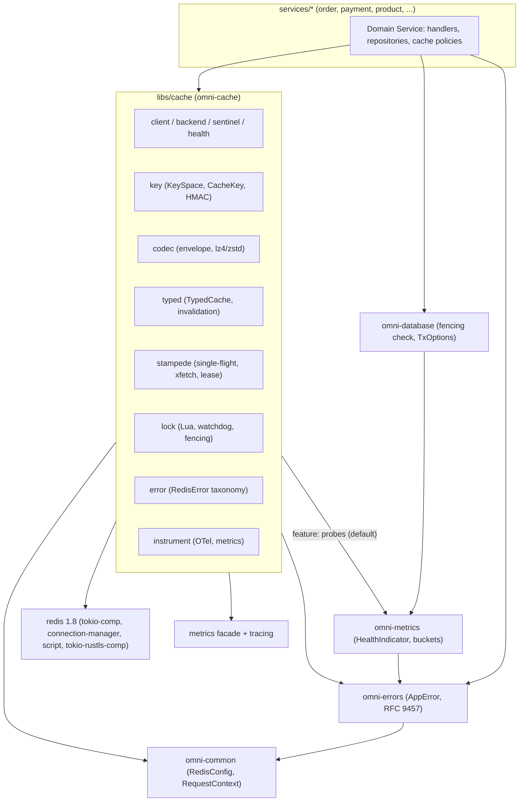
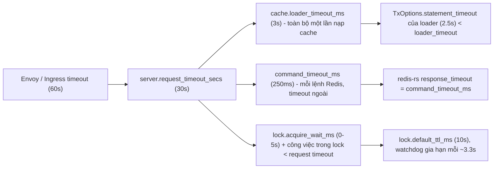
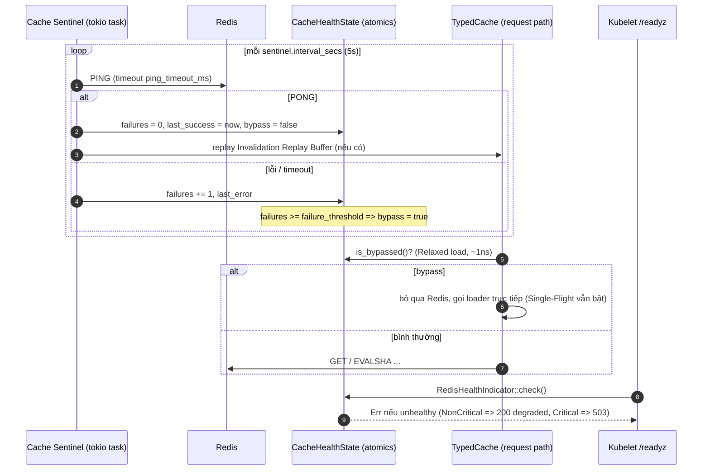
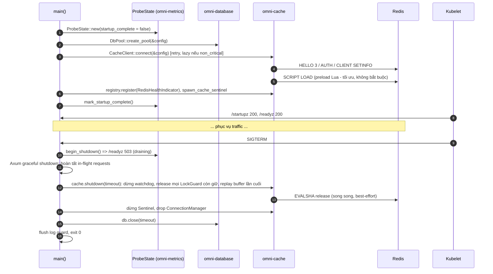
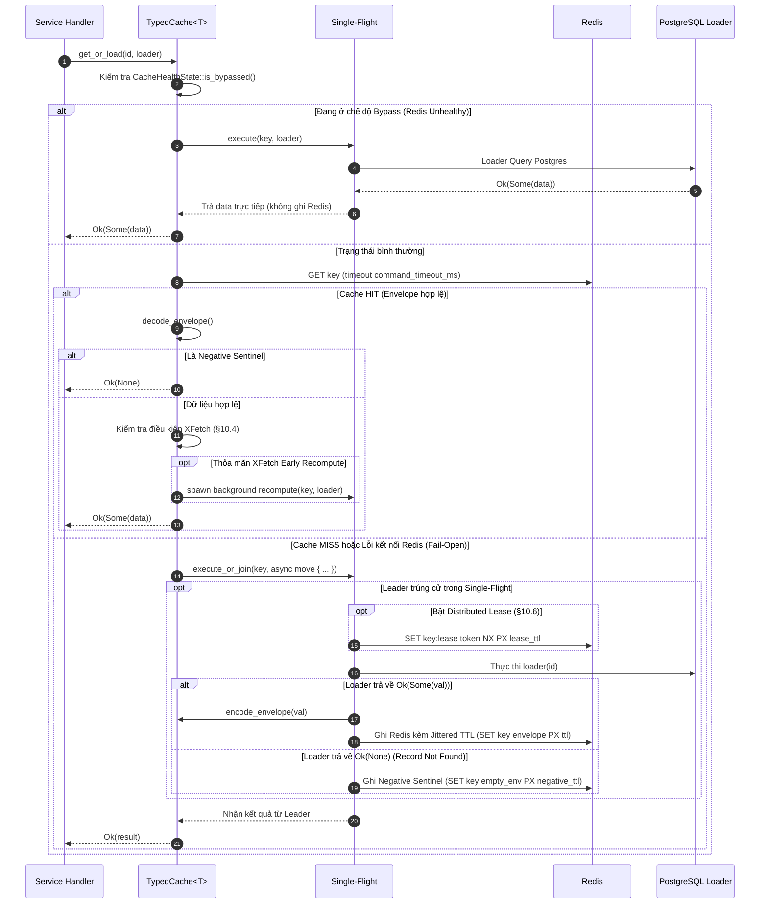
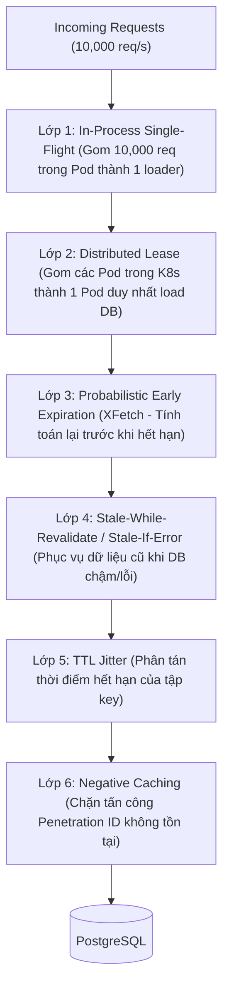
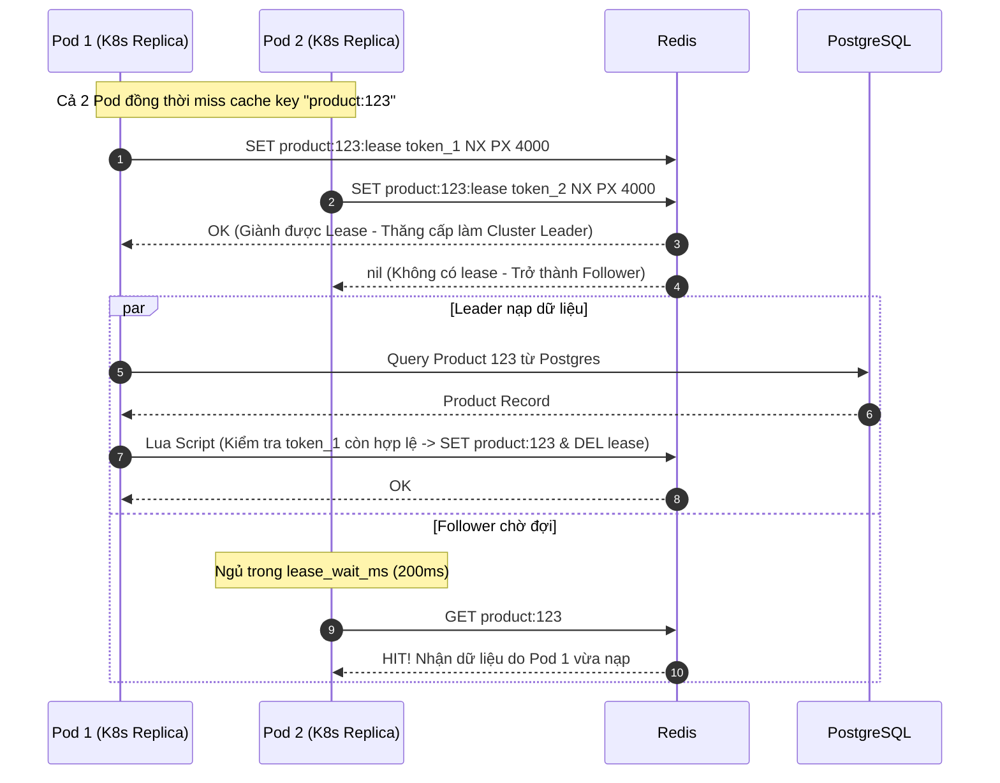
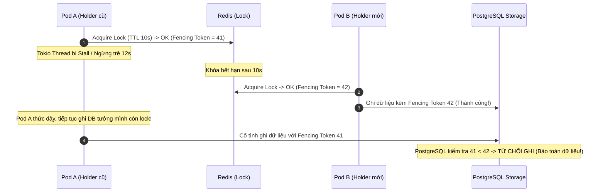

# OmniKubernetes Architecture Specification: Distributed Caching & Concurrency Control (`omni-cache`)

- **Document Version:** `1.0.0`
- **Status:** Draft for Review / Enterprise Architecture Standard
- **Author:** System Architecture Team
- **Roadmap Step:** Giai đoạn 2 — Bước 4: Distributed Caching & Concurrency Lock ([`RoadMap.md`](../../RoadMap.md))
- **Target Platform:** Rust (2024 Edition, **Rust 1.94+**), Tokio (1.43+), Axum (0.8+), **redis-rs 1.8** (`ConnectionManager`, RESP3, `Script`/EVALSHA), Redis OSS 7.2+ / **Valkey 8+** (tối thiểu Redis 6.2 cho ACL + RESP3), AWS ElastiCache / GCP Memorystore (tùy chọn), Kubernetes (StatefulSet / Operator, NetworkPolicy, Prometheus Operator)

---

## 1. Executive Summary & Core Principles

Sau khi tầng **Relational Persistence** (`omni-database`) hoàn tất, hệ sinh thái OmniKubernetes cần một lớp **trạng thái tạm thời phân tán (Ephemeral Distributed State)** với hai sứ mệnh hoàn toàn khác nhau nhưng cùng dùng chung hạ tầng Redis:

1. **Caching:** giảm độ trễ đọc và gánh tải cho PostgreSQL. Dữ liệu ở đây là **bản sao có thể mất** — mất cache chỉ làm hệ thống chậm đi, không làm hệ thống sai.
2. **Concurrency Control (Coordination):** khóa phân tán, lease, fencing token để điều phối nhiều Pod replica. Dữ liệu ở đây là **trạng thái điều phối** — mất nó có thể làm hai Pod cùng thực thi một tác vụ độc quyền (double charge, double send).

Nhầm lẫn giữa hai sứ mệnh này là nguồn gốc của phần lớn sự cố liên quan đến Redis trong thực tế: dùng chung instance `allkeys-lru` cho cả cache lẫn lock (khóa bị evict), coi lock Redis là đảm bảo tuyệt đối cho tính đúng đắn (không có fencing), hoặc để cache sập kéo theo toàn bộ Pod bị rút khỏi traffic (`/readyz` coi Redis là `Critical`).

Crate `libs/cache` (`omni-cache`) cung cấp một lớp **mỏng, tường minh, quan sát được** trên `redis-rs`, xác lập **9 nguyên lý cốt lõi**:

1. **Cache Is an Optimization, Never the Source of Truth (Fail-Open Reads):**
   - PostgreSQL là nguồn sự thật duy nhất. Mọi lỗi Redis trên đường đọc (timeout, mất kết nối, payload hỏng) đều bị **hạ cấp thành cache miss** và gọi thẳng loader — request không bao giờ thất bại chỉ vì cache.
   - Mặc định `RedisHealthIndicator` có mức `NonCritical`: Redis sập ⇒ `/readyz` trả `200 degraded`, **không** rút Pod khỏi EndpointSlice.
2. **Coordination Is Not Cache (Fail-Closed Locks):**
   - Lock, lease, fencing counter là trạng thái điều phối: không lấy được lock ⇒ trả lỗi rõ ràng (`409`/`503`), **không bao giờ** "giả vờ đã lấy được".
   - Production tách hai vai trò thành hai endpoint với chính sách bộ nhớ khác nhau: cache `allkeys-lfu`, coordination `noeviction` + AOF (§6.6).
3. **Bounded Everything:**
   - Mọi lệnh Redis bọc trong `tokio::time::timeout(command_timeout)` **bên ngoài** cơ chế reconnect của `ConnectionManager`; mọi key **bắt buộc có TTL**; mọi payload có trần kích thước; mọi loader có `loader_timeout`; mọi lần chờ lock có `acquire_wait`.
4. **Stampede-Proof by Construction (Defense in Depth):**
   - Sáu lớp phòng thủ xếp chồng: Single-Flight cục bộ, TTL Jitter, Probabilistic Early Expiration (XFetch), Stale-While-Revalidate / Stale-If-Error, Distributed Lease (mô hình Facebook Memcache) và Negative Caching (§10).
5. **Correctness Comes from Fencing, Not from the Lock:**
   - Lock Redis (kể cả Redlock) không đảm bảo loại trừ tương hỗ tuyệt đối dưới GC pause, Tokio stall, clock jump hay failover. Mọi lock trả về một **fencing token đơn điệu tăng**; tài nguyên đích (PostgreSQL) phải từ chối token cũ (§11.7).
6. **Cluster-Ready Keyspace & Atomic Lua:**
   - Cú pháp key chuẩn hóa, hash tag có chủ đích, mọi thao tác nhiều key đi qua Lua script khai báo đầy đủ `KEYS[]` ⇒ chuyển sang Redis Cluster ở v1.1 không phải viết lại.
7. **Observability by Default:**
   - Span theo **OpenTelemetry Database Semantic Conventions** (`db.system.name = "redis"`), bộ chỉ số `cache_*`, `lock_*`, `redis_client_*` cho Prometheus; **không bao giờ** đưa key hay value vào nhãn metric hoặc log (chống cardinality explosion và rò rỉ PII).
8. **Security & Privacy by Default:**
   - ACL user riêng cho từng service, TLS trong Production, mật khẩu là `SecretString`, không dựng URL chứa mật khẩu, định danh nhạy cảm trong key được băm HMAC (Nghị định 13/2023/NĐ-CP, GDPR).
9. **Zero Hidden Global State & Testability:**
   - Không client toàn cục. `CacheClient` truyền qua `AppState`. Logic thuần (key, codec, XFetch, jitter, single-flight, ánh xạ lỗi, guardrail) kiểm thử được **không cần Redis** nhờ `MemoryBackend`; kiểm thử thật được gating qua `OMNI_TEST_REDIS_URL` để `cargo test --all` luôn xanh.

---

## 2. Scope of Applicability & Workspace Dependency Architecture

### 2.1. Nằm trong phạm vi (In-Scope)

| #   | Năng lực                                                                                  | Module                          |
| :-- | :---------------------------------------------------------------------------------------- | :------------------------------ |
| 1   | Cầu nối cấu hình `RedisConfig` → `ConnectionInfo` / `ConnectionManagerConfig` (không URL) | `config.rs`                     |
| 2   | `CacheClient`: K kết nối multiplexed round-robin, connect retry, timeout ngoài, shutdown  | `client.rs`, `backend/redis.rs` |
| 3   | Cache Sentinel, `CacheHealthState`, `RedisHealthIndicator`, chế độ Bypass                 | `sentinel.rs`, `health.rs`      |
| 4   | Keyspace chuẩn hóa: `KeySpace`, `CacheKey`, hash tag, băm HMAC định danh nhạy cảm         | `key.rs`                        |
| 5   | Envelope nhị phân, serialization JSON, nén LZ4 (mặc định) / Zstd (feature), chống bomb    | `codec.rs`                      |
| 6   | `TypedCache<T>`: cache-aside, `get_or_load`, invalidation, negative caching               | `typed.rs`, `invalidation.rs`   |
| 7   | Stampede protection: Single-Flight, Jitter, XFetch, SWR/SIE, Distributed Lease            | `stampede/*.rs`                 |
| 8   | Distributed Lock: acquire/release/extend Lua, watchdog renewal, lock-loss signal, fencing | `lock.rs`, `scripts.rs`         |
| 9   | Phân loại lỗi `RedisError` → `CacheError` → `AppError` (RFC 9457)                         | `error.rs`                      |
| 10  | Span OTel, metrics Prometheus, slow command log                                           | `instrument.rs`                 |
| 11  | `MemoryBackend` mô phỏng đúng ngữ nghĩa script cho unit test (feature `test-util`)        | `backend/memory.rs`             |

### 2.2. Ngoài phạm vi (Out-of-Scope)

- **Redis Cluster (`cluster-async`) và Redis Sentinel client:** v1.1. Keyspace và script đã được thiết kế tương thích Cluster ngay từ v1.0 (§7.3). Trong v1.0, HA được cung cấp bởi endpoint primary ổn định (ElastiCache/Memorystore primary endpoint, hoặc Service K8s trỏ vào master do Operator quản lý).
- **L1 Near-Cache in-process (moka) + invalidation qua Pub/Sub hoặc RESP3 Client-Side Caching:** v1.1, chỉ chừa điểm mở rộng (`CachePolicy::near_cache`).
- **Redlock đa master (N ≥ 3 instance độc lập):** không triển khai trong v1.0 (lý do tại §11.1). Chừa trait `LockBackend` cho biến thể `redlock` nếu có yêu cầu.
- **Rate Limiting (GCRA/Token Bucket trên Redis):** Bước 7. Sẽ **tái sử dụng** `CacheClient` và cơ chế `Script` của tiêu chuẩn này.
- **Session store, refresh-token blacklist:** Bước 5 (`omni-auth`) sẽ xây trên `TypedCache` + `KeySpace`.
- **Pub/Sub, Redis Streams làm message broker:** Bước 6 (`omni-messaging`).
- **Mã hóa value at-rest phía client:** không mặc định; dữ liệu có PII nhạy cảm cao không được đưa vào cache (§14.3).

### 2.3. Sơ đồ Phụ thuộc Kiến trúc (Acyclic Crate Dependency Graph)



> [!IMPORTANT]
> `omni-cache` **không phụ thuộc** `omni-database` và ngược lại. Hai crate là anh em ngang hàng; sự phối hợp (invalidation sau commit, fencing token ghi vào Postgres) diễn ra ở tầng service theo các mẫu chuẩn ở §9.3 và §11.7. Chiều phụ thuộc bắt buộc: `omni-cache → omni-metrics → omni-errors → omni-common`. Theo quy tắc orphan của Rust, `impl From<CacheError> for AppError` nằm trong `omni-cache`.

### 2.4. Các điểm điều chỉnh so với văn bản RoadMap (Roadmap Deviations)

| RoadMap ghi                                         | Thiết kế chuẩn hóa                                                                                                               | Lý do kỹ thuật                                                                                                                                                                                                                                                                                   |
| :-------------------------------------------------- | :------------------------------------------------------------------------------------------------------------------------------- | :----------------------------------------------------------------------------------------------------------------------------------------------------------------------------------------------------------------------------------------------------------------------------------------------- |
| `omni_cache::create_manager(&config.redis)`         | `CacheClient::connect(&app_config)` (nhận `AppConfig<C>`)                                                                        | Cần `service.name` để dựng namespace key và `CLIENT SETNAME`/`lib-name` (truy vết trên `CLIENT LIST`), cần `server.request_timeout_secs` cho timeout hierarchy — giống cách `DbPool::create_pool(&config)` đang làm.                                                                             |
| Key `omni:{service_name}:{resource}:{id}`           | `omni:order:product:v1:{018f4a2b-...}` — dấu `{}` **chỉ** bao quanh phần định danh làm hash tag có chủ đích                      | Trong Redis Cluster, chuỗi trong `{...}` là **hash tag** quyết định slot. Nếu viết literal `omni:{order}:...` thì toàn bộ key của một service rơi vào **một slot duy nhất** ⇒ hot shard. Bổ sung segment `v{schema}` để vô hiệu hóa hàng loạt khi đổi cấu trúc DTO.                              |
| "Redis Async Multiplexed Manager" + `pool_size: 16` | K (`connections`, mặc định 2) `ConnectionManager` round-robin; `pool_size` bị `deprecated`                                       | `ConnectionManager` là **một** kết nối TCP multiplexed, tự pipeline mọi request đồng thời — không có khái niệm pool. 16–500 kết nối là lãng phí. Vài kết nối song song chỉ để giảm head-of-line blocking khi có value lớn (§6.2).                                                                |
| `connection_url()` nối mật khẩu vào URL             | Dựng `ConnectionInfo` bằng builder (`ConnectionAddr` + `RedisConnectionInfo::set_password`)                                      | Mật khẩu chứa `@ : / ? #` làm hỏng URL (cùng lỗi G2 của `DatabaseConfig`); URL chứa secret dễ rò vào log/panic message.                                                                                                                                                                          |
| "Local Mutex / SingleFlight"                        | Single-Flight dạng **sharded map + tác vụ nền + `Shared` future**, không dùng Mutex giữ qua `.await`                             | Một Mutex toàn cục tuần tự hóa mọi key; Mutex theo key giữ qua `.await` không cancellation-safe (client ngắt kết nối ⇒ leader bị drop ⇒ follower treo hoặc phải tự load lại) và rò bộ nhớ map (§10.3).                                                                                           |
| "Probabilistic Early Expiration / Jitter TTL"       | Giữ nguyên, bổ sung **Stale-While-Revalidate**, **Stale-If-Error**, **Negative Caching** và **Distributed Lease**                | Single-Flight chỉ chặn trùng lặp **trong một Pod**: 20 Pod ⇒ vẫn 20 truy vấn DB cho một hot key. Lease chặn trùng lặp liên Pod và đồng thời chống "stale set" (ghi đè dữ liệu cũ sau invalidation) (§10.7).                                                                                      |
| "Distributed Locking (Khóa phân tán Redlock)"       | Single-instance lease lock + **fencing token** (mặc định); Redlock đa master là extension point                                  | Redlock cần ≥ 3 master **độc lập** (hiếm có trên K8s), và theo phân tích của Martin Kleppmann (2016) vẫn không an toàn cho tính đúng đắn khi thiếu fencing token. Với fencing token, một instance (có replica) là đủ cho mục đích hiệu quả, còn tính đúng đắn do tài nguyên đích bảo vệ (§11.1). |
| Giải phóng khóa "bằng mã băm nguyên tử qua Lua"     | Compare-and-Delete Lua so sánh **owner token ngẫu nhiên 128-bit** (UUIDv4), không phải "mã băm"                                  | Cần giá trị không đoán được, duy nhất cho mỗi lần acquire; UUIDv7 có phần timestamp đoán được nên không dùng cho token sở hữu.                                                                                                                                                                   |
| "Tự động nén qua `zstd` hoặc `lz4`"                 | `lz4_flex` (pure Rust, `safe-encode`/`safe-decode`) mặc định; `zstd` sau feature flag; kiểm tra trần giải nén trước khi cấp phát | LZ4 tối ưu độ trễ (nén/giải nén GB/s), không cần toolchain C trong Docker build; Zstd cho tỉ lệ nén cao hơn nhưng kéo theo `zstd-sys` (C). Không có trần giải nén ⇒ một value độc hại (hoặc lỗi) có thể buộc Pod cấp phát hàng GB (decompression bomb).                                          |
| (không đề cập) Timeout lệnh                         | Ghi đè `response_timeout` mặc định 500ms của redis-rs 1.x bằng `command_timeout_ms`, và bọc thêm timeout ngoài                   | `ConnectionManager` cho các lệnh phát sinh trong lúc reconnect **chờ future kết nối** — có thể vượt `response_timeout`. Timeout ngoài là chốt chặn cứng của nguyên lý "Bounded Everything".                                                                                                      |

---

## 3. Standards & Compliance References

| Tiêu chuẩn / Tài liệu                                                                                | Tổ chức              | Áp dụng                                                                                           |
| :--------------------------------------------------------------------------------------------------- | :------------------- | :------------------------------------------------------------------------------------------------ |
| **Redis Cluster Specification — Hash tags, key distribution**                                        | Redis Ltd.           | Thiết kế keyspace tương thích Cluster (§7.3).                                                     |
| **Redis — Distributed Locks with Redis (`SET NX PX`, Redlock)**                                      | Redis Ltd.           | Thuật toán acquire/release (§11.2).                                                               |
| **Martin Kleppmann — "How to do distributed locking" (2016)**                                        | —                    | Lập luận fencing token, giới hạn của Redlock (§11.1, §11.7).                                      |
| **Vattani, Chierichetti, Lowenstein — "Optimal Probabilistic Cache Stampede Prevention", VLDB 2015** | VLDB Endowment       | Thuật toán XFetch (§10.4).                                                                        |
| **Nishtala et al. — "Scaling Memcache at Facebook", NSDI 2013 (Leases)**                             | USENIX               | Distributed Lease chống thundering herd và stale set (§10.7).                                     |
| **RFC 5861 — HTTP Cache-Control Extensions for Stale Content**                                       | IETF                 | Ngữ nghĩa `stale-while-revalidate`, `stale-if-error` áp dụng cho cache ứng dụng (§10.6).          |
| **Redis Serialization Protocol RESP3 / Lua Scripting (`EVALSHA`, `NOSCRIPT`)**                       | Redis Ltd.           | Phát hiện mất kết nối chủ động, script atomic (§6.2, §11.2).                                      |
| **OpenTelemetry Semantic Conventions — Database (stable) & Redis**                                   | CNCF / OpenTelemetry | `db.system.name = "redis"`, `db.operation.name`, `db.namespace`, `server.address` (§13.1).        |
| **LZ4 Block Format / Zstandard (RFC 8878)**                                                          | —/ IETF              | Định dạng nén payload (§8.3).                                                                     |
| **RFC 9457 Problem Details**                                                                         | IETF                 | Hợp đồng lỗi trả về client qua `omni-errors` (§12).                                               |
| **RFC 9562 (UUID v4/v7)**                                                                            | IETF                 | UUIDv4 cho owner token; UUIDv7 cho id thực thể trong key.                                         |
| **Nghị định 13/2023/NĐ-CP & GDPR Art. 5(1)(c), Art. 17**                                             | VN Gov / EU          | Tối thiểu hóa dữ liệu, không PII trong key/log, TTL giới hạn, invalidation khi xóa dữ liệu (§14). |
| **OWASP ASVS v5 — V8 (Data Protection), V13 (Configuration), V9 (Communications)**                   | OWASP                | ACL least-privilege, TLS, vô hiệu lệnh nguy hiểm (§14).                                           |

---

## 4. Current State & Gap Analysis

### 4.1. Những gì đã có và được tái sử dụng

| Thành phần sẵn có                                                       | Vị trí                                                                                                     | Cách `omni-cache` dùng                                                                                                                     |
| :---------------------------------------------------------------------- | :--------------------------------------------------------------------------------------------------------- | :----------------------------------------------------------------------------------------------------------------------------------------- |
| `RedisConfig` (`host`, `port`, `password: Option<SecretString>`, ...)   | [`redis.rs`](../../libs/common/src/config/redis.rs)                                                        | Nguồn cấu hình duy nhất; mở rộng tương thích ngược (§5.1).                                                                                 |
| `redacted_url()`                                                        | [`redis.rs`](../../libs/common/src/config/redis.rs)                                                        | Trường `server.address` trong log chẩn đoán — không bao giờ có mật khẩu.                                                                   |
| `ConfigValidationIssue`, `validate_all` 2 pha                           | [`config/mod.rs`](../../libs/common/src/config/mod.rs)                                                     | Thêm `validate_redis_guardrails` (§5.3) song song `validate_database_guardrails`.                                                          |
| `RequestContext` (`trace_id`, `user_id`, `tenant_id`)                   | [`context.rs`](../../libs/common/src/middleware/context.rs)                                                | Gắn span loader vào trace hiện tại; `tenant_id` làm segment key cho dữ liệu đa tenant.                                                     |
| `AppError` (Clone, RFC 9457)                                            | [`app_error.rs`](../../libs/errors/src/app_error.rs)                                                       | Kiểu lỗi của loader (Clone ⇒ chia sẻ được cho mọi follower của Single-Flight); đích ánh xạ `CacheError`.                                   |
| `HealthIndicator`, `DependencyCriticality`, `HealthRegistry`            | [`probes.rs`](../../libs/metrics/src/probes.rs)                                                            | `RedisHealthIndicator` cắm vào `/readyz`, mặc định `NonCritical`.                                                                          |
| `init_prometheus` + `set_buckets_for_metric`                            | [`exporter.rs`](../../libs/metrics/src/exporter.rs)                                                        | Đăng ký thêm `CACHE_DURATION_BUCKETS`, `LOCK_WAIT_BUCKETS`, `PAYLOAD_SIZE_BUCKETS` (§13.3).                                                |
| `TxOptions` (`statement_timeout`, `read_only`), `check_optimistic_lock` | [`transaction.rs`](../../libs/database/src/transaction.rs), [`audit.rs`](../../libs/database/src/audit.rs) | Loader đọc dùng transaction read-only có `statement_timeout` < `loader_timeout`; fencing check tái dùng `DbError::ConcurrentModification`. |
| Mẫu Sentinel + cached health (`PoolHealthState`)                        | [`sentinel.rs`](../../libs/database/src/sentinel.rs), [`health.rs`](../../libs/database/src/health.rs)     | `CacheHealthState` dùng cùng mô hình atomics + hysteresis (§6.4).                                                                          |
| Workspace dep `redis = 1.8.1` (`tokio-comp`, `connection-manager`)      | [`Cargo.toml`](../../Cargo.toml)                                                                           | Bổ sung feature TLS, tắt default features không cần thiết (§15.2).                                                                         |

### 4.2. Các vấn đề phát hiện cần xử lý trước/trong khi triển khai

| #   | Vấn đề                                                                                                                                    | Mức độ     | Đề xuất                                                                                                                    |
| :-- | :---------------------------------------------------------------------------------------------------------------------------------------- | :--------- | :------------------------------------------------------------------------------------------------------------------------- |
| G1  | `RedisConfig::connection_url()` nối mật khẩu **không URL-encode**                                                                         | Cao        | Không dùng URL; dựng `ConnectionInfo` bằng builder. Đánh dấu `connection_url()` `#[deprecated]`.                           |
| G2  | `RedisConfig` thiếu `username` (ACL Redis 6+), TLS (`tls.enabled`, CA, mTLS), `protocol`, cấu hình reconnect, TCP keepalive               | Cao        | Mở rộng cấu hình tương thích ngược (§5.1).                                                                                 |
| G3  | `pool_size` (1–500) không có ngữ nghĩa với `ConnectionManager` multiplexed                                                                | Trung bình | Thay bằng `connections` (1–16, mặc định 2); `pool_size` thành alias deprecated, cảnh báo `CFG_REDIS_POOL_SIZE_DEPRECATED`. |
| G4  | `command_timeout_ms` mặc định 1000ms: lớn so với ngân sách fail-open (mỗi lệnh lỗi cộng thẳng 1s vào latency request)                     | Trung bình | Prod khuyến nghị 150–250ms; guardrail `CFG_REDIS_TIMEOUT_BUDGET` (§5.3).                                                   |
| G5  | Không có guardrail Redis nào trong `validate_all` (TLS/auth trong prod, thứ tự TTL lock/lease)                                            | Cao        | Thêm `validate_redis_guardrails` (§5.3).                                                                                   |
| G6  | `config/prod/default.yaml` và `config/staging/default.yaml` chưa có section `redis`                                                       | Trung bình | Bổ sung profile theo bảng §5.2.                                                                                            |
| G7  | `omni-metrics::init_prometheus` chưa có bucket cho cache/lock ⇒ histogram bị render thành **summary**, không aggregate được qua nhiều Pod | Cao        | Thêm 3 dải bucket + `Matcher::Full` cho từng histogram (§13.3).                                                            |
| G8  | Workspace `redis` bật default features (`geospatial`, `streams`, `num-bigint`...) không dùng; thiếu `tokio-rustls-comp`                   | Thấp       | `default-features = false` + chọn lọc feature (§15.2).                                                                     |
| G9  | `AppError` không có biến thể `423 Locked`, `Conflict` không ghi đè được `code` (trùng G8 của tài liệu persistence)                        | Thấp       | Ánh xạ `LockNotAcquired` → `409 Conflict` + `detail`; quyết định mở Q3 (§18).                                              |
| G10 | Chưa có Redis trong môi trường dev cục bộ (`process-compose.yaml` mới là placeholder)                                                     | Trung bình | Thêm Valkey/Redis vào harness dev; test thật gating qua `OMNI_TEST_REDIS_URL` (§16).                                       |
| G11 | `release` profile dùng `panic = "abort"`                                                                                                  | Lưu ý      | Mọi panic trong loader làm **sập tiến trình** ở release — thiết kế Single-Flight không dựa vào `catch_unwind` (§10.3).     |
| G12 | MSRV: `redis 1.8.1` yêu cầu Rust 1.88; workspace 1.94 — **tương thích**                                                                   | Thông tin  | Không cần hành động; ghi nhận để chặn việc hạ MSRV về sau.                                                                 |

---

## 5. Configuration Model

### 5.1. `RedisConfig` mở rộng (tương thích ngược)

Mọi trường mới có giá trị mặc định an toàn trong `Default` impl nên các file YAML hiện tại vẫn nạp được. Biến môi trường theo quy ước `OMNI__REDIS__*`, lồng sâu dùng `__` (ví dụ `OMNI__REDIS__LOCK__DEFAULT_TTL_MS`).

```yaml
# config/base.yaml — section redis (đề xuất)
redis:
  enabled: false
  host: "localhost"
  port: 6379
  username: null # [MỚI] ACL user (Redis 6+). null => user "default"
  password: null # SecretString
  database_index: 0 # Cluster chỉ hỗ trợ DB 0 — khuyến nghị luôn dùng 0
  protocol: "resp3" # [MỚI] resp2 | resp3 (RESP3 phát hiện mất kết nối chủ động)
  tls: # [MỚI]
    enabled: false
    ca_cert_path: null # CA PEM nếu không thuộc trust store (ElastiCache/Memorystore/self-signed)
    client_cert_path: null # mTLS (tùy chọn)
    client_key_path: null

  # --- Kết nối multiplexed ---
  connections: 2 # [MỚI] số ConnectionManager round-robin (1..=16)
  pool_size: 16 # [DEPRECATED] bị bỏ qua, cảnh báo CFG_REDIS_POOL_SIZE_DEPRECATED
  pipeline_buffer_size: 1024 # [MỚI] hàng đợi lệnh nội bộ mỗi kết nối (redis-rs mặc định 50)
  connection_timeout_ms: 2000
  command_timeout_ms: 1000 # prod khuyến nghị 150-250
  tcp_keepalive_secs: 30 # [MỚI] < idle timeout của NAT/LB
  reconnect: # [MỚI] map sang ConnectionManagerConfig
    max_retries: 6
    min_delay_ms: 100
    max_delay_ms: 2000
  connect_retry: # [MỚI] retry lúc khởi động (tương tự database.connect_retry)
    max_attempts: 10
    initial_backoff_ms: 250
    max_backoff_ms: 5000

  # --- Keyspace & payload ---
  key_prefix: "omni"
  key_hash_secret: null # [MỚI] SecretString >= 32 byte, HMAC cho định danh nhạy cảm (§7.4)
  compression: "lz4" # [MỚI] none | lz4 | zstd (zstd cần feature)
  compression_threshold_bytes: 8192
  max_value_bytes: 1048576 # [MỚI] trần payload sau nén; vượt => không cache (WARN)

  # --- Readiness & degradation ---
  sentinel: # [MỚI]
    interval_secs: 5
    ping_timeout_ms: 500
    failure_threshold: 3
  criticality: "non_critical" # [MỚI] critical | non_critical (ảnh hưởng /readyz và startup)
  bypass_on_unhealthy: true # [MỚI] bỏ qua Redis khi Sentinel báo lỗi (§6.4)

  # --- Cache defaults (ghi đè được theo từng TypedCache) ---
  cache: # [MỚI]
    default_ttl_secs: 300
    max_ttl_secs: 86400 # trần TTL mọi key cache (bound staleness)
    ttl_jitter_pct: 10
    xfetch_beta: 1.0 # 0 = tắt XFetch
    stale_ttl_secs: 60 # cửa sổ stale-while-revalidate / stale-if-error
    negative_ttl_secs: 30
    loader_timeout_ms: 3000
    lease_ttl_ms: 4000 # >= loader_timeout_ms
    lease_wait_ms: 200 # follower liên Pod chờ tối đa trước khi tự load
    invalidation_replay_capacity: 10000

  # --- Distributed lock defaults ---
  lock: # [MỚI]
    default_ttl_ms: 10000
    renew_interval_ratio: 0.33 # watchdog gia hạn mỗi ttl * ratio
    acquire_wait_ms: 0 # 0 = try-once
    retry_min_delay_ms: 20
    retry_max_delay_ms: 250
    drift_factor: 0.01

  # --- Endpoint điều phối riêng (khuyến nghị prod, §6.6) ---
  coordination: null # [MỚI] { host, port, username, password, tls } — null => dùng chung endpoint cache
```

### 5.2. Khuyến nghị theo môi trường

| Trường                   | `dev`           | `staging`         | `prod`                                                   |
| :----------------------- | :-------------- | :---------------- | :------------------------------------------------------- |
| `tls.enabled`            | `false`         | `true`            | `true` (bắt buộc)                                        |
| `username` / `password`  | `null` / `null` | ACL user riêng    | ACL user riêng, secret từ Kubernetes Secret / ESO        |
| `command_timeout_ms`     | 1000            | 300               | 150–250                                                  |
| `connections`            | 1               | 2                 | 2–4 (tăng khi có value > 64 KB thường xuyên)             |
| `criticality`            | `non_critical`  | `non_critical`    | `non_critical` (chỉ `critical` khi service dựa vào lock) |
| `coordination`           | `null`          | `null` hoặc riêng | Endpoint riêng `noeviction` + AOF (§6.6)                 |
| `cache.default_ttl_secs` | 60              | 300               | Theo từng resource; `max_ttl_secs` ≤ 86400               |

### 5.3. Guardrails mới (Pha 2 — Cross-field & Production)

Bổ sung `AppConfig::validate_redis_guardrails` (chỉ chạy khi `redis.enabled = true`), dùng đúng cơ chế `ConfigValidationIssue` hiện có:

| Mã                               | Điều kiện vi phạm                                                                                         | Môi trường        |
| :------------------------------- | :-------------------------------------------------------------------------------------------------------- | :---------------- |
| `CFG_REDIS_TIMEOUT_BUDGET`       | `command_timeout_ms * 4 >= server.request_timeout_secs * 1000` (lệnh Redis chiếm > 25% ngân sách request) | Tất cả            |
| `CFG_REDIS_LOADER_BUDGET`        | `cache.loader_timeout_ms >= server.request_timeout_secs * 1000`                                           | Tất cả            |
| `CFG_REDIS_LEASE_ORDER`          | `cache.lease_ttl_ms < cache.loader_timeout_ms` (lease hết hạn khi loader còn chạy ⇒ load trùng)           | Tất cả            |
| `CFG_REDIS_LOCK_TTL_ORDER`       | `lock.default_ttl_ms < 3 * command_timeout_ms` hoặc `renew_interval_ratio ∉ (0, 0.5]`                     | Tất cả            |
| `CFG_REDIS_TTL_ORDER`            | `cache.default_ttl_secs > cache.max_ttl_secs` hoặc `ttl_jitter_pct > 50`                                  | Tất cả            |
| `CFG_REDIS_KEY_PREFIX`           | `key_prefix` không khớp `^[a-z0-9][a-z0-9-]{0,15}$` (cấm `:`, `{`, `}`, khoảng trắng)                     | Tất cả            |
| `CFG_REDIS_CONNECTIONS_BOUNDS`   | `connections ∉ [1, 16]`                                                                                   | Tất cả            |
| `CFG_REDIS_POOL_SIZE_DEPRECATED` | `pool_size` khác mặc định (người dùng còn cấu hình trường cũ)                                             | Tất cả (cảnh báo) |
| `CFG_PROD_REDIS_TLS_REQUIRED`    | `tls.enabled = false` (cả endpoint `coordination` nếu có)                                                 | `prod`            |
| `CFG_PROD_REDIS_AUTH_REQUIRED`   | `password` rỗng / giá trị mặc định yếu, hoặc `username` là `null`/`"default"`                             | `prod`            |
| `CFG_PROD_REDIS_KEY_HASH_SECRET` | `key_hash_secret` thiếu hoặc < 32 byte                                                                    | `prod`            |
| `CFG_PROD_REDIS_COORDINATION`    | Service bật lock (`lock` được dùng) nhưng `coordination = null`                                           | `prod` (cảnh báo) |

### 5.4. Timeout Hierarchy (Phân cấp thời gian chờ)



Quy tắc: **tầng trong luôn hết hạn trước tầng ngoài**. Hai hệ quả quan trọng:

- Đường đọc fail-open tốn tối đa `command_timeout_ms + loader_time` — do đó `command_timeout_ms` phải nhỏ. Khi Redis chậm kéo dài, chế độ **Bypass** (§6.4) loại bỏ hẳn khoản "thuế timeout" này.
- Loader nên dùng transaction read-only với `statement_timeout` thấp hơn `loader_timeout` (qua `TxOptions { read_only: true, statement_timeout: Some(..), .. }` của `omni-database`) — vì timeout phía client **không hủy** câu lệnh đang chạy trên Postgres.

---

## 6. Connection Architecture

### 6.1. Dựng `ConnectionInfo` bằng builder (không qua URL)

```rust
// libs/cache/src/config.rs (trích)
use redis::{ConnectionAddr, ConnectionInfo, IntoConnectionInfo, ProtocolVersion, RedisConnectionInfo};

pub fn connection_info(&self, ep: &RedisEndpoint) -> Result<ConnectionInfo, CacheError> {
    let addr = if ep.tls.enabled {
        ConnectionAddr::TcpTls {
            host: ep.host.clone(),
            port: ep.port,
            insecure: false, // không bao giờ tắt kiểm tra hostname
            tls_params: None, // CA riêng/mTLS đi qua Client::build_with_tls (6.1.1)
        }
    } else {
        ConnectionAddr::Tcp(ep.host.clone(), ep.port)
    };

    let mut redis = RedisConnectionInfo::default()
        .set_db(i64::from(self.raw.database_index))
        .set_protocol(match self.raw.protocol {
            RedisProtocol::Resp2 => ProtocolVersion::RESP2,
            RedisProtocol::Resp3 => ProtocolVersion::RESP3,
        })
        .set_lib_name("omni-cache", env!("CARGO_PKG_VERSION"));
    if let Some(user) = &ep.username {
        redis = redis.set_username(user);
    }
    if let Some(pass) = &ep.password {
        redis = redis.set_password(pass.expose_secret()); // không materialize URL chứa secret
    }

    let tcp = redis::io::tcp::TcpSettings::default()
        .set_nodelay(true)
        .set_keepalive(
            socket2::TcpKeepalive::new().with_time(Duration::from_secs(self.raw.tcp_keepalive_secs)),
        );

    Ok(addr
        .into_connection_info()?
        .set_redis_settings(redis)
        .set_tcp_settings(tcp))
}
```

**6.1.1. TLS với CA riêng / mTLS:** khi `tls.ca_cert_path` hoặc `client_cert_path` được cấu hình, client được dựng bằng `redis::Client::build_with_tls(conn_info, TlsCertificates { client_tls, root_cert })` (feature `tls-rustls`). Nội dung PEM được đọc **một lần** lúc khởi động; lỗi đọc file là lỗi cấu hình vĩnh viễn (fail-fast).

> [!NOTE]
> Khác với SQLx (không có TCP keepalive phía client), redis-rs 1.x cho phép đặt `TcpKeepalive` qua `TcpSettings`. Kết hợp với RESP3 (ConnectionManager chủ động lắng nghe push và tự reconnect khi kết nối đứt **kể cả lúc không có traffic**), kết nối "nửa sống" sau NAT/LB idle timeout được phát hiện mà không cần ping trên mỗi request.

### 6.2. Mô hình Multiplexing & `ConnectionManagerConfig`

```rust
// libs/cache/src/backend/redis.rs (trích)
fn manager_config(s: &CacheSettings) -> ConnectionManagerConfig {
    let r = &s.raw.reconnect;
    ConnectionManagerConfig::new()
        .set_number_of_retries(r.max_retries)
        .set_min_delay(Duration::from_millis(r.min_delay_ms))
        .set_max_delay(Duration::from_millis(r.max_delay_ms))
        .set_connection_timeout(Some(Duration::from_millis(s.raw.connection_timeout_ms)))
        // Ghi đè mặc định 500ms của redis-rs 1.x
        .set_response_timeout(Some(Duration::from_millis(s.raw.command_timeout_ms)))
        .set_pipeline_buffer_size(s.raw.pipeline_buffer_size)
}

#[derive(Clone, Debug)]
pub(crate) struct RedisBackend {
    conns: Arc<[ConnectionManager]>, // K kết nối, mỗi kết nối tự reconnect độc lập
    next: Arc<AtomicUsize>,
    command_timeout: Duration,
}

impl RedisBackend {
    #[inline]
    fn conn(&self) -> ConnectionManager {
        // ConnectionManager: Clone rẻ (Arc nội bộ), an toàn dùng đồng thời.
        let i = self.next.fetch_add(1, Ordering::Relaxed) % self.conns.len();
        self.conns[i].clone()
    }

    /// Mọi lệnh đi qua đây: timeout NGOÀI bao trùm cả thời gian chờ reconnect.
    async fn run<T, F>(&self, op: &'static str, f: impl FnOnce(ConnectionManager) -> F) -> Result<T, CacheError>
    where
        F: Future<Output = redis::RedisResult<T>>,
    {
        match tokio::time::timeout(self.command_timeout, f(self.conn())).await {
            Ok(res) => res.map_err(|e| CacheError::from_redis(op, e)),
            Err(_) => Err(CacheError::Timeout { op }),
        }
    }
}
```

**Vì sao K kết nối thay vì pool?** Redis thực thi lệnh đơn luồng và trả lời **theo thứ tự** trên mỗi kết nối. Một `GET` value 1 MB chặn mọi response phía sau trên cùng kết nối (head-of-line blocking). Với K = 2–4 kết nối round-robin, ảnh hưởng của value lớn được pha loãng mà không phải trả chi phí quản lý pool. Tăng K quá 4 hầu như không cải thiện thông lượng vì nút thắt là luồng thực thi của Redis server.

**Các lệnh bị CẤM trên kết nối multiplexed dùng chung** (được chặn bằng thiết kế API — `omni-cache` không phơi `ConnectionManager` thô ra ngoài):

| Lệnh / mẫu                                       | Lý do                                                                                                                |
| :----------------------------------------------- | :------------------------------------------------------------------------------------------------------------------- |
| `WATCH` / `MULTI` / `EXEC` (optimistic CAS)      | `WATCH` là trạng thái **theo kết nối**; các task khác xen lệnh vào cùng kết nối ⇒ CAS sai. Dùng Lua script thay thế. |
| `BLPOP`, `BRPOP`, `XREAD BLOCK`, `WAIT`          | Chặn toàn bộ kết nối đến khi hết thời gian ⇒ mọi request khác treo theo. Cần kết nối riêng (ngoài phạm vi v1.0).     |
| `SELECT`, `CLIENT REPLY OFF`, `CLIENT TRACKING`  | Thay đổi trạng thái kết nối dùng chung.                                                                              |
| `SUBSCRIBE` (RESP2)                              | Chuyển kết nối sang chế độ subscribe. Pub/Sub thuộc Bước 6, kết nối riêng.                                           |
| `KEYS`, `FLUSHDB`, `FLUSHALL`, `DEBUG`, `CONFIG` | O(N) chặn server hoặc nguy hiểm vận hành; còn bị chặn thêm bằng ACL (§14.1).                                         |

> [!TIP]
> `redis::pipe().atomic()` (MULTI/EXEC **không** WATCH) là an toàn trên kết nối multiplexed, vì redis-rs gửi toàn bộ khối như một request đóng gói duy nhất.

### 6.3. Khởi tạo có Retry giới hạn & Chế độ khởi động theo Criticality

`CacheClient::connect(&config)` áp dụng bounded exponential backoff có jitter (giống `omni-database` §6.3), với hành vi phân nhánh theo `redis.criticality`:

| Tình huống khi khởi động                       | `criticality = critical`                      | `criticality = non_critical` (mặc định)                                                                                    |
| :--------------------------------------------- | :-------------------------------------------- | :------------------------------------------------------------------------------------------------------------------------- |
| Kết nối được                                   | Tiếp tục                                      | Tiếp tục                                                                                                                   |
| Lỗi tạm thời, hết `connect_retry.max_attempts` | `Err(CacheError::Unavailable)` ⇒ thoát mã ≠ 0 | `WARN` + tạo `ConnectionManager::new_lazy_with_config` + bật Bypass; Pod vẫn khởi động, Sentinel tự phục hồi khi Redis lên |
| Lỗi vĩnh viễn (xem dưới)                       | Fail-fast ngay                                | **Fail-fast ngay** — sai cấu hình không được che giấu dù cache không trọng yếu                                             |

Lỗi vĩnh viễn (không retry): `ErrorKind::AuthenticationFailed`, `ErrorKind::InvalidClientConfig`, `ServerErrorKind::NoPerm` (ACL thiếu quyền), `ErrorKind::RESP3NotSupported` (gợi ý đặt `protocol: resp2`), lỗi đọc file CA/cert, lỗi xác thực chứng chỉ TLS.

### 6.4. Cache Sentinel, Readiness & Chế độ Bypass

Giống `omni-database`, `/readyz` **không bao giờ** bắn `PING` trực tiếp. Một tác vụ nền duy nhất mỗi Pod ping từng endpoint (cache, coordination), cập nhật `CacheHealthState` (atomics), nuôi metric `redis_client_*`.



Ba điểm thiết kế then chốt:

1. **Hysteresis:** `failure_threshold = 3` (≈15s) chống flapping khi failover vài giây.
2. **Bypass loại bỏ "thuế timeout":** không có Bypass, khi Redis treo, **mọi** request trả thêm `command_timeout_ms` trước khi fail-open. Với Bypass, sau ≤ 15s hệ thống quay về độ trễ "như không có cache". Trong suốt thời gian này, **Single-Flight cục bộ là tấm khiên duy nhất** bảo vệ Postgres (tải DB tối đa ≈ số Pod × số key khác nhau đang được truy cập).
3. **Bypass có điểm mù nhất quán:** invalidation phát sinh trong lúc Bypass (hoặc thất bại do timeout) không được bỏ đi mà đưa vào **Invalidation Replay Buffer** (bounded, mặc định 10.000 key) và được phát lại ngay khi Sentinel thấy Redis khỏe lại. Tràn buffer ⇒ `ERROR` + `cache_invalidations_total{outcome="dropped"}`; độ cũ của dữ liệu khi đó bị chặn trên bởi `max_ttl_secs`.

> [!IMPORTANT]
> Không cấu hình `criticality = critical` chỉ vì "service có dùng Redis". Hãy tự hỏi: _nếu Redis sập, service còn trả lời đúng (dù chậm hơn) không?_ Nếu có — `non_critical`. Chỉ service mà **mọi** endpoint chính đều cần lock (ví dụ worker điều phối thanh toán) mới nên `critical`. Đánh dấu sai làm một sự cố Redis biến thành sự cố toàn hệ thống (tất cả Pod cùng bị rút khỏi traffic).

### 6.5. Vòng đời đầy đủ: Startup → Serving → Shutdown



> [!IMPORTANT]
> Thứ tự đóng: **HTTP drain → cache.shutdown (release lock) → db.close**. Lock bảo vệ công việc ghi DB; release lock trước khi công việc kết thúc phá vỡ loại trừ tương hỗ, còn đóng DB trước khi release lock khiến Pod khác phải chờ hết TTL mới lấy được lock.

### 6.6. Topology & Triển khai trên Kubernetes

**Tách vai trò cache và coordination** là khuyến nghị quan trọng nhất của chương này:

| Thuộc tính              | Endpoint **cache**                 | Endpoint **coordination** (lock, lease lock, fencing)        |
| :---------------------- | :--------------------------------- | :----------------------------------------------------------- |
| `maxmemory-policy`      | `allkeys-lfu` (hoặc `allkeys-lru`) | `noeviction` — **không bao giờ** được evict khóa/counter     |
| Persistence             | Tắt (RDB tùy chọn để warm-start)   | AOF `appendfsync everysec` (giữ fencing counter qua restart) |
| Khi đầy bộ nhớ          | Evict key ít dùng — đúng mong muốn | Từ chối ghi (`OOM`) ⇒ acquire thất bại rõ ràng (fail-closed) |
| Kích thước              | Lớn (GB), theo working set         | Nhỏ (vài chục MB)                                            |
| Hậu quả nếu mất dữ liệu | Chậm hơn tạm thời                  | Có thể 2 holder cùng lúc — được fencing token chặn (§11.7)   |

> [!WARNING]
> Dùng chung một instance `allkeys-lru` cho cả hai vai trò nghĩa là khi bộ nhớ chịu áp lực, Redis **có thể evict một lock đang được giữ** — Pod khác lập tức lấy được lock trong khi holder cũ vẫn đang chạy. `database_index` khác nhau **không** tách được `maxmemory-policy` (chính sách áp dụng toàn instance). Trong v1.0, nếu bắt buộc dùng chung, đặt `volatile-lfu` và đảm bảo mọi key cache có TTL (đã là bất biến của thư viện) — lock key cũng có TTL nên vẫn có rủi ro; chỉ chấp nhận ở `dev`/`staging`.

Các phương án HA được hỗ trợ trong v1.0:

| Phương án                                                           | Failover                                    | Ghi chú                                                                        |
| :------------------------------------------------------------------ | :------------------------------------------ | :----------------------------------------------------------------------------- |
| Managed (ElastiCache / Memorystore) — primary endpoint              | DNS của primary endpoint đổi khi failover   | Khuyến nghị cho prod. ConnectionManager reconnect theo DNS mới (TTL DNS thấp). |
| Valkey/Redis + Sentinel do Operator quản lý, Service K8s trỏ master | Operator cập nhật label/Endpoint của master | Client chỉ thấy một Service ổn định; không cần Sentinel client.                |
| Standalone StatefulSet 1 replica                                    | Không (restart Pod)                         | Chỉ `dev`/`staging`.                                                           |
| Redis Cluster                                                       | Tự động                                     | v1.1 (`cluster-async`). Keyspace v1.0 đã sẵn sàng.                             |

Ngoài ra: `NetworkPolicy` chỉ cho phép namespace của service truy cập port 6379/6380; `PodDisruptionBudget` cho Redis; giám sát phía server bằng `redis_exporter` (§13.5).

---

## 7. Keyspace Design

### 7.1. Ngữ pháp key chuẩn

```text
cache-key   = prefix ":" service ":" resource ":" "v" schema-ver *( ":" segment ) ":" "{" id "}"
lease-key   = cache-key ":lease"
lock-key    = prefix ":" service ":lock:" "{" lock-ns "}" ":r:" resource-id
fence-key   = prefix ":" service ":lock:" "{" lock-ns "}" ":fence"

prefix      = 1*16( a-z / 0-9 / "-" )          ; mặc định "omni"
service     = service.name đã chuẩn hóa [a-z0-9-]
resource    = 1*32( a-z / 0-9 / "-" / "_" )     ; &'static str trong code
schema-ver  = 1*3DIGIT                          ; tăng khi DTO thay đổi không tương thích
segment     = 1*64( a-z / A-Z / 0-9 / "-" / "_" / "." )   ; ví dụ tenant id, locale
id          = 1*128( VCHAR trừ "{" "}" ":" khoảng trắng ) ; UUIDv7, hoặc HMAC hex (7.4)
```

Ví dụ:

| Mục đích                      | Key                                                              |
| :---------------------------- | :--------------------------------------------------------------- |
| Sản phẩm theo id              | `omni:product:product:v1:{018f4a2b-8a5e-7a1b-9c3d-2e4f5a6b7c8d}` |
| Danh mục theo tenant + locale | `omni:product:category-tree:v2:t-42:vi-VN:{root}`                |
| User theo email (đã băm HMAC) | `omni:user:user-by-email:v1:{h:9f2c...e1}`                       |
| Lease nạp sản phẩm            | `omni:product:product:v1:{018f4a2b-...}:lease`                   |
| Lock capture thanh toán       | `omni:payment:lock:{payment-capture}:r:018f4a2b-...`             |
| Fencing counter               | `omni:payment:lock:{payment-capture}:fence`                      |

Ràng buộc: tổng độ dài key ≤ 512 byte (Redis cho phép 512 MB nhưng key dài tốn bộ nhớ và băng thông); các segment do người dùng cung cấp được kiểm tra ký tự lúc dựng key, vi phạm ⇒ `CacheError::InvalidKey` (lỗi lập trình, không phải lỗi runtime ngẫu nhiên).

### 7.2. API kiểu tĩnh: `KeySpace` và `CacheKey`

```rust
// libs/cache/src/key.rs (trích)
#[derive(Debug, Clone)]
pub struct KeySpace {
    base: Arc<str>,           // "omni:product:product:v1"
    resource: &'static str,   // nhãn metric low-cardinality
    hasher: Option<KeyHasher>,
}

#[derive(Debug, Clone, PartialEq, Eq, Hash)]
pub struct CacheKey(Arc<str>); // đã validate, rẻ khi clone (dùng làm key của Single-Flight map)

impl KeySpace {
    /// `resource` bắt buộc là `&'static str` => không thể vô tình đưa dữ liệu động vào nhãn metric.
    pub fn new(client: &CacheClient, resource: &'static str, schema_version: u16) -> Result<Self, CacheError>;

    /// Key theo id công khai (UUID, mã sản phẩm...).
    pub fn key(&self, id: impl std::fmt::Display) -> Result<CacheKey, CacheError>;

    /// Key có segment phụ (tenant, locale) trước id.
    pub fn key_with(&self, segments: &[&str], id: impl std::fmt::Display) -> Result<CacheKey, CacheError>;

    /// Key theo định danh nhạy cảm (email, số điện thoại, CCCD): id = "h:" + hex(HMAC-SHA256(secret, value))[..32].
    pub fn key_sensitive(&self, value: &str) -> Result<CacheKey, CacheError>;
}
```

### 7.3. Hash Tag & thao tác nhiều key

- **Cache key:** hash tag là `{id}` ⇒ key của các thực thể khác nhau phân tán đều trên 16.384 slot; key và lease-key của **cùng một thực thể** nằm cùng slot ⇒ Lua script lease (§10.7) hợp lệ trên Cluster.
- **Lock key:** hash tag là `{lock-ns}` ⇒ mọi lock của một namespace và fencing counter của namespace đó cùng slot ⇒ script acquire (đọc/ghi 2 key) hợp lệ trên Cluster. Lock có lưu lượng thấp hơn cache vài bậc nên tập trung một slot/namespace là chấp nhận được.
- **`MGET` nhiều thực thể:** hợp lệ trên standalone; trên Cluster (v1.1) backend sẽ tự chia theo slot. API `get_many` không giả định atomic.
- **Cấm** thao tác theo pattern (`KEYS`, `SCAN` + `DEL` hàng loạt) trên đường request. Vô hiệu hóa hàng loạt dùng **schema version** (đổi `v1` → `v2` khi deploy) hoặc **namespace generation** (§7.5).

### 7.4. Định danh nhạy cảm trong key (PII-safe Keys)

Key xuất hiện trong `SLOWLOG`, `MONITOR`, `redis-cli --bigkeys`, bản dump RDB và log debug. Theo nguyên tắc tối thiểu hóa dữ liệu (Nghị định 13/2023, GDPR Art. 5(1)(c)), email/số điện thoại/CCCD **không được** xuất hiện nguyên văn trong key.

SHA-256 thuần **không đủ**: không gian số điện thoại Việt Nam (~10⁹) có thể brute-force trong vài phút. Vì vậy dùng **HMAC-SHA256 với `key_hash_secret`** (bí mật theo môi trường, ≥ 32 byte), cắt 128 bit đầu (32 hex) — đủ chống va chạm cho mục đích cache. Crate `hmac` và `sha2` đã có sẵn trong cây phụ thuộc của workspace.

> [!NOTE]
> Xoay vòng `key_hash_secret` tương đương vô hiệu hóa toàn bộ key nhạy cảm (cache miss hàng loạt có kiểm soát nhờ Single-Flight + lease). Thực hiện ngoài giờ cao điểm.

### 7.5. Vô hiệu hóa hàng loạt: Namespace Generation (tùy chọn)

Với resource có nhu cầu "xóa toàn bộ" lúc runtime (ví dụ cây danh mục sau khi import), `CachePolicy::generational()` chèn generation vào key: `omni:product:category-tree:v2:g17:...`. Generation đọc từ key `omni:product:category-tree:v2:gen` (`INCR` để vô hiệu hóa) và được cache trong tiến trình tối đa 1 giây ⇒ vô hiệu hóa hàng loạt có hiệu lực toàn cụm trong ≤ 1s, chi phí O(1), key cũ tự hết hạn theo TTL. Mặc định **tắt** để không thêm round-trip.

---

## 8. Serialization, Compression & Wire Format (`codec.rs`)

### 8.1. Envelope Nhị phân Chuẩn hóa (Wire Protocol Envelope)

Mọi value lưu vào Redis đều được đóng gói trong một **Binary Envelope cố định 12-byte header** trước khi chuyển thành mảng byte. Thiết kế này giải quyết triệt để 3 vấn đề:

1. Cho phép phát hiện phiên bản schema của payload mà không cần deserialize toàn bộ JSON.
2. Lưu trữ chính xác kích thước sau giải nén (`uncompressed_len`) để chặn đứng tấn công **Decompression Bomb**.
3. Hỗ trợ cờ sentinel cho **Negative Caching** (§8.4) với chi phí zero-allocation.

```text
 0                   1                   2                   3
 0 1 2 3 4 5 6 7 8 9 0 1 2 3 4 5 6 7 8 9 0 1 2 3 4 5 6 7 8 9 0 1
+-+-+-+-+-+-+-+-+-+-+-+-+-+-+-+-+-+-+-+-+-+-+-+-+-+-+-+-+-+-+-+-+
|                  Magic Bytes: b"OMC1" (4 bytes)               |
+-+-+-+-+-+-+-+-+-+-+-+-+-+-+-+-+-+-+-+-+-+-+-+-+-+-+-+-+-+-+-+-+
|  Compression  | Format (JSON) |     Flags     |   Schema Ver  |
+-+-+-+-+-+-+-+-+-+-+-+-+-+-+-+-+-+-+-+-+-+-+-+-+-+-+-+-+-+-+-+-+
|               Uncompressed Length (u32 little-endian)         |
+-+-+-+-+-+-+-+-+-+-+-+-+-+-+-+-+-+-+-+-+-+-+-+-+-+-+-+-+-+-+-+-+
|                       Payload Bytes ...                       |
|                       (Raw JSON hoặc LZ4 block)               |
+-+-+-+-+-+-+-+-+-+-+-+-+-+-+-+-+-+-+-+-+-+-+-+-+-+-+-+-+-+-+-+-+
```

| Trường / Byte Offset | Kiểu dữ liệu | Giá trị quy ước & Mục đích                                                                                                    |
| :------------------- | :----------- | :---------------------------------------------------------------------------------------------------------------------------- |
| `0..4` (4 bytes)     | `[u8; 4]`    | `b"OMC1"` — Magic bytes định danh chuẩn cache OmniKubernetes Version 1. Từ chối ngay nếu payload không khớp.                  |
| `4` (1 byte)         | `u8`         | `0x00`: None (không nén), `0x01`: LZ4 (`lz4_flex`), `0x02`: Zstd (tùy chọn qua feature flag).                                 |
| `5` (1 byte)         | `u8`         | `0x01`: JSON (`serde_json`). (Dành riêng `0x02` cho Bincode/Postcard trong tương lai).                                        |
| `6` (1 byte)         | `u8`         | Bit 0: `is_negative` (Sentinel negative caching); Bit 1: `stale_allowed`; Bit 2..7: Dành riêng (phải là 0).                   |
| `7` (1 byte)         | `u8`         | `schema_version` của DTO ứng dụng (đối chiếu với `KeySpace::schema_version` để chống deserialize sai phiên bản).              |
| `8..12` (4 bytes)    | `u32` (LE)   | Chiều dài dữ liệu sau giải nén. Dùng để pre-allocate chính xác buffer và kiểm tra trần an toàn **trước khi** giải nén (§8.2). |
| `12..end`            | `[u8]`       | Dữ liệu payload thực tế (có thể rỗng nếu `is_negative = true`).                                                               |

### 8.2. Cơ chế Chống Decompression Bomb (Resource Exhaustion Defense)

Decompression Bomb (Zip Bomb biến thể) là kỹ thuật tấn công hoặc lỗi dữ liệu khiến một chuỗi nén cực nhỏ (vài KB) bung ra hàng Gigabyte bộ nhớ RAM khi giải nén, lập tức kích hoạt Linux OOM Killer hạ gục Pod ứng dụng.

`omni-cache` thực thi quy tắc kiểm tra 2 lớp nghiêm ngặt trước khi gọi bất kỳ hàm giải nén nào:

```rust
// libs/cache/src/codec.rs (trích)
pub const HEADER_LEN: usize = 12;
pub const MAGIC_BYTES: &[u8; 4] = b"OMC1";

pub fn decode_envelope<T: DeserializeOwned>(
    bytes: &[u8],
    max_value_bytes: usize,
    expected_schema_version: u8,
) -> Result<Option<T>, CacheError> {
    if bytes.len() < HEADER_LEN {
        return Err(CacheError::Codec("Payload too short for envelope header".into()));
    }
    if &bytes[0..4] != MAGIC_BYTES {
        return Err(CacheError::Codec("Invalid cache envelope magic bytes".into()));
    }

    let compression = bytes[4];
    let flags = bytes[6];
    let schema_ver = bytes[7];
    let uncompressed_len = u32::from_le_bytes(bytes[8..12].try_into().unwrap()) as usize;

    // 1. Kiểm tra Negative Cache Sentinel
    if (flags & 0x01) != 0 {
        return Ok(None);
    }

    // 2. Chống lệch Schema Version
    if schema_ver != expected_schema_version {
        return Err(CacheError::SchemaVersionMismatch {
            expected: expected_schema_version,
            actual: schema_ver,
        });
    }

    // 3. CHỐNG DECOMPRESSION BOMB: Kiểm tra trần trước khi cấp phát bộ nhớ
    if uncompressed_len > max_value_bytes {
        return Err(CacheError::DecompressionBomb {
            claimed_bytes: uncompressed_len,
            max_allowed_bytes: max_value_bytes,
        });
    }

    let payload_slice = &bytes[HEADER_LEN..];

    // 4. Giải nén an toàn với buffer kích thước định trước
    let decompressed_buf = match compression {
        0x00 => payload_slice,
        0x01 => {
            let mut out = Vec::with_capacity(uncompressed_len);
            lz4_flex::decompress_into(payload_slice, &mut out)
                .map_err(|e| CacheError::Codec(format!("LZ4 decompression failed: {e}")))?;
            if out.len() != uncompressed_len {
                return Err(CacheError::Codec("Decompressed length mismatch".into()));
            }
            return Ok(Some(serde_json::from_slice(&out)?));
        }
        #[cfg(feature = "zstd")]
        0x02 => {
            let decoded = zstd::stream::decode_all(payload_slice)
                .map_err(|e| CacheError::Codec(format!("Zstd decompression failed: {e}")))?;
            if decoded.len() > max_value_bytes {
                return Err(CacheError::DecompressionBomb {
                    claimed_bytes: decoded.len(),
                    max_allowed_bytes: max_value_bytes,
                });
            }
            return Ok(Some(serde_json::from_slice(&decoded)?));
        }
        other => return Err(CacheError::Codec(format!("Unsupported compression format: {other}"))),
    };

    Ok(Some(serde_json::from_slice(decompressed_buf)?))
}
```

### 8.3. Engine Nén: Pure Rust LZ4 vs Zstd

| Tiêu chí                     | `lz4_flex` (Mặc định)                                  | `zstd` (Feature `zstd`)                                  |
| :--------------------------- | :----------------------------------------------------- | :------------------------------------------------------- |
| **Nền tảng mã nguồn**        | 100% Safe Pure Rust (không phụ thuộc C toolchain)      | C-binding (`zstd-sys`), cần CMake/Clang khi build Docker |
| **Tốc độ nén / giải nén**    | Cực nhanh (~1.5–3.0 GB/s), độ trễ sub-microsecond      | Trung bình (~400 MB/s nén, ~1.2 GB/s giải nén)           |
| **Tỉ lệ nén (Compression)**  | Khá (~40–60% với JSON lặp)                             | Rất cao (~60–80% với JSON cấu trúc lớn)                  |
| **Chi phí CPU trên mỗi Pod** | Không đáng kể, an toàn với Tokio worker threads        | Tốn CPU hơn, có thể gây jitter cho runtime nếu lạm dụng  |
| **Khuyến nghị sử dụng**      | Mặc định cho mọi microservice trong cụm OmniKubernetes | Chỉ bật khi lưu trữ tài liệu > 64 KB và nghẽn băng thông |

- **Ngưỡng kích hoạt nén (`compression_threshold_bytes`):** Mặc định **8192 bytes (8 KB)**. Các payload JSON nhỏ hơn 8 KB sẽ được lưu thô (`compression = 0x00`). Lý do: với payload nhỏ, chi phí CPU để nén và thêm overhead header vượt qua lợi ích tiết kiệm vài trăm byte trong bộ nhớ Redis.
- **Trần Payload (`max_value_bytes`):** Mặc định **1,048,576 bytes (1 MB)**. Nếu sau khi nén payload vẫn vượt quá trần này, `TypedCache` từ chối ghi vào Redis, phát sinh cảnh báo log `WARN` mang `trace_id` và tăng metric `cache_payload_overflow_total`. Dữ liệu quá lớn không bao giờ thuộc về Redis key-value store.

### 8.4. Mã hóa Negative Cache Sentinel

Khi một truy vấn tìm kiếm thực thể trong PostgreSQL trả về kết quả rỗng (Record Not Found), việc không lưu cache sẽ mở toang cánh cửa cho tấn công **Cache Penetration** (§10.7).

Thay vì serialize chuỗi `"null"` hoặc một cấu trúc JSON rườm rà, `omni-cache` mã hóa Negative Cache thành một Envelope tối giản:

- Header 12 byte với `flags = 0x01` (`is_negative = true`).
- `uncompressed_len = 0`.
- Payload = rỗng (0 bytes).
- Tổng dung lượng trên Redis: **đúng 12 bytes**.
- Giải mã: Đọc byte cờ `flags & 0x01 != 0` ⇒ trả về ngay `Ok(None)` mà không tiêu tốn CPU deserialize hay phân bổ heap (`0 allocations`).

---

## 9. `TypedCache<T>` API & Read/Write Patterns (`typed.rs`, `invalidation.rs`)

### 9.1. Trừu tượng hóa `TypedCache<T>`

`TypedCache<T>` là giao diện lập trình cấp cao chính của `omni-cache`, gắn liền với một thực thể miền và kiểu dữ liệu cụ thể:

```rust
// libs/cache/src/typed.rs (trích)
pub struct TypedCache<T> {
    keyspace: KeySpace,
    backend: Arc<RedisBackend>,
    policy: CachePolicy,
    single_flight: Arc<SingleFlight<CacheKey, Result<Option<T>, AppError>>>,
    health: Arc<CacheHealthState>,
    metrics: CacheMetricsRecorder,
}

impl<T> TypedCache<T>
where
    T: Serialize + DeserializeOwned + Clone + Send + Sync + 'static,
{
    pub fn new(client: &CacheClient, resource: &'static str, policy: CachePolicy) -> Result<Self, CacheError> {
        let keyspace = KeySpace::new(client, resource, policy.schema_version)?;
        Ok(Self {
            keyspace,
            backend: client.backend.clone(),
            policy,
            single_flight: Arc::new(SingleFlight::new()),
            health: client.health.clone(),
            metrics: client.metrics_recorder(resource),
        })
    }
}
```

> [!NOTE]
> Ràng buộc `Clone` trên kiểu dữ liệu `T` là bắt buộc: khi 100 tác vụ đồng thời cùng gọi `get_or_load` vào một key miss, cơ chế Single-Flight (§10.2) thực thi một lần duy nhất loader hàm nạp và clone kết quả trong bộ nhớ cho 99 tác vụ còn lại — tránh việc phải re-serialize hoặc re-fetch qua TCP.

### 9.2. Luồng Thực thi Toàn diện: `get_or_load`

`get_or_load` thực thi đầy đủ **6 lớp bảo vệ** theo quy trình nghiêm ngặt dưới đây:



### 9.3. Mô hình Invalidation & Nhất quán Dữ liệu (Cache Consistency)

OmniKubernetes tuân thủ mô hình **Cache-Aside (Lazy Loading)** kết hợp với **Post-Commit Invalidation**:

#### 1. Quy tắc Vàng: Không bao giờ Invalidate trong Transaction Block

Cấm tuyệt đối việc gọi `cache.invalidate(&key)` bên trong transaction database đang mở.

- **Rủi ro:** Nếu transaction bị abort/rollback sau đó, cache đã bị xóa oan. Tệ hơn, nếu một request đọc khác xen vào giữa thời điểm xóa cache và rollback, nó sẽ đọc dữ liệu cũ từ Postgres và ghi ngược dữ liệu cũ vào Redis ⇒ **Dữ liệu thối vĩnh viễn (Permanent Stale Cache)**.
- **Giải pháp:** Luôn thực hiện invalidation **ngay sau** khi `tx.commit().await?` thành công rực rỡ:

```rust
// Mẫu chuẩn thao tác ghi dữ liệu kèm Invalidation
pub async fn update_product(
    pool: &DbPool,
    cache: &TypedCache<ProductDto>,
    cmd: UpdateProductCommand,
) -> Result<ProductDto, AppError> {
    // 1. Thực thi thay đổi trong Transaction bền vững của omni-database
    let updated = pool.with_transaction(|mut tx| async move {
        let product = product_repo::update(&mut tx, &cmd).await?;
        Ok(product)
    }).await?;

    // 2. CHỈ INVALIDATE SAU KHI DATABASE ĐÃ COMMIT THÀNH CÔNG
    if let Err(e) = cache.invalidate(&cmd.id).await {
        // Lỗi xóa cache không làm hỏng request của người dùng (Fail-Open ghi)
        // Lỗi này được tự động nuốt vào Invalidation Replay Buffer bên dưới!
        tracing::warn!(error = %e, product_id = %cmd.id, "Async cache invalidation deferred to replay buffer");
    }

    Ok(updated)
}
```

#### 2. Invalidation Replay Buffer (Bộ đệm bù trừ lỗi mạng)

Khi Redis gặp sự cố ngắn hạn hoặc lệnh `DEL` bị timeout, việc bỏ qua lệnh xóa sẽ để lại cache thối. `TypedCache` tích hợp sẵn **`InvalidationReplayBuffer`**:

- Cấu trúc: Bounded lock-free ring buffer (dung lượng mặc định 10.000 phần tử).
- Khi lệnh `DEL` gặp timeout hoặc lỗi kết nối: Key được đưa vào Buffer.
- Sentinel task chạy nền (§6.4) định kỳ quét buffer; khi kết nối phục hồi, nó gửi một mảng `DEL` pipeline giải phóng toàn bộ các key tồn đọng.
- Trường hợp buffer bị tràn (trên 10.000 key): hệ thống ghi log `ERROR` kèm alert Prometheus `cache_invalidations_total{outcome="dropped"}`. Tính đúng đắn của dữ liệu lúc này được neo chặn bởi `max_ttl_secs` (§5.1).

#### 3. Delayed Double Deletion (cho hệ sinh thái có Read Replica)

Khi cơ sở dữ liệu triển khai PostgreSQL Streaming Replication (Primary - Read Replica), việc xóa cache có thể gặp hiện tượng đua:

1. Thread A cập nhật Primary DB, xóa Redis cache.
2. Thread B đọc dữ liệu, miss cache, query từ **Read Replica** (chưa kịp nhận WAL do replication lag vài chục mili-giây).
3. Thread B ghi lại giá trị cũ của Read Replica vào Redis cache!
4. Kết quả: Cache chứa giá trị cũ dù Primary DB đã mới.

`TypedCache::invalidate_with_double_delete(&key, delay: Duration)` giải quyết triệt để:

- Thực hiện xóa lần 1 ngay lập tức.
- Spawn một tokio background task ngủ trong `delay` (khuyến nghị 500ms > replication lag trung bình) và thực hiện **xóa lần thứ hai**.

---

## 10. Cache Stampede Protection Architecture (`stampede/*.rs`)

Sự cố **Cache Stampede (Thundering Herd)** xảy ra khi một key có lưu lượng cực lớn (ví dụ sản phẩm flash-sale, 10.000 req/s) hết hạn hoặc bị xóa. Tại thời điểm `t = 0`, hàng nghìn request đồng loạt miss cache và cùng bắn truy vấn nặng xuống PostgreSQL, làm cạn kiệt Connection Pool và khiến dịch vụ tê liệt.

`omni-cache` thiết lập hệ thống **6 lớp phòng thủ chiều sâu (Defense in Depth)** xếp chồng:



### 10.1. Lớp 1: In-Process Single-Flight (`stampede/single_flight.rs`)

Single-Flight đảm bảo rằng trong cùng một tiến trình Pod, **chỉ có duy nhất một tác vụ nạp dữ liệu** được thực thi cho một key tại một thời điểm, bất kể có bao nhiêu luồng đồng thời yêu cầu:

```rust
// libs/cache/src/stampede/single_flight.rs (trích)
use std::sync::Arc;
use parking_lot::Mutex;
use tokio::sync::watch;

pub struct SingleFlight<K, V> {
    // Sharded map 16 phân vùng giảm lock contention giữa các key khác nhau
    shards: [Mutex<std::collections::HashMap<K, watch::Receiver<Option<V>>>>; 16],
}

impl<K, V> SingleFlight<K, V>
where
    K: std::hash::Hash + Eq + Clone,
    V: Clone,
{
    pub async fn execute_or_join<F, Fut>(&self, key: K, loader: F) -> V
    where
        F: FnOnce() -> Fut,
        Fut: std::future::Future<Output = V>,
    {
        let shard_idx = self.shard_index(&key);
        let rx = {
            let mut map = self.shards[shard_idx].lock();
            if let Some(existing_rx) = map.get(&key) {
                // Đã có một tác vụ Leader đang nạp key này -> Đăng ký làm Follower
                existing_rx.clone()
            } else {
                // Trúng cử làm Leader: tạo kênh watch và chèn vào map
                let (tx, rx) = watch::channel(None);
                map.insert(key.clone(), rx);
                drop(map);

                // RAII Guard đảm bảo dọn sạch map kể cả khi loader bị panic hoặc bị drop
                let cleanup_guard = CleanupGuard {
                    flight: self,
                    key: key.clone(),
                    shard_idx,
                };

                let result = loader().await;
                let _ = tx.send(Some(result.clone()));
                drop(cleanup_guard); // Dọn entry khỏi map
                return result;
            }
        };

        // Follower chờ kết quả từ Leader qua watch channel (Cancellation-safe)
        let mut rx = rx;
        while rx.borrow().is_none() {
            if rx.changed().await.is_err() {
                // Leader bị drop/hủy trước khi hoàn thành -> Tự động thử lại
                return Box::pin(self.execute_or_join(key, loader)).await;
            }
        }
        rx.borrow().as_ref().unwrap().clone()
    }
}
```

> [!IMPORTANT]
> **Khả năng an toàn khi hủy bỏ (Cancellation Safety):** Nếu client đóng kết nối HTTP khiến future của Follower bị hủy, Leader vẫn tiếp tục chạy để nạp dữ liệu cho các Follower khác và điền cache. Nếu chính Leader bị client hủy kết nối, kênh `watch` bị drop, các Follower thức dậy an toàn và một Follower tiếp theo sẽ tự động kế thừa quyền Leader mà không bị deadlock.

### 10.2. Lớp 2: TTL Jitter (`stampede/jitter.rs`)

Nếu một tác vụ đồng bộ nạp 100.000 sản phẩm vào Redis với TTL cố định là 3600 giây, đúng 1 giờ sau 100.000 sản phẩm sẽ đồng loạt bốc hơi, gây sập hệ thống.

TTL Jitter áp dụng phân phối đồng đều (Uniform Distribution) ngẫu nhiên xung quanh giá trị gốc:

$$\text{TTL}_{\text{actual}} = \text{TTL}_{\text{base}} \times \left(1.0 + \text{rand}(-1.0, 1.0) \times \frac{\text{jitter\_pct}}{100.0}\right)$$

Với `default_ttl_secs = 300` và `ttl_jitter_pct = 10`, TTL thực tế của từng key sẽ phân tán ngẫu nhiên trong khoảng `[270s, 330s]`. Thời điểm hết hạn bị trải phẳng, triệt tiêu xung nhịp tải đột biến.

### 10.3. Lớp 3: Probabilistic Early Expiration — Thuật toán XFetch (`stampede/xfetch.rs`)

Được chứng minh toán học trong nghiên cứu đỉnh cao của Vattani et al. (VLDB 2015), thuật toán XFetch cho phép tính toán lại giá trị cache **trước khi nó hết hạn** dựa trên xác suất tăng dần theo thời gian:

$$\text{now} - (\delta \times \beta \times \ln(\text{rand}())) \ge \text{expiry}$$

Trong đó:

- `now`: Thời điểm hiện tại (epoch ms).
- `expiry`: Thời điểm key sẽ hết hạn trong Redis.
- $\delta$ (`delta`): Thời gian thực thi của loader trong lần nạp gần nhất (ms), được lưu kèm trong metadata.
- $\beta$ (`beta`): Hệ số độ nhạy (cấu hình `xfetch_beta`, mặc định `1.0`). Khi $\beta > 1$, việc tính toán lại diễn ra sớm hơn và quyết liệt hơn; $\beta = 0$ tắt tính năng này.
- $\text{rand}()$: Biến ngẫu nhiên phân bố đều trong $(0.0, 1.0]$. Hàm $\ln(\text{rand}())$ cho giá trị âm từ $-\infty$ đến $0$.

**Nguyên lý vận hành:**
Khi key còn mới, $-\delta \beta \ln(\text{rand}())$ rất nhỏ so với khoảng cách tới `expiry` ⇒ xác suất kích hoạt gần như bằng 0. Khi key sắp hết hạn và thời gian nạp $\delta$ lớn, xác suất chạm ngưỡng tiến dần đến 1. Khi một request đọc trúng điều kiện XFetch:

1. Nó **trả ngay dữ liệu cache hiện tại** cho người dùng (độ trễ siêu tốc < 1ms).
2. Đồng thời spawn một background task nạp mới dữ liệu từ Postgres và cập nhật Redis.
3. Người dùng tiếp theo lại có dữ liệu mới toanh — **Hiện tượng Cache Miss đối với các hot key bị xóa bỏ hoàn toàn!**

### 10.4. Lớp 4: Stale-While-Revalidate (SWR) & Stale-If-Error (SIE) (`stampede/swr.rs`)

Mô hình kế thừa chuẩn RFC 5861 chia vòng đời dữ liệu trong Redis thành hai vùng:

```text
|<------------- TTL Soft (Fresh) ------------->|<--- Stale TTL --->|
+----------------------------------------------+-------------------+-------------> Thời gian
|      Phục vụ trực tiếp, dữ liệu tươi mới     |  SWR kích hoạt:   | Key bị xóa
|                                              |  Trả stale ngay,  | hoàn toàn
|                                              |  Refresh chạy nền | khỏi Redis
+----------------------------------------------+-------------------+------------->
```

- **Stale-While-Revalidate (SWR):** Khi dữ liệu vượt qua `TTL_soft` nhưng chưa vượt `TTL_hard = TTL_soft + stale_ttl_secs`, request nhận ngay dữ liệu stale và kích hoạt background task cập nhật.
- **Stale-If-Error (SIE):** Nếu trong quá trình nạp lại, cơ sở dữ liệu PostgreSQL gặp sự cố quá tải, chập chờn hoặc trả về timeout, `TypedCache` bắt lỗi và tiếp tục trả về dữ liệu stale cho client thay vì quăng lỗi `500 Internal Server Error`. Hệ thống tự bảo vệ tính khả dụng ngay cả khi tầng lưu trữ gặp thảm họa.

### 10.5. Lớp 5: Distributed Lease — Mô hình Facebook Memcache (`stampede/lease.rs`)

Single-Flight ở §10.1 chỉ giải quyết được sự cố trên **một Pod**. Khi hệ thống scale lên 50 Pod replica, khi một key hot bị miss, 50 Pod vẫn tạo ra 50 truy vấn đồng thời xuống Postgres.

Distributed Lease giải quyết triệt để vấn đề này trên quy mô toàn cụm Kubernetes:



**Ngăn chặn Stale Set (Bảo vệ tính đúng đắn khi nạp chậm):**
Nếu Pod 1 gặp network lag hoặc database query mất 5 giây (vượt quá `lease_ttl_ms`), trong lúc đó có thao tác ghi mới cập nhật sản phẩm và xóa cache. Khi Pod 1 hoàn thành, nếu nó ghi đè bừa bãi vào Redis, nó sẽ ghi đè dữ liệu cũ lên dữ liệu mới.
Lua script ghi dữ liệu của Lease bắt buộc kiểm tra `token_1`:

```lua
-- Lua script: write_with_lease.lua
-- KEYS[1] = data_key, KEYS[2] = lease_key
-- ARGV[1] = lease_token, ARGV[2] = payload, ARGV[3] = ttl_ms
if redis.call("get", KEYS[2]) == ARGV[1] then
    redis.call("set", KEYS[1], ARGV[2], "PX", ARGV[3])
    redis.call("del", KEYS[2])
    return 1
else
    -- Lease đã hết hạn hoặc bị hủy bởi thao tác ghi khác -> Hủy ghi dữ liệu cũ
    return 0
end
```

### 10.6. Lớp 6: Negative Caching (`stampede/negative.rs`)

Khi bot quét các ID rác không hề tồn tại trong cơ sở dữ liệu (ví dụ: `id = 00000000-0000-0000-0000-000000000000`), mọi tầng cache trước đó đều miss, ép PostgreSQL liên tục chạy `Index Scan` vô ích.

Negative Caching lưu trữ kết quả rỗng có thời hạn ngắn (`negative_ttl_secs = 30s`) dưới dạng Sentinel Envelope 12-byte (§8.4). 10.000 request tiếp theo truy vấn ID rác này sẽ nhận ngay `Ok(None)` trực tiếp từ Redis trong < 1ms, chặn đứng hoàn toàn đòn tấn công xuyên thủng cache.

---

## 11. Distributed Concurrency Control & Fencing (`lock.rs`, `scripts.rs`)

### 11.1. Hiện thực về Khóa Phân tán & Luận điểm Martin Kleppmann

Khóa phân tán trên Redis (kể cả thuật toán Redlock nhiều master) **không bao giờ đảm bảo loại trừ tương hỗ tuyệt đối (Mutual Exclusion)** trong một hệ thống phân tán bất đồng bộ không có đồng hồ vật lý đồng bộ hoàn hảo.

Theo phân tích kinh điển của nhà khoa học máy tính Martin Kleppmann (2016):

1. **Tokio Runtime Starvation / Thread Stall:** Một luồng công nhân có thể bị hệ điều hành tạm dừng hoặc bị block I/O lâu hơn thời gian TTL của khóa.
2. **Network Partition & Failover Lag:** Redis master có thể chết và failover sang replica trước khi kịp nhân bản khóa bất đồng bộ.
3. **Clock Skew:** Đồng hồ NTP trên các node lệch pha làm TTL trôi không đều.

Hậu quả: Pod A tưởng mình vẫn giữ khóa, nhưng thực tế khóa đã hết hạn và được cấp cho Pod B. Cả hai Pod cùng lúc cập nhật một bản ghi trong Database!



Do đó, OmniKubernetes xác lập nguyên tắc kiến trúc:

- **Lock Redis chỉ là một cơ chế Tối ưu hóa Hiệu năng (Efficiency):** Ngăn chặn việc nhiều Pod làm trùng một tác vụ nặng nề tốn tài nguyên.
- **Tính Đúng đắn Tuyệt đối (Correctness) bắt buộc phải do Tầng Lưu trữ Đích bảo vệ bằng Fencing Token (§11.7).**

### 11.2. Bộ 3 Lua Scripts Nguyên tử Chuẩn hóa

Tất cả các thao tác với khóa phân tán đều được đóng gói thành các Lua Script nguyên tử, tự động biên dịch `EVALSHA` và tương thích 100% với Redis Cluster:

#### 1. `acquire_with_fence.lua` (Nhận khóa & Cấp phát Fencing Token)

```lua
-- KEYS[1] = lock_key:   omni:payment:lock:{pay}:r:order-123
-- KEYS[2] = fence_key:  omni:payment:lock:{pay}:fence
-- ARGV[1] = owner_token (UUIDv4 128-bit)
-- ARGV[2] = ttl_ms (ví dụ 10000)
local acquired = redis.call('SET', KEYS[1], ARGV[1], 'NX', 'PX', ARGV[2])
if acquired then
    local fence = redis.call('INCR', KEYS[2])
    return {1, fence}
else
    return {0, 0}
end
```

#### 2. `release.lua` (Giải phóng khóa an toàn - Compare-and-Delete)

```lua
-- KEYS[1] = lock_key
-- ARGV[1] = owner_token
if redis.call('GET', KEYS[1]) == ARGV[1] then
    return redis.call('DEL', KEYS[1])
else
    -- Khóa đã bị thay đổi hoặc đã hết hạn và thuộc về Pod khác -> Không được xóa bừa
    return 0
end
```

#### 3. `extend.lua` (Gia hạn khóa - Watchdog Heartbeat)

```lua
-- KEYS[1] = lock_key
-- ARGV[1] = owner_token
-- ARGV[2] = ttl_ms
if redis.call('GET', KEYS[1]) == ARGV[1] then
    return redis.call('PEXPIRE', KEYS[1], ARGV[2])
else
    return 0
end
```

### 11.3. Cơ chế Watchdog Tự động Gia hạn & Lock-Loss Signaling

Khóa phân tán trong `omni-cache` giải quyết bài toán nan giải: _Đặt TTL bao nhiêu là đủ?_ Nếu TTL quá dài, khi Pod sập khóa sẽ bị giam hàng giờ; nếu TTL quá ngắn, tác vụ nghiệp vụ dài có thể mất khóa giữa chừng.

Giải pháp là **Watchdog Background Task**:

- TTL mặc định đặt ngắn: **10 giây**.
- Một tác vụ nền được kích hoạt ngay khi nhận khóa, định kỳ gia hạn mỗi `10s * 0.33 ≈ 3.3s`.
- Khi tác vụ nghiệp vụ kết thúc và `LockGuard` được drop, watchdog tự động chấm dứt.

**Kênh Báo hiệu Mất khóa (`lock_loss_rx`):**
Nếu mạng phân rã hoặc Redis gặp sự cố khiến 2 lần gia hạn liên tiếp thất bại, hoặc Lua script gia hạn trả về `0` (khóa đã bị cướp bởi client khác do quá hạn):

- Watchdog phát tín hiệu `LockLostReason` qua kênh `tokio::sync::watch::Sender`.
- Tác vụ nghiệp vụ lắng nghe trên receiver này sẽ lập tức hủy bỏ luồng tính toán, rollback công việc và không gửi các câu lệnh nguy hại xuống DB:

```rust
// libs/cache/src/lock.rs (trích mẫu sử dụng)
let mut lock_guard = cache.lock("order-process", &order_id, Duration::from_secs(10)).await?;
let mut lock_loss_rx = lock_guard.loss_signal();

tokio::select! {
    biased;
    _ = lock_loss_rx.changed() => {
        tracing::error!(order_id = %order_id, "Aborting operation: Distributed lock was preempted or lost");
        return Err(AppError::from(CacheError::LockLost { resource: order_id.to_string() }));
    }
    res = perform_heavy_payment_processing(&order_id, lock_guard.fencing_token()) => {
        res?;
    }
}
```

### 11.4. Chiến lược Acquire: Non-blocking Try-Lock vs Lock with Backoff

- **`try_lock`:** Thử lấy khóa đúng 1 lần duy nhất, trả về ngay lập tức `Err(CacheError::LockNotAcquired)` nếu tài nguyên đang bị khóa. Thích hợp cho các tiến trình nền chạy theo lịch (Cron jobs / Schedulers) khi nhiều Pod cùng thức dậy lúc nửa đêm — chỉ 1 Pod được làm, các Pod khác tự động bỏ qua.
- **`lock_with_timeout(wait_timeout)`:** Dành cho các luồng nghiệp vụ người dùng cần chờ tài nguyên được giải phóng. Áp dụng thuật toán **Truncated Exponential Backoff with Full Jitter**:
  $$\text{sleep} = \text{rand}(0, \min(\text{max\_delay}, \text{min\_delay} \times 2^{\text{attempt}}))$$
  Thời gian thử lại lặp đi lặp lại cho đến khi lấy được khóa hoặc vượt quá `wait_timeout`.

### 11.5. RAII `LockGuard` & An toàn Hủy bỏ (Cancellation Safety)

`LockGuard` kiểm soát quyền sở hữu khóa theo nguyên lý RAII:

- Khi `LockGuard` ra khỏi phạm vi hoạt động (ra khỏi scope hàm, hoặc future bị hủy do HTTP client disconnect):
  - Khối `Drop` sẽ gửi tín hiệu dừng watchdog.
  - Tự động spawn một detached tokio task thực thi `release.lua` để giải phóng khóa trên Redis ngay lập tức mà không làm block luồng đồng bộ `drop()`.
- Phương thức tường minh `guard.release().await`: Cho phép người dùng chờ xác nhận giải phóng khóa từ Redis và bắt lỗi nếu cần thiết.

### 11.6. Đảm bảo Tính tương thích Tuyệt đối với Redis Cluster

Một hạn chế chết người khi chạy Lua script trên Redis Cluster là lỗi `CROSSSLOT Keys in request don't hash to the same slot`.
Nhờ cấu trúc Keyspace đã đặc tả tại §7.1:

- `KEYS[1]` (Lock key): `omni:payment:lock:{pay}:r:order-123`
- `KEYS[2]` (Fencing key): `omni:payment:lock:{pay}:fence`

Cả hai key đều chứa hash tag `{pay}`. Theo đặc tả Redis Cluster, hash slot được tính toán **chỉ dựa trên chuỗi bên trong dấu ngoặc nhọn `{...}`**. Do đó, `KEYS[1]` và `KEYS[2]` luôn luôn rơi vào cùng một Hash Slot trên cùng một Node Redis vật lý. Bộ script của `omni-cache` hoạt động 100% trơn tru trên Redis Cluster mà không cần bất kỳ thay đổi nào.

### 11.7. Kiểm tra Fencing Token tại Tầng PostgreSQL

Fencing Token là một số nguyên dương 64-bit đơn điệu tăng được cấp phát nguyên tử qua lệnh `INCR` trong Lua script. Mọi thao tác ghi dữ liệu bảo vệ bởi khóa phân tán bắt buộc phải ghi kèm `fencing_token` này xuống PostgreSQL:

```sql
-- Schema bảng nghiệp vụ tích hợp Fencing Token
ALTER TABLE orders ADD COLUMN fencing_token BIGINT NOT NULL DEFAULT 0;

-- Truy vấn cập nhật có điều kiện rào chắn (Fencing Enforcement)
UPDATE orders
SET status = 'PROCESSING',
    fencing_token = $1,
    updated_at = NOW()
WHERE id = $2 AND fencing_token < $1;
```

**Cơ chế bảo vệ:**
Nếu một Pod A bị stall và tỉnh lại sau khi Pod B đã hoàn thành công việc với token $42$, câu lệnh của Pod A mang token $41$ sẽ có điều kiện `fencing_token < 41` trả về `false`.
PostgreSQL báo cáo số dòng ảnh hưởng (`rows_affected`) là **`0`**:

- Service phát hiện `rows_affected == 0`, kiểm tra bản ghi vẫn tồn tại ⇒ Xác nhận đã xảy ra vi phạm xung đột do tiến trình giữ khóa cũ bị quá hạn!
- Service ném lỗi `AppError::Conflict` (RFC 9457), rollback toàn bộ transaction và ghi log cảnh báo mức `WARN`.

---

## 12. Error Taxonomy & RFC 9457 Problem Details (`error.rs`)

### 12.1. Phân loại Lỗi `CacheError`

Toàn bộ các lỗi phát sinh từ kết nối mạng, Redis client, giải nén, mã hóa hay tranh chấp điều phối đều được chuyển đổi thành enum có cấu trúc `CacheError`:

```rust
// libs/cache/src/error.rs (trích)
#[derive(thiserror::Error, Debug)]
pub enum CacheError {
    #[error("Redis command '{op}' timed out")]
    Timeout { op: &'static str },

    #[error("Redis connection unavailable: {0}")]
    Unavailable(String),

    #[error("Decompression bomb detected: claimed {claimed_bytes} bytes exceeds ceiling {max_allowed_bytes}")]
    DecompressionBomb { claimed_bytes: usize, max_allowed_bytes: usize },

    #[error("Cache codec failure: {0}")]
    Codec(String),

    #[error("Schema version mismatch: expected {expected}, found {actual}")]
    SchemaVersionMismatch { expected: u8, actual: u8 },

    #[error("Invalid cache key: {0}")]
    InvalidKey(String),

    #[error("Distributed lock '{resource}' acquisition failed: {reason:?}")]
    LockNotAcquired { resource: String, reason: LockAcquireReason },

    #[error("Distributed lock '{resource}' was lost during processing")]
    LockLost { resource: String },

    #[error("Operation bypassed due to unhealthy cache state")]
    Bypassed,

    #[error("Redis backend internal error during '{op}': {source}")]
    Backend { op: &'static str, source: redis::RedisError },
}
```

### 12.2. Ma trận Ánh xạ: Fail-Open vs Fail-Closed

| Nhóm lỗi `CacheError`               | Phân loại ngữ cảnh   | Hành vi hệ thống (System Action)                                                           | Ánh xạ `AppError` / HTTP Code                             |
| :---------------------------------- | :------------------- | :----------------------------------------------------------------------------------------- | :-------------------------------------------------------- |
| `Timeout`, `Unavailable`, `Backend` | **Đường đọc Cache**  | **Fail-Open:** Ghi log `WARN`, tăng metric miss/error, gọi thẳng Loader nạp từ PostgreSQL. | Không quăng lỗi ra ngoài; request người dùng thành công   |
| `Bypassed`                          | **Đường đọc Cache**  | **Fail-Open:** Bỏ qua Redis ngay tức khắc (~1ns), gọi Loader qua Single-Flight.            | Không quăng lỗi ra ngoài                                  |
| `DecompressionBomb`, `Codec`        | **Đường đọc Cache**  | Xóa key hỏng (`DEL`), gọi Loader để hồi phục dữ liệu hợp lệ.                               | Không quăng lỗi ra ngoài                                  |
| `Timeout`, `Unavailable`            | **Đường ghi Cache**  | Ghi log `WARN`, đưa key cần xóa vào `InvalidationReplayBuffer` (§9.3).                     | Tiếp tục hoàn thành request                               |
| `LockNotAcquired`                   | **Concurrency Lock** | **Fail-Closed:** Từ chối thực hiện tác vụ độc quyền, giải phóng tài nguyên.                | `409 Conflict` (hoặc `423 Locked`), mã lỗi RFC 9457 chuẩn |
| `LockLost`                          | **Concurrency Lock** | **Fail-Closed:** Hủy bỏ ngay transaction DB, ngăn chặn phá hoại dữ liệu.                   | `503 Service Unavailable` / `500 Internal Error`          |
| `InvalidKey`                        | **Mọi ngữ cảnh**     | Lỗi lập trình: segment key chứa ký tự cấm hoặc vượt quá 512 byte.                          | `500 Internal Server Error`                               |

### 12.3. Hợp đồng Lỗi RFC 9457 Problem Details cho Khóa Phân tán

Khi một request người dùng yêu cầu một tác vụ độc quyền bị từ chối do xung đột khóa đồng thời, hệ thống trả về payload RFC 9457 thông qua `omni-errors`:

```http
HTTP/1.1 409 Conflict
Content-Type: application/problem+json

{
  "type": "urn:problem:concurrency:lock-conflict",
  "title": "Resource Concurrency Conflict",
  "status": 409,
  "detail": "The requested resource 'order:018f4a2b-8a5e-7a1b-9c3d-2e4f5a6b7c8d' is currently being processed by another operation. Please retry after a short delay.",
  "instance": "/orders/018f4a2b-8a5e-7a1b-9c3d-2e4f5a6b7c8d/capture",
  "code": "CONCURRENCY_LOCK_ACQUISITION_FAILED",
  "timestamp": "2026-11-02T15:30:00Z",
  "trace_id": "4bf92f3577b34da6a3ce929d0e0e4736",
  "invalid_params": null
}
```

---

## 13. Observability, Metrics & Distributed Tracing (`instrument.rs`)

### 13.1. OpenTelemetry Database Semantic Conventions

Tất cả các thao tác với Redis đều được bọc trong OpenTelemetry Spans tuân thủ **Database Semantic Conventions (stable)**:

- Tên Span: `redis.{operation}` (ví dụ: `redis.GET`, `redis.SET`, `redis.EVALSHA`).
- Thuộc tính Span bắt buộc:
  - `db.system.name = "redis"`
  - `db.operation.name`: Tên lệnh Redis viết hoa.
  - `server.address`: Địa chỉ máy chủ Redis (tự động che mật khẩu).
  - `server.port`: Cổng TCP kết nối.
  - `db.namespace`: Tên resource tĩnh (`&'static str`), ví dụ: `product`, `order`.

> [!CAUTION]
> **Quy tắc Bất biến về Cardinality và Bảo mật PII:** Tuyệt đối **không bao giờ** đưa raw key chứa ID động (`omni:order:product:v1:{uuid}`) hay giá trị value vào nhãn metric hoặc span name! Việc này sẽ làm sập hệ thống Prometheus (Cardinality Explosion) và vi phạm nghiêm trọng luật bảo vệ dữ liệu cá nhân do rò rỉ ID vào hệ thống giám sát tập trung.

### 13.2. Đặc tả Bộ Chỉ số Prometheus (Prometheus Metrics Specification)

| Tên Metric                              | Loại      | Nhãn (Labels)               | Đơn vị        | Ý nghĩa giám sát                                                                         |
| :-------------------------------------- | :-------- | :-------------------------- | :------------ | :--------------------------------------------------------------------------------------- |
| `cache_operations_total`                | Counter   | `resource`, `op`, `outcome` | requests      | Đo lường số thao tác cache. `outcome`: `hit`, `miss`, `stale`, `bypass`, `negative_hit`. |
| `cache_operation_duration_seconds`      | Histogram | `resource`, `op`            | seconds       | Độ trễ các lệnh cache (dùng dải bucket microsecond §13.3).                               |
| `cache_payload_bytes`                   | Histogram | `resource`, `compression`   | bytes         | Kích thước payload sau khi đóng gói envelope.                                            |
| `cache_singleflight_deduplicated_total` | Counter   | `resource`                  | requests      | Số lượng request đồng thời được gộp thành công qua Single-Flight (đo hiệu quả bảo vệ).   |
| `cache_xfetch_early_recomputed_total`   | Counter   | `resource`                  | events        | Số lần thuật toán XFetch kích hoạt tính toán lại dữ liệu ngầm trước khi hết hạn.         |
| `cache_leases_total`                    | Counter   | `resource`, `outcome`       | events        | Số lượng lease phân tán. `outcome`: `acquired`, `waited_hit`, `waited_miss`.             |
| `cache_invalidations_total`             | Counter   | `resource`, `outcome`       | events        | Kết quả xóa cache. `outcome`: `immediate`, `replayed`, `dropped`.                        |
| `lock_acquisitions_total`               | Counter   | `namespace`, `outcome`      | attempts      | Kết quả yêu cầu khóa. `outcome`: `success`, `contended`, `timeout`.                      |
| `lock_hold_duration_seconds`            | Histogram | `namespace`                 | seconds       | Thời gian một khóa phân tán được giữ cho đến khi giải phóng.                             |
| `lock_renewal_failures_total`           | Counter   | `namespace`, `reason`       | failures      | Số lần Watchdog gia hạn khóa thất bại (cảnh báo sớm rớt mạng).                           |
| `redis_client_connected`                | Gauge     | `endpoint_role`             | boolean (0/1) | Trạng thái kết nối của từng endpoint (`cache` hoặc `coordination`).                      |
| `redis_client_bypass_active`            | Gauge     | `endpoint_role`             | boolean (0/1) | Đang bật chế độ Bypass do Sentinel phát hiện Redis không khỏe mạnh (`1 = active`).       |

### 13.3. Cấu hình Histogram Buckets (`omni-metrics`)

Cần đăng ký 3 dải bucket chuẩn hóa trong `omni-metrics::exporter` để histogram không bị suy thoái thành summary:

```rust
// libs/metrics/src/exporter.rs (bổ sung đăng ký bucket)
pub const CACHE_DURATION_BUCKETS: &[f64] = &[
    0.0002, 0.0005, 0.001, 0.002, 0.005, 0.010, 0.025, 0.050, 0.100, 0.250, 0.500,
]; // 200µs đến 500ms

pub const LOCK_WAIT_BUCKETS: &[f64] = &[
    0.005, 0.010, 0.025, 0.050, 0.100, 0.250, 0.500, 1.0, 2.5, 5.0,
]; // 5ms đến 5s

pub const PAYLOAD_SIZE_BUCKETS: &[f64] = &[
    64.0, 256.0, 1024.0, 4096.0, 16384.0, 65536.0, 262144.0, 1048576.0,
]; // 64B đến 1MB
```

### 13.4. Slow Command Logging

Bất kỳ lệnh Redis nào có thời gian thực thi vượt quá `50ms` đều tự động kích hoạt log cảnh báo mức `WARN`:

```json
{
  "timestamp": "2026-11-02T15:35:12.451Z",
  "level": "WARN",
  "target": "omni_cache::instrument",
  "message": "Slow Redis command detected",
  "db.system.name": "redis",
  "db.operation.name": "EVALSHA",
  "db.namespace": "product",
  "elapsed_ms": 78.4,
  "threshold_ms": 50,
  "trace_id": "4bf92f3577b34da6a3ce929d0e0e4736",
  "server.address": "valkey-primary.redis.svc.cluster.local"
}
```

---

## 14. Security, Compliance & Data Protection

### 14.1. Cấu hình Redis ACL 6+ (Least-Privilege Standard)

Trong môi trường Production, mỗi microservice sở hữu một tài khoản ACL riêng biệt tuân thủ triệt để nguyên tắc đặc quyền tối thiểu (Least Privilege). Tuyệt đối không dùng user `default`!

```text
# Ví dụ cấu hình ACL cho order-service (/etc/redis/users.acl)
user order-service on #active
  >strong_random_password_from_k8s_secret
  ~omni:order:*                     # Chỉ cho phép đọc/ghi keyspace của chính service
  ~omni:cache:shared:*              # Cho phép đọc cache chia sẻ nếu có
  +@read                            # Cho phép nhóm lệnh đọc (GET, MGET, STRLEN, ...)
  +@write                           # Cho phép nhóm lệnh ghi (SET, DEL, PEXPIRE, ...)
  +@string                          # Kiểu chuỗi
  +@scripting                       # Lua scripting (EVAL, EVALSHA, SCRIPT LOAD)
  +ping                             # Sentinel keepalive
  +client|setname                   # Đặt tên kết nối để DBA trace vết
  -@all                             # Cấm mọi thứ còn lại
```

**Các lệnh NGUY HIỂM bị vô hiệu hóa toàn diện ở cấp độ Server:**
DBA cấu hình Redis server đổi tên hoặc cấm tuyệt đối các lệnh: `FLUSHDB`, `FLUSHALL`, `KEYS`, `CONFIG`, `DEBUG`, `MONITOR`, `SHUTDOWN`, `SLAVEOF`, `REPLICAOF`.

### 14.2. Mã hóa Đường truyền TLS 1.3

- **In-Transit Encryption:** Mọi gói tin truyền qua mạng giữa Pod ứng dụng và Redis Cluster/Valkey bắt buộc phải qua kênh mã hóa TLS 1.3 (qua feature `tokio-rustls-comp`).
- **Xác thực Chứng chỉ:** Không bao giờ bật cờ `insecure = true`. CA certificate được nạp thông qua Kubernetes ConfigMap và cấu hình đường dẫn `redis.tls.ca_cert_path`.
- **mTLS:** Được hỗ trợ đầy đủ cho các cụm yêu cầu Zero-Trust nội bộ thông qua `client_cert_path` và `client_key_path`.

### 14.3. Tuân thủ Quyền Riêng tư (Nghị định 13/2023/NĐ-CP & GDPR)

1. **Nguyên tắc Hạn chế Lưu trữ (Storage Limitation):** Mọi key đưa vào Redis bắt buộc phải có TTL và bị chặn trần bởi `max_ttl_secs` (tối đa 24 giờ). Không có bất kỳ dữ liệu nào được phép "tồn tại mãi mãi" trong cache.
2. **Quyền được Xóa dữ liệu (Right to Erasure / RTBF - Art. 17 GDPR):** Khi người dùng kích hoạt yêu cầu xóa tài khoản hoặc xóa dữ liệu cá nhân trong hệ thống, lệnh Invalidation cache đối với các thực thể liên quan phải được thực thi đồng bộ ngay lập tức.
3. **Bảo vệ Định danh Nhạy cảm trong Key:** Email, Số CMND/CCCD, Số điện thoại phải được băm qua HMAC-SHA256 trước khi ghép vào key (§7.4). Dù kẻ tấn công có dump toàn bộ Redis memory, chúng cũng không thể đảo ngược để thu thập danh sách email hay số điện thoại của người dùng.
4. **Nghiêm cấm lưu PII Thô không mã hóa:** Dữ liệu thanh toán thẻ (PCI-DSS), mật khẩu, mã PIN không bao giờ được phép đưa vào `TypedCache`.

---

## 15. Workspace Integration & Crate Implementation Plan

### 15.1. Cấu trúc Thư mục Chuẩn của `libs/cache`

```text
libs/cache/
├── Cargo.toml
├── README.md
├── tests/
│   ├── integration_redis.rs          # Test thật với Redis (gating OMNI_TEST_REDIS_URL)
│   ├── stampede_tests.rs             # Test mô phỏng stampede dưới tải cao
│   └── lock_concurrency_tests.rs     # Test tranh chấp khóa phân tán & fencing
└── src/
    ├── lib.rs                        # Re-exports: CacheClient, TypedCache, DistributedLock
    ├── config.rs                     # CacheSettings, RedisEndpoint, connection_info builder
    ├── client.rs                     # CacheClient struct, vòng đời, shutdown handler
    ├── error.rs                      # CacheError enum, ánh xạ AppError (RFC 9457)
    ├── key.rs                        # KeySpace, CacheKey, HMAC-SHA256 helper
    ├── codec.rs                      # Binary envelope header, LZ4/Zstd codec, bomb defense
    ├── typed.rs                      # TypedCache<T>, get_or_load, set, get_many
    ├── invalidation.rs               # InvalidationReplayBuffer, double deletion helper
    ├── health.rs                     # CacheHealthState (atomics), RedisHealthIndicator
    ├── sentinel.rs                   # Sentinel background loop, auto-bypass logic
    ├── instrument.rs                 # OTel tracing span helpers, Prometheus metrics recorder
    ├── scripts.rs                    # Lua scripts constants, EVALSHA fallback manager
    ├── lock.rs                       # DistributedLock, LockGuard, Watchdog renewal task
    ├── backend/
    │   ├── mod.rs                    # Trait CacheBackend
    │   ├── redis.rs                  # Triển khai backend thật trên redis-rs 1.8
    │   └── memory.rs                 # [test-util] MemoryBackend giả lập chuẩn Lua
    └── stampede/
        ├── mod.rs
        ├── single_flight.rs          # In-process sharded single-flight
        ├── jitter.rs                 # Uniform random jitter calculation
        ├── xfetch.rs                 # Vattani VLDB 2015 XFetch early recompute
        ├── swr.rs                    # Stale-While-Revalidate & Stale-If-Error logic
        ├── lease.rs                  # Distributed lease coordination
        └── negative.rs               # Negative cache entry wrapper
```

### 15.2. File `Cargo.toml` Chuẩn hóa

```toml
[package]
name = "omni-cache"
version.workspace = true
edition.workspace = true
authors.workspace = true
license.workspace = true

[lints]
workspace = true

[features]
default = ["lz4", "probes"]
lz4 = ["dep:lz4_flex"]
zstd = ["dep:zstd"]
probes = ["dep:omni-metrics"]
tls-rustls = ["redis/tokio-rustls-comp"]
test-util = ["dep:parking_lot"]

[dependencies]
# Workspace dependencies
omni-common = { workspace = true }
omni-errors = { workspace = true }
omni-metrics = { workspace = true, optional = true }

# Redis Client (tối ưu tính năng, tắt default features không dùng)
redis = { version = "1.8.1", default-features = false, features = [
    "tokio-comp",
    "connection-manager",
    "script",
] }

# Async & Runtime
tokio = { workspace = true, features = ["sync", "time", "rt"] }
futures-util = { workspace = true }
async-trait = { workspace = true }
parking_lot = { workspace = true }

# Serialization & Codec
serde = { workspace = true, features = ["derive"] }
serde_json = { workspace = true }
lz4_flex = { version = "0.11", default-features = false, features = ["safe-encode", "safe-decode"], optional = true }
zstd = { version = "0.13", optional = true }

# Security & Hashing
hmac = { workspace = true }
sha2 = { workspace = true }
hex = { workspace = true }
uuid = { workspace = true, features = ["v4", "v7"] }
rand = { workspace = true }

# Observability
tracing = { workspace = true }
metrics = { workspace = true }
thiserror = { workspace = true }

[dev-dependencies]
tokio = { workspace = true, features = ["full", "test-util"] }
```

### 15.3. Quy trình Hakari & Cargo Lints

Sau khi cập nhật file `Cargo.toml` của `omni-cache`, bắt buộc thực thi lệnh đồng bộ dependency của workspace:

```bash
cargo hakari generate
cargo clippy --all-targets --all-features -- -D warnings
```

---

## 16. Verification, Testing & Chaos Engineering Strategy

### 16.1. Triển khai `MemoryBackend` cho Unit Tests

Để tuân thủ Nguyên lý số 9 (**Zero Hidden Global State & Testability**), `omni-cache` cung cấp struct `MemoryBackend` trong feature `test-util`.

- Lưu trữ in-memory bằng `parking_lot::RwLock<HashMap<String, (Vec<u8>, Instant)>>`.
- Mô phỏng chính xác ngữ nghĩa của các Lua Scripts:
  - `SET NX PX` và atomic counter `INCR` của fencing.
  - Compare-and-delete cho lệnh `release`.
  - Compare-and-pexpire cho lệnh `extend`.
- Cho phép chạy toàn bộ test suite của các domain service (`services/*`) trên máy của lập trình viên hoặc CI runner mà **hoàn toàn không cần cài đặt hay bật container Redis**, giúp `cargo test --all` luôn luôn xanh mượt và chạy chỉ trong vài giây.

### 16.2. Kiểm thử Tích hợp với Redis/Valkey Thật (`OMNI_TEST_REDIS_URL`)

Các bài kiểm thử mạng thực tế (integration tests) nằm trong thư mục `tests/` và được bảo vệ bằng biến môi trường `OMNI_TEST_REDIS_URL`:

```rust
// tests/integration_redis.rs (trích)
fn get_test_redis_url() -> Option<String> {
    std::env::var("OMNI_TEST_REDIS_URL").ok()
}

#[tokio::test]
async fn test_stampede_under_concurrent_load() {
    let Some(url) = get_test_redis_url() else {
        eprintln!("Skipping test: OMNI_TEST_REDIS_URL not set");
        return;
    };
    // Khởi tạo client, mô phỏng 100 tác vụ đồng thời truy vấn cùng 1 key
    // Xác minh loader chỉ chạy đúng 1 lần duy nhất nhờ Single-Flight + Lease!
}
```

### 16.3. Kịch bản Chaos Engineering & Phục hồi

| Kịch bản Thử nghiệm                       | Phương thức Gây lỗi                                   | Hành vi Mong đợi của Hệ thống                                                                        |
| :---------------------------------------- | :---------------------------------------------------- | :--------------------------------------------------------------------------------------------------- |
| **1. Redis Server Đột ngột Sập (Crash)**  | `docker kill valkey-primary`                          | Request đọc chuyển sang Fail-Open và gọi Postgres. `/readyz` trả `200 degraded`. Pod không bị rút.   |
| **2. Tắc nghẽn Mạng (High Latency)**      | Thêm trễ 500ms qua `tc qdisc add dev eth0 root netem` | Lệnh chạm ngưỡng `command_timeout_ms` (150ms) bị cắt ngay. Sentinel kích hoạt Bypass sau 3 lần ping. |
| **3. Mất Khóa Phân tán giữa chừng**       | Xóa thủ công lock key trên Redis khi worker đang chạy | Watchdog phát hiện trả về `0`, kích hoạt `lock_loss_signal`, worker hủy bỏ cập nhật DB an toàn.      |
| **4. Áp lực Bộ nhớ Redis (OOM Eviction)** | Bơm dữ liệu vượt `maxmemory` trên instance Cache      | Redis tự động evict key theo chính sách `allkeys-lfu`. Tầng Coordination từ chối ghi có kiểm soát.   |

---

## 17. Migration, Rollout & Operational Runbook

### 17.1. Lộ trình Triển khai Không Gián đoạn (Zero-Downtime Rollout)

Việc đưa `omni-cache` vào các service nghiệp vụ hiện hữu tuân thủ chiến lược 3 pha an toàn:

1. **Pha 1: Triển khai Hạ tầng (Infrastructure Provisioning):**
   - Triển khai Valkey/Redis Cluster hoặc Cloud Managed Service.
   - Thiết lập tài khoản ACL riêng cho từng service và nạp Kubernetes Secrets.
   - Bật Prometheus Exporter giám sát tài nguyên Redis server.
2. **Pha 2: Kích hoạt Chế độ Bypass / Shadow Testing:**
   - Cập nhật cấu hình service: `redis.enabled = true`, nhưng đặt `bypass_on_unhealthy = true`.
   - Chạy thử nghiệm trên môi trường Staging, kiểm tra nhịp đập Sentinel và các chỉ số OTel.
3. **Pha 3: Bật Cache Chính thức & Chuyển đổi Schema Version:**
   - Bật cache trên từng endpoint có tải đọc cao.
   - Khi có thay đổi cấu trúc dữ liệu DTO: Tăng `schema_version` từ `1` lên `2` trong code (`KeySpace::new(client, "product", 2)`).
   - Key mới sẽ mang tiền tố `v2`, dữ liệu `v1` cũ tự động bị bỏ rơi và được Redis giải phóng qua TTL mà không cần chạy lệnh `FLUSHDB` nguy hiểm.

### 17.2. Cẩm nang Vận hành Sự cố (Incident Runbook)

#### 1. Sự cố: Tỉ lệ Cache Hit sụt giảm đột ngột (`cache_hit_ratio < 70%`)

- **Triệu chứng:** CPU của PostgreSQL tăng vọt, metric `cache_operations_total{outcome="miss"}` tăng đột biến.
- **Nguyên nhân tiềm ẩn:**
  - Service vừa rollout phiên bản mới làm tăng `schema_version` (cold cache).
  - Khóa bí mật `key_hash_secret` bị thay đổi.
  - Redis đạt ngưỡng bộ nhớ `maxmemory` và đang liên tục evict key.
- **Hành động xử lý:**
  1. Kiểm tra metric `redis_evicted_keys_total`. Nếu tăng nhanh ⇒ Tăng dung lượng RAM cho Redis hoặc giảm `max_ttl_secs`.
  2. Kiểm tra log ứng dụng xem có cảnh báo `SchemaVersionMismatch` không.
  3. Single-Flight sẽ tự động ghìm chân tải truy vấn xuống Postgres, không được can thiệp thủ công bằng các lệnh xóa hàng loạt!

#### 2. Sự cố: Redis Server bị treo hoặc CPU 100%

- **Triệu chứng:** Độ trễ API tăng thêm đúng bằng `command_timeout_ms` (150ms).
- **Hành động xử lý:**
  1. Kiểm tra xem Sentinel đã tự động bật cờ **Bypass** chưa (`redis_client_bypass_active == 1`). Nếu đã bật, độ trễ hệ thống sẽ tự động giảm về mức bình thường.
  2. Truy cập CLI Redis kiểm tra lệnh chậm: `SLOWLOG GET 10`. Tìm kiếm các lệnh bị cấm như `KEYS *` hoặc các câu script Lua bị lặp vô tận.
  3. Nếu Redis không thể phục hồi, chuyển biến môi trường `OMNI__REDIS__ENABLED=false` và trigger rolling restart service.

### 17.3. Cảnh báo Prometheus Alerting Rules Mẫu

```yaml
groups:
  - name: omni-cache.alerts
    rules:
      - alert: RedisClientBypassActive
        expr: redis_client_bypass_active == 1
        for: 1m
        labels:
          severity: critical
        annotations:
          summary: "Service {{ $labels.service }} has entered Redis Bypass mode"
          description: "Sentinel has detected Redis failures for > 15s. Traffic is bypassing cache and hitting PostgreSQL directly."

      - alert: RedisLockRenewalFailed
        expr: rate(lock_renewal_failures_total[2m]) > 0
        for: 30s
        labels:
          severity: warning
        annotations:
          summary: "Distributed lock watchdog renewals failing in {{ $labels.namespace }}"
          description: "Workers are failing to renew locks. High risk of concurrent work preemption."

      - alert: RedisCacheHighMissRate
        expr: |
          sum(rate(cache_operations_total{outcome="miss"}[5m]))
          /
          sum(rate(cache_operations_total[5m])) > 0.5
        for: 15m
        labels:
          severity: warning
        annotations:
          summary: "High cache miss rate (> 50%) for resource {{ $labels.resource }}"
          description: "Check if cache TTL is too short or frequent invalidations are occurring."
```

---

## 18. Architectural Decision Records (ADRs) & Trade-offs

### ADR-1: Multiplexed ConnectionManager thay vì Generic Connection Pool (bb8/deadpool)

- **Bối cảnh:** Redis là máy chủ đơn luồng xử lý I/O theo thứ tự. Nhiều thư viện truyền thống sử dụng Connection Pool (như `deadpool-redis`) mở 50–100 kết nối TCP đồng thời.
- **Quyết định:** Sử dụng K (2–4) `redis::aio::ConnectionManager` round-robin.
- **Lý do & Đánh đổi:** `ConnectionManager` tự động pipeline hàng trăm request trên một kết nối TCP duy nhất, tiết kiệm triệt để file descriptors và chi phí handshake TLS. Mở K kết nối song song nhằm mục đích duy nhất là giải tỏa hiện tượng head-of-line blocking khi có payload lớn, không cần quản lý pool phức tạp.

### ADR-2: Khóa Single-Instance kèm Fencing Token thay vì Redlock Đa Master

- **Bối cảnh:** Redlock yêu cầu tối thiểu 3 đến 5 Redis master độc lập hoàn toàn về mặt vật lý, làm tăng gấp bội chi phí vận hành hạ tầng trên Kubernetes.
- **Quyết định:** Chuẩn hóa giải pháp 1 Redis primary (có replica HA) kết hợp **Fencing Token bắt buộc kiểm tra tại PostgreSQL**.
- **Lý do & Đánh đổi:** Như Martin Kleppmann đã chứng minh, Redlock vẫn không thể đảm bảo tính đúng đắn khi thiếu fencing token dưới các điều kiện trôi đồng hồ hoặc tạm dừng tiến trình. Với fencing token, một instance Redis duy nhất là đủ cho mục đích tối ưu hiệu năng loại trừ tương hỗ, trong khi tính đúng đắn do PostgreSQL bảo đảm tuyệt đối.

### ADR-3: Nén Pure Rust `lz4_flex` làm Mặc định thay vì Zstd

- **Bối cảnh:** Nén dữ liệu cache giúp tiết kiệm RAM Redis và băng thông mạng.
- **Quyết định:** Sử dụng `lz4_flex` (Pure Rust) làm mặc định, đưa `zstd` thành tùy chọn qua feature flag.
- **Lý do & Đánh đổi:** `lz4_flex` giải phóng hoàn toàn dự án khỏi sự phụ thuộc vào toolchain C/C++ và CMake khi build Docker image của workspace Rust 2024. Tốc độ nén và giải nén tính bằng GB/s đảm bảo không gây giật lag (jitter) cho luồng worker của Tokio.

### ADR-4: Fail-Open Read với Sentinel Bypass thay vì Fail-Closed Caching

- **Bối cảnh:** Khi Redis sập hoặc chậm bất thường, hệ thống nên dừng phục vụ hay tiếp tục chạy?
- **Quyết định:** Áp dụng triệt để nguyên lý Fail-Open cho đường đọc và tự động kích hoạt chế độ Bypass.
- **Lý do & Đánh đổi:** Cache chỉ là tầng tối ưu hóa, PostgreSQL mới là nguồn chân lý. Dịch vụ chấp nhận chạy chậm hơn thay vì trả lỗi cho khách hàng. Chế độ Bypass giúp loại bỏ thời gian chờ timeout vô ích của từng request.

### ADR-5: Single-Flight Future Sharing thay vì Key-Based Mutex

- **Bối cảnh:** Cần chống thundering herd trong tiến trình khi cache miss.
- **Quyết định:** Sử dụng Sharded Map kết hợp `tokio::sync::watch` channel chia sẻ future, không dùng `tokio::sync::Mutex` theo key.
- **Lý do & Đánh đổi:** Async Mutex giữ qua điểm `.await` không cancellation-safe (khi client drop request, mutex có thể bị treo hoặc rò rỉ bộ nhớ). Cơ chế kênh watch an toàn tuyệt đối với cancellation và tương thích với cờ biên dịch `panic = "abort"`.

---

## 19. Definition of Done & Task Completion Protocol

Trước khi đánh dấu hoàn thành việc triển khai crate `omni-cache` hoặc commit mã nguồn tích hợp vào bất kỳ service nào, kỹ sư bắt buộc phải thực thi và vượt qua toàn bộ các bước kiểm tra chất lượng nghiêm ngặt theo [.agents/rules/quality-gate.md](../../.agents/rules/quality-gate.md):

```bash
# 1. Định dạng toàn bộ mã nguồn
cargo fmt --all

# 2. Đồng bộ hóa cây phụ thuộc workspace
cargo hakari generate

# 3. Kiểm tra tĩnh nghiêm ngặt (Zero warnings allowed)
cargo clippy --all-targets --all-features -- -D warnings

# 4. Chạy toàn bộ test suite (đảm bảo unit tests chạy xanh trên MemoryBackend)
cargo test --all

# 5. Chạy integration tests nếu có Redis cục bộ
OMNI_TEST_REDIS_URL="redis://localhost:6379" cargo test -p omni-cache --test integration_redis
```

### Checklist Nghiệm thu Kỹ thuật (DoD Checklist)

- [ ] Cấu hình `RedisConfig` mở rộng tương thích ngược, có đầy đủ guardrails trong `validate_all`.
- [ ] Không có bất kỳ chuỗi URL chứa mật khẩu thô nào xuất hiện trong mã nguồn, log hoặc panic messages.
- [ ] Envelope nhị phân 12-byte header được kiểm thử với các ca payload rỗng, schema mismatch và decompression bomb.
- [ ] Single-Flight vượt qua bài kiểm tra cancellation-safe khi leader future bị drop đột ngột.
- [ ] Thuật toán XFetch và Jitter được kiểm thử với độ lệch chuẩn thống kê mong đợi.
- [ ] Bộ 3 Lua scripts (`acquire`, `release`, `extend`) chạy pass trên cả standalone lẫn cluster hash slots.
- [ ] Fencing token được xác thực thành công tại tầng PostgreSQL trigger / conditional update.
- [ ] Mọi span OpenTelemetry đều mang `db.system.name = "redis"` và không chứa raw ID hoặc PII trong nhãn.
- [ ] Metric Prometheus hiển thị đúng các bucket microsecond khi scrape tại `/metrics`.
- [ ] Tài liệu kiến trúc này được cập nhật đầy đủ, không còn bất kỳ mục "TODO" hay nội dung dở dang nào.
