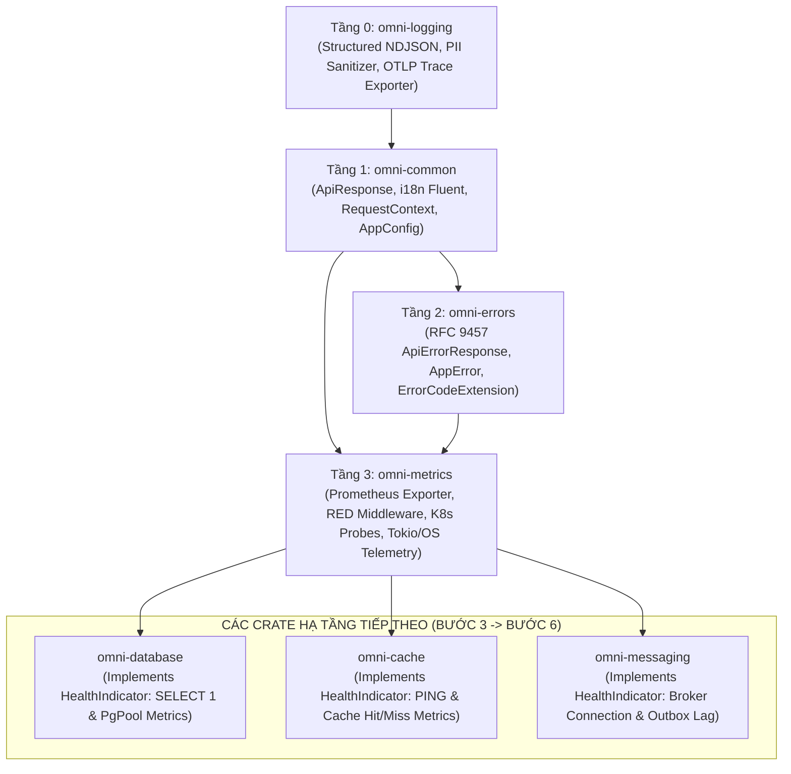
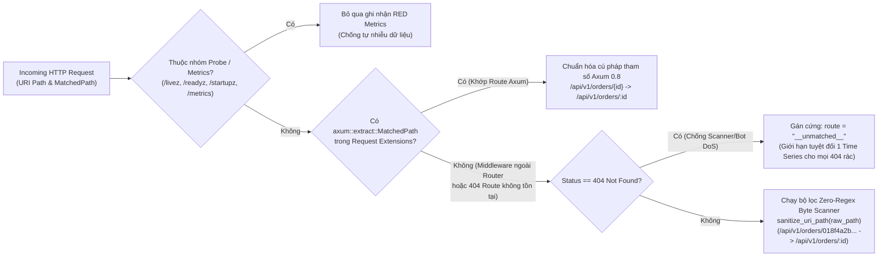

# OmniKubernetes Architecture Specification: Enterprise Metrics Telemetry, RED Middleware & Kubernetes Probes Standard

- **Document Version:** `1.0.0`
- **Status:** Approved / Enterprise Architecture Standard
- **Author:** System Architecture Team
- **Target Platform:** Rust (2024 Edition, Rust 1.85+), Tokio Runtime (1.43+), Axum Framework (0.8+), Prometheus / OpenMetrics, Kubernetes (Kubelet Probes, EndpointSlice, Prometheus Operator, Horizontal Pod Autoscaler)

---

## 1. Executive Summary & Core Principles

Sau khi hoàn thành hai trụ cột quan sát đầu tiên là **Structured Logging** (`omni-logging`) và **Distributed Tracing** (`omni-common::middleware`), cùng nền tảng **Type-Safe Configuration** (`omni-common::config`), hệ sinh thái **OmniKubernetes** cần mảnh ghép thứ ba để khép kín tam giác quan sát (**The Observability Triad**): **Metrics Telemetry & Kubernetes Health Probes (`omni-metrics`)**.

Trong môi trường Kubernetes chịu tải cao, nếu **Logs** trả lời câu hỏi _"Chuyện gì đã xảy ra ở từng bước?"_ và **Traces** trả lời _"Độ trễ nằm ở microservice nào?"_, thì **Metrics** và **Probes** đóng vai trò là **hệ thần kinh tự động hóa (Autonomous Control Loop)** của toàn cụm:

- Quyết định khi nào cần báo động khẩn cấp cho kỹ sư trực vận hành (On-call SRE Alerting theo cam kết SLA/SLO).
- Cung cấp tín hiệu thời gian thực để Kubernetes **Horizontal Pod Autoscaler (HPA)** tự động nhân bản thêm Pod khi lưu lượng tăng đột biến.
- Điều khiển **Kubernetes Kubelet** và **Envoy Gateway / EndpointSlice Controller** tự động cô lập các Pod đang bị mất kết nối cơ sở dữ liệu hoặc tự động khởi động lại các Pod bị treo tiến trình.

Tiêu chuẩn kiến trúc này xác lập **6 nguyên lý cốt lõi (Core Architectural Tenets)** cho crate `libs/metrics` (`omni-metrics`):

1. **Chuẩn hóa Bộ chỉ số RED & Tương thích OpenMetrics (Standardized RED Telemetry):**
   - Mọi microservice HTTP/REST khởi chạy trên Axum bắt buộc xuất bản bộ chỉ số **RED (Rate - Errors - Duration)** cộng thêm chỉ số tải tức thời (**In-Flight Requests**) theo đúng quy ước đặt tên và đơn vị cơ sở của Prometheus (`_total`, `_seconds`, `_bytes`).
   - Sử dụng **Prometheus Histograms** với dải bucket chuẩn hóa thay vì Summaries, cho phép tổng hợp phân vị chính xác (`p50`, `p95`, `p99`) xuyên suốt hàng chục Pod replicas bằng hàm `histogram_quantile()` trên PromQL.
2. **Bảo vệ Tuyệt đối Chống Bùng nổ Số chiều (Strict Low-Cardinality Guardrails):**
   - **Cardinality Explosion** (nổ bùng tổ hợp nhãn do gắn UUID, User ID hoặc URL thô vào metric labels) là nguyên nhân số 1 gây sập máy chủ Prometheus (OOM) trong thực tế.
   - Thiết lập cơ chế chuẩn hóa đường dẫn 2 tầng: Trích xuất mẫu route tĩnh qua `axum::extract::MatchedPath` kết hợp bộ lọc **Zero-Regex Byte Scanner (`sanitize_uri_path`)** tự động quy đổi mọi UUIDv4/v7, ULID, ID có tiền tố (`usr_...`, `ord_...`), chuỗi Hex, số nguyên về `:id`, đồng thời gom toàn bộ các đường dẫn `404 Not Found` không khớp route về nhãn cố định `"__unmatched__"`.
3. **Phân loại Lỗi Nghiệp vụ Không Đọc Lại Body (Zero-Copy Error Code Attribution):**
   - Tích hợp trực tiếp với `omni-errors` (`ApiErrorResponse` & `AppError`) thông qua cơ chế đính kèm siêu dữ liệu kiểu tĩnh `ErrorCodeExtension` vào `axum::response::Response::extensions()`.
   - Cho phép `red_metrics_middleware` ghi nhận chính xác mã lỗi nghiệp vụ (`ERR_VALIDATION_FAILED`, `ERR_UNAUTHORIZED`, `ERR_RATE_LIMITED`, `ERR_INTERNAL_SERVER`, v.v.) vào counter `http_request_errors_total` với **chi phí cấp phát bằng 0** (không bao giờ phải đọc hay giải mã lại luồng JSON Response Body).
4. **Phân tách Cô lập 3 Đầu dò Kubernetes (Tri-Probe Isolation & Anti-Cascading Restart):**
   - Phân định rạch ròi trách nhiệm của 3 endpoints theo chuẩn Kubernetes:
     - **`GET /livez` (Liveness Probe):** Chỉ kiểm tra sự sống của tiến trình và khả năng lập lịch của Tokio Reactor (thông qua `tokio::task::yield_now()` và Watchdog Heartbeat). **Tuyệt đối không kiểm tra Database/Redis** tại `/livez` nhằm ngăn chặn thảm họa khởi động lại dây chuyền (**Cascading Restart / Thundering Herd**) khi hạ tầng lưu trữ chập chờn.
     - **`GET /readyz` (Readiness Probe):** Kiểm tra thực tế, chạy song song có giới hạn thời gian (`tokio::time::timeout`) toàn bộ các phụ thuộc hạ tầng cốt lõi (`HealthIndicator` cho PostgreSQL, Redis, Message Broker) kết hợp cổng chặn **Graceful Shutdown Drain Gate** (chủ động trả về `503 Service Unavailable` ngay khi nhận tín hiệu `SIGTERM` để rút Pod khỏi `EndpointSlice` trước khi đóng kết nối).
     - **`GET /startupz` (Startup Probe):** Bảo vệ các dịch vụ cần thời gian khởi tạo ban đầu dài (chạy SQLx migrations, nạp bộ đệm i18n/cache) khỏi bị `livenessProbe` giết nhầm trước khi tiến trình sẵn sàng.
5. **Quản lý Bộ nhớ Bền vững & Tự động Dọn dẹp (RAII In-Flight Guard & Background Upkeep):**
   - Sử dụng mẫu **RAII Drop Guard (`InFlightGuard`)** để đảm bảo chỉ số `http_requests_in_flight` luôn được giảm trừ chính xác ngay cả khi Client ngắt kết nối giữa chừng (Future cancellation), hết hạn Timeout hoặc xảy ra Panic.
   - Tự động khởi chạy tác vụ nền gọi `PrometheusHandle::run_upkeep()` định kỳ mỗi 5 giây để xả các bộ đệm `AtomicBucket` của Histogram, ngăn chặn triệt để lỗi rò rỉ bộ nhớ dẫn tới `OOMKilled` (Exit Code 137) khi máy chủ Prometheus tạm thời ngừng thu thập dữ liệu.
6. **Thu thập Chỉ số Hệ thống & Tokio Runtime Không Mã `unsafe` (Zero-`unsafe` Runtime & Process Telemetry):**
   - Tuân thủ nghiêm ngặt quy định `unsafe_code = "deny"` trên toàn workspace và hỗ trợ kiểm thử song song cô lập (`metrics::with_local_recorder`).
   - Kết hợp API ổn định của `tokio::runtime::RuntimeMetrics` (`num_workers`, `num_alive_tasks`, `global_queue_depth`, `worker_total_busy_duration`, `worker_park_count`) với trình đọc `/proc/self/*` thuần Rust an toàn trên Linux container và cơ chế fallback mượt mà trên macOS (Local Dev).

---

## 2. Scope of Applicability & Workspace Dependency Architecture

### 2.1. Nằm trong phạm vi (In-Scope)

- **Crate nền tảng `libs/metrics` (`omni-metrics`):**
  - Bộ khởi tạo Prometheus Exporter (`PrometheusBuilder`, `PrometheusHandle`, `MetricsConfig`) hỗ trợ cả chế độ Global Singleton idempotent lẫn Isolated Recorder cho kiểm thử tự động.
  - Middleware đo lường `red_metrics_middleware` và bộ chuẩn hóa đường dẫn chống bùng nổ nhãn `sanitize_uri_path`.
  - Hệ thống Kubernetes Probes (`/livez`, `/readyz`, `/startupz`, `/healthz`), trait mở rộng `HealthIndicator`, bộ điều phối kiểm tra song song `HealthRegistry`, và cổng điều khiển trạng thái `ProbeState` (Startup & Graceful Shutdown Drain).
  - Bộ thu thập chỉ số Tokio Runtime và tài nguyên tiến trình hệ điều hành (`spawn_system_metrics_collector`).
- **Tích hợp Liên Crate (Cross-Crate Integration):**
  - **`libs/errors` (`omni-errors`):** Đính kèm `ErrorCodeExtension` vào `Response::extensions()` bên trong `IntoResponse for ApiErrorResponse` để truyền mã lỗi `code` sang `omni-metrics` không cần đọc lại body.
  - **`libs/common` (`omni-common`):** Cập nhật hàm `is_health_probe_path` trong `middleware::observability` để bao gồm `/startupz` (đảm bảo cả 3 đầu dò Kubernetes đều được miễn trừ khỏi APM Root Span và Access Log), đồng thời cung cấp phương thức cầu nối từ `AppConfig` sang `MetricsConfig`.

### 2.2. Sơ đồ Phụ thuộc Kiến trúc (Acyclic Crate Dependency Graph)

Thiết kế tuân thủ cấu trúc phân lớp một chiều (Directed Acyclic Graph), đảm bảo các crate hạ tầng phía sau (`omni-database`, `omni-cache`, `omni-messaging`) có thể trực tiếp triển khai trait `HealthIndicator` và phát sinh metrics nội bộ mà không gây phụ thuộc vòng:



---

## 3. Standards & Compliance References

| Tiêu chuẩn / Đặc tả kỹ thuật                             | Cơ quan ban hành      | Ứng dụng cụ thể trong hệ thống OmniKubernetes                                                                                             |
| :------------------------------------------------------- | :-------------------- | :---------------------------------------------------------------------------------------------------------------------------------------- |
| **OpenMetrics 1.0 & Prometheus Exposition Format 0.0.4** | CNCF / Prometheus     | Định dạng xuất văn bản `/metrics` (`text/plain; version=0.0.4; charset=utf-8`), quy chuẩn hậu tố `_total`, `_seconds`, `_bytes`.          |
| **Google SRE Book (The Four Golden Signals)**            | Google SRE            | Giám sát toàn diện 4 tín hiệu vàng: Latency (Độ trễ), Traffic (Lưu lượng), Errors (Tỷ lệ lỗi), và Saturation (Mức độ bão hòa tài nguyên). |
| **RED & USE Telemetry Methodologies**                    | Brendan Gregg / Weave | Phương pháp RED (Rate, Errors, Duration) cho tầng dịch vụ HTTP và phương pháp USE (Utilization, Saturation, Errors) cho Tokio/OS.         |
| **Kubernetes Container Probes Specification (v1.32+)**   | CNCF / Kubernetes     | Chuẩn hóa hành vi `livenessProbe` (`/livez`), `readinessProbe` (`/readyz`), `startupProbe` (`/startupz`) và `EndpointSlice` draining.     |
| **OpenTelemetry Semantic Conventions for Metrics**       | CNCF / OpenTelemetry  | Đồng bộ ngữ nghĩa nhãn phân loại (`method`, `route`, `status_code`, `error_code`, `service`, `environment`).                              |
| **Rust 2024 Edition Safety & Pedantic Standard**         | Rust Project          | Đảm bảo `unsafe_code = "deny"`, không xung đột biến toàn cục khi chạy `cargo test --all` đa luồng.                                        |

---

## 4. Prometheus Metric Exposition & RED Telemetry Architecture

### 4.1. Sơ đồ Luồng Xử lý RED Middleware & Vòng đời Bộ nhớ Histogram

```mermaid
sequenceDiagram
    autonumber
    participant Client as Client / Envoy Gateway
    participant ObsMW as observability_middleware<br/>(omni-common)
    participant RedMW as red_metrics_middleware<br/>(omni-metrics)
    participant Handler as Axum Router & Handler<br/>(Business Logic / AppError)
    participant Recorder as PrometheusRecorder<br/>(Lock-Free Atomic Storage)
    participant Upkeep as Background Upkeep & System Task<br/>(Every 5s)
    participant Prom as Prometheus Server / Scraper

    Client->>ObsMW: HTTP Request (e.g., POST /api/v1/orders/0192d4b8...)
    Note over ObsMW: Nếu path thuộc (/livez, /readyz, /startupz, /metrics)<br/>-> Bỏ qua APM Span & Access Log
    ObsMW->>RedMW: Forward Request + RequestContext
    Note over RedMW: 1. Giải quyết route mẫu (MatchedPath hoặc sanitize_uri_path)<br/>2. Khởi tạo InFlightGuard -> gauge!("http_requests_in_flight").increment(1.0)<br/>3. Ghi mốc thời gian Instant::now()
    RedMW->>Handler: next.run(req).await
    alt Thành công (HTTP 2xx / 3xx)
        Handler-->>RedMW: Response (Status 201 Created)
    else Lỗi Nghiệp vụ hoặc Hệ thống (HTTP 4xx / 5xx)
        Handler-->>RedMW: ApiErrorResponse -> Đính kèm ErrorCodeExtension("ERR_VALIDATION_FAILED")
    end
    Note over RedMW: 4. Tính duration = start.elapsed().as_secs_f64()<br/>5. counter!("http_requests_total").increment(1)<br/>6. histogram!("http_request_duration_seconds").record(duration)<br/>7. Nếu status >= 400: trích xuất ErrorCodeExtension<br/>   -> counter!("http_request_errors_total").increment(1)<br/>8. Drop InFlightGuard -> gauge!("http_requests_in_flight").decrement(1.0)
    RedMW->>Recorder: Ghi nhận Atomic Counter / Gauge / AtomicBucket
    RedMW-->>ObsMW: Return Response
    ObsMW-->>Client: HTTP Response (+ X-Request-Id, traceparent, Server-Timing)

    loop Định kỳ mỗi 5 giây (Background Maintenance)
        Upkeep->>Recorder: handle.run_upkeep() (Xả AtomicBucket chống OOM)
        Upkeep->>Recorder: Cập nhật Tokio Runtime & /proc/self/* OS Metrics
    end

    Prom->>Recorder: GET /metrics
    Recorder-->>Prom: 200 OK (text/plain; version=0.0.4; charset=utf-8)
```

### 4.2. Từ điển Chỉ số Chuẩn Toàn Hệ thống (Enterprise Metric Catalog)

Toàn bộ các microservices trong **OmniKubernetes** tự động đính kèm 2 nhãn toàn cục (**Global Labels**) vào mọi chỉ số thông qua `PrometheusBuilder::add_global_label`:

- `service`: Tên định danh của microservice (ví dụ: `"order-service"`, lấy từ `config.service.name`).
- `environment`: Môi trường vận hành (`"dev"`, `"staging"`, `"prod"`, lấy từ `config.service.environment`).

Bảng dưới đây quy định danh mục chỉ số chuẩn bắt buộc do `omni-metrics` phát hành:

| Tên Metric (Prometheus Name)                     | Kiểu (Type) |  Đơn vị   | Nhãn (Labels)                                                 | Mô tả & Mục đích Vận hành (SRE / HPA / Alerting)                                                                                      |
| :----------------------------------------------- | :---------: | :-------: | :------------------------------------------------------------ | :------------------------------------------------------------------------------------------------------------------------------------ |
| **`omni_build_info`**                            |   `Gauge`   |  `count`  | `version`, `rust_version`                                     | Luôn mang giá trị `1.0`. Dùng để đối chiếu phiên bản binary đang chạy trên từng Pod và phát hiện lệch phiên bản khi rollout.          |
| **`http_requests_total`**                        |  `Counter`  |  `count`  | `method`, `route`, `status_code`                              | **[RED - Rate]** Tổng số HTTP requests đã xử lý. Dùng tính RPS (`rate(http_requests_total[1m])`) và làm tín hiệu co giãn cho HPA.     |
| **`http_request_errors_total`**                  |  `Counter`  |  `count`  | `method`, `route`, `status_code`, `error_code`, `error_class` | **[RED - Errors]** Tổng số HTTP requests thất bại (`status >= 400`), phân loại chi tiết theo mã lỗi `omni-errors` và lớp `4xx`/`5xx`. |
| **`http_request_duration_seconds`**              | `Histogram` | `seconds` | `method`, `route`, `status_code`                              | **[RED - Duration]** Phân bố thời gian xử lý HTTP request. Dùng tính phân vị độ trễ `p50`, `p90`, `p95`, `p99` và SLO Apdex.          |
| **`http_requests_in_flight`**                    |   `Gauge`   |  `count`  | `method`, `route`                                             | **[Saturation]** Số lượng request đang được xử lý đồng thời tại thời điểm hiện tại. Phát hiện nghẽn cổ chai hoặc slowloris.           |
| **`k8s_readiness_dependency_status`**            |   `Gauge`   |  `state`  | `dependency`, `criticality`                                   | Trạng thái sức khỏe của từng phụ thuộc hạ tầng (`1.0` = Healthy, `0.0` = Unhealthy) trong lần kiểm tra `/readyz` gần nhất.            |
| **`k8s_readiness_check_duration_seconds`**       | `Histogram` | `seconds` | `dependency`                                                  | Độ trễ phản hồi ping/healthcheck của từng phụ thuộc hạ tầng (PostgreSQL, Redis, Broker), giúp phát hiện suy giảm mạng sớm.            |
| **`tokio_runtime_workers_count`**                |   `Gauge`   | `threads` | _(Global labels only)_                                        | Số lượng worker threads được cấp phát cho Tokio multi-threaded runtime.                                                               |
| **`tokio_runtime_alive_tasks`**                  |   `Gauge`   |  `tasks`  | _(Global labels only)_                                        | Số lượng async tasks (`tokio::spawn`) đang tồn tại trong runtime. Tăng liên tục không giảm là dấu hiệu rò rỉ task (Task Leak).        |
| **`tokio_runtime_global_queue_depth`**           |   `Gauge`   |  `tasks`  | _(Global labels only)_                                        | Số lượng tasks đang xếp hàng chờ trong Global Injection Queue. Giá trị `> 0` kéo dài báo hiệu **Thread Pool Saturation**.             |
| **`tokio_runtime_worker_busy_duration_seconds`** |   `Gauge`   | `seconds` | `worker`                                                      | Tổng thời gian tích lũy (giây) mà từng worker thread (`0..N`) bận thực thi tác vụ. Dùng tính `% CPU Saturation` của Tokio reactor.    |
| **`tokio_runtime_worker_park_count_total`**      |   `Gauge`   |  `count`  | `worker`                                                      | Tổng số lần worker thread chuyển sang trạng thái nghỉ (park) chờ công việc mới.                                                       |
| **`tokio_watchdog_Check_lag_seconds`**           |   `Gauge`   | `seconds` | _(Global labels only)_                                        | Độ trễ lập lịch thực tế của Tokio Watchdog timer (chênh lệch giữa thời gian thức dậy thực tế và chu kỳ kỳ vọng).                      |
| **`process_resident_memory_bytes`**              |   `Gauge`   |  `bytes`  | _(Global labels only)_                                        | Dung lượng bộ nhớ vật lý thực tế đang sử dụng (**Memory RSS**). Dùng cảnh báo nguy cơ chạm trần `resources.limits.memory` (OOM).      |
| **`process_virtual_memory_bytes`**               |   `Gauge`   |  `bytes`  | _(Global labels only)_                                        | Dung lượng bộ nhớ ảo (`VmSize`) của tiến trình.                                                                                       |
| **`process_cpu_seconds_total`**                  |   `Gauge`   | `seconds` | _(Global labels only)_                                        | Tổng thời gian CPU (User + System mode) mà tiến trình đã tiêu thụ kể từ khi khởi chạy.                                                |
| **`process_open_fds`**                           |   `Gauge`   |   `fds`   | _(Global labels only)_                                        | Số lượng File Descriptors (sockets, files, pipes) đang mở.                                                                            |
| **`process_max_fds`**                            |   `Gauge`   |   `fds`   | _(Global labels only)_                                        | Giới hạn tối đa File Descriptors (`RLIMIT_NOFILE`) của container. Dùng tính tỷ lệ `process_open_fds / process_max_fds`.               |
| **`process_threads`**                            |   `Gauge`   | `threads` | _(Global labels only)_                                        | Tổng số luồng hệ điều hành (OS Threads: Tokio workers + blocking pool + logging appender + OTel batcher) của tiến trình.              |
| **`process_uptime_seconds`**                     |   `Gauge`   | `seconds` | _(Global labels only)_                                        | Thời gian sống liên tục của tiến trình tính bằng giây kể từ lúc hoàn tất Bootstrap.                                                   |

### 4.3. Thiết kế Dải Bucket Chuẩn cho Histogram (`HTTP_DURATION_BUCKETS`)

Theo mặc định, nếu không cấu hình `set_buckets` hoặc `set_buckets_for_metric`, thư viện `metrics-exporter-prometheus` sẽ xuất các phép đo `histogram!()` dưới dạng **Prometheus Summary** (các phân vị `quantile="0.5"`, `quantile="0.99"` được tính cục bộ trên từng Pod).
Tuy nhiên, trong môi trường Kubernetes nhiều Pod replica, **Summary không thể cộng gộp về mặt toán học** (trung bình cộng các p99 của 10 Pod không phải là p99 của toàn dịch vụ!).

Do đó, `omni-metrics` bắt buộc cấu hình `PrometheusBuilder` sử dụng **Native Prometheus Histograms** với 11 mốc chia (buckets) trải rộng từ **5 mili-giây đến 10 giây**:

```rust
/// Dải bucket chuẩn (đơn vị: giây) cho độ trễ HTTP/gRPC Request (từ 5ms đến 10s).
pub const HTTP_DURATION_BUCKETS: [f64; 11] = [
    0.005, // 5ms   - Truy vấn in-memory / Redis cache hit cực nhanh
    0.010, // 10ms  - Truy vấn SQL đơn giản theo Primary Key
    0.025, // 25ms  - Mục tiêu p50 chuẩn cho API nội bộ
    0.050, // 50ms  - Xử lý giao dịch có 2-3 câu lệnh SQL / gRPC call
    0.100, // 100ms - Ngưỡng p95 mục tiêu cho các API nghiệp vụ chính
    0.250, // 250ms - Ngưỡng bắt đầu cảnh báo truy vấn chậm (Slow Query threshold = 200ms)
    0.500, // 500ms - Ngưỡng p99 tối đa theo cam kết SLA
    1.000, // 1.0s  - Tác vụ nặng (tạo báo cáo, xác thực Argon2, gọi cổng thanh toán ngoài)
    2.500, // 2.5s  - Ngưỡng suy giảm hiệu năng nghiêm trọng
    5.000, // 5.0s  - Ngưỡng chạm trần資料庫 acquire_timeout_secs
    10.00, // 10.0s - Ngưỡng tiệm cận request timeout
];

/// Dải bucket tinh gọn cho các kiểm tra sức khỏe hạ tầng (/readyz ping DB/Redis: 1ms đến 2s).
pub const PROBE_DURATION_BUCKETS: [f64; 8] = [
    0.001, // 1ms
    0.005, // 5ms
    0.010, // 10ms
    0.025, // 25ms
    0.050, // 50ms
    0.100, // 100ms
    0.500, // 500ms
    2.000, // 2.0s
];
```

> [!IMPORTANT]
> **Quy tắc `with_recommended_naming(false)`:**
> Trong `metrics-exporter-prometheus v0.18.3`, cờ `with_recommended_naming` mặc định là `false`. Chúng ta giữ nguyên `false` và đặt tên metric tường minh theo chuẩn Prometheus (`http_requests_total`, `http_request_duration_seconds`). Điều này tránh hiện tượng bộ exporter tự động nối trùng hậu tố thành `http_requests_total_total` hoặc `http_request_duration_seconds_seconds`.

### 4.4. Cơ chế `ErrorCodeExtension`: Liên kết Không Chi phí giữa `omni-errors` và `omni-metrics`

Một bài toán kỹ thuật thực tế thường gặp khi xây dựng RED Middleware trong Axum là:
Khi một Handler trả về `Result<ApiResponse<T>, AppError>`, Axum tự động gọi `IntoResponse::into_response` để biến `AppError` (hoặc `ApiErrorResponse`) thành `axum::response::Response<Body>` trước khi trả quyền điều khiển về cho tầng Middleware. Lúc này, phần thân JSON (`{"type": "...", "code": "ERR_VALIDATION_FAILED", ...}`) đã bị đóng gói thành luồng byte bất đồng bộ (`axum::body::Body`).
Nếu Middleware cố gắng đọc lại `Response::into_body()` để parse JSON lấy trường `code`, hệ thống sẽ chịu chi phí cấp phát bộ nhớ và giải mã JSON hai lần trên mọi request lỗi.

**Giải pháp kiến trúc chuẩn của OmniKubernetes:**

1. Định nghĩa một kiểu dữ liệu mở rộng nhẹ (`Clone`, `Zero-Allocation` với `Cow<'static, str>`) tại `omni-errors`:

   ```rust
   /// Extension đính kèm trong `http::Response::extensions()` mang mã lỗi nghiệp vụ chuẩn.
   #[derive(Debug, Clone, PartialEq, Eq)]
   pub struct ErrorCodeExtension(pub Cow<'static, str>);
   ```

2. Trong `impl IntoResponse for ApiErrorResponse` tại `libs/errors/src/problem.rs`, trước khi trả về `Response`, đính kèm trực tiếp `ErrorCodeExtension(self.code.clone())` vào `response.extensions_mut()`:

   ```rust
   let code_ext = ErrorCodeExtension(self.code.clone());
   let mut response = (status, headers, Json(self)).into_response();
   response.extensions_mut().insert(code_ext);
   response
   ```

3. Tại `red_metrics_middleware` (`omni-metrics`), khi `response.status().as_u16() >= 400`:
   - Middleware đọc `response.extensions().get::<ErrorCodeExtension>()` trong thời gian $O(1)$ mà không chạm vào `Body`.
   - Nếu request bị từ chối ở tầng Router/Tower trước khi vào Handler (ví dụ: Axum Router trả về `404 Not Found` hoặc `405 Method Not Allowed`, hoặc `tower::load_shed` trả về `503 Service Unavailable` mà không qua `ApiErrorResponse`), Middleware tự động ánh xạ `StatusCode` sang hằng số chuẩn của `omni_errors::codes::*` (`404 -> ERR_NOT_FOUND`, `405 -> ERR_METHOD_NOT_ALLOWED`, `429 -> ERR_RATE_LIMITED`, `503 -> ERR_SERVICE_UNAVAILABLE`, `500 -> ERR_INTERNAL_SERVER`).

---

## 5. Low-Cardinality URI Sanitization Engine

### 5.1. Nguy cơ Bùng nổ Số chiều (The Cardinality Bomb Problem)

Trong Prometheus, mỗi tổ hợp giá trị khác nhau của các nhãn (`method`, `route`, `status_code`) tạo ra một **Time Series** độc lập trong bộ nhớ RAM (TSDB Head Block).
Nếu gán trực tiếp `req.uri().path()` vào nhãn `route`:

- 1.000.000 đơn hàng được truy vấn qua `GET /api/v1/orders/0192d4b8-f2e1-7e83-a4c3-b8162e24cf81` sẽ sinh ra **1.000.000 chuỗi thời gian riêng biệt**.
- Một cuộc tấn công quét lỗ hổng (Vulnerability Scanner / Botnet) gửi 500.000 request tới các đường dẫn ngẫu nhiên trả về `404 Not Found` sẽ ngay lập tức đánh sập toàn bộ cụm giám sát Prometheus.

### 5.2. Kiến trúc Chuẩn hóa Đường dẫn 2 Tầng (2-Tier Route Normalization Pipeline)

`omni-metrics` giải quyết triệt để vấn đề này bằng chiến lược 2 tầng kết hợp:



#### Quy tắc nhận diện phân đoạn động trong `sanitize_uri_path` (Zero-Regex, Single-Pass):

Để đạt hiệu năng tối đa trên hot-path (tránh chi phí DFA backtracking của `regex` trên mỗi HTTP request), hàm `sanitize_uri_path(path: &str) -> String` duyệt từng phân đoạn (`segment`) được tách bởi dấu `/` bằng các phép kiểm tra byte ASCII tuần tự ($O(N)$ với $N \le 256$):

| Loại phân đoạn động (Dynamic Segment Pattern)           | Ví dụ đầu vào thực tế                                            | Nhãn chuẩn hóa đầu ra | Quy tắc nhận diện Byte-Level                                                                                   |
| :------------------------------------------------------ | :--------------------------------------------------------------- | :-------------------: | :------------------------------------------------------------------------------------------------------------- |
| **Axum 0.8 Brace Parameter**                            | `{id}`, `{order_id}`, `{*wildcard}`                              |  `:id` / `:order_id`  | Bắt đầu bằng `'{'` và kết thúc bằng `'}'`, chuyển `{name}` thành `:name` để thống nhất toàn hệ thống.          |
| **UUID (v1, v4, v7) & Ruled Hex**                       | `018f4a2b-8a5e-7a1b`, `0192d4b8-f2e1-7e83-a4c3-b8162e24cf81`     |         `:id`         | Chứa chỉ các ký tự hex (`0-9`, `a-f`, `A-F`) và dấu `'-'`, có ít nhất 1 dấu `'-'` và độ dài $\ge 8$ ký tự.     |
| **Số nguyên thuần túy (Numeric ID)**                    | `12345`, `9876543210`                                            |         `:id`         | 100% ký tự là chữ số ASCII (`b'0'..=b'9`), loại trừ tiền tố phiên bản API (`v1`, `v2`, `v3`).                  |
| **Định danh có Tiền tố Nghiệp vụ (Prefixed Domain ID)** | `usr_01HZX87Q1K7`, `ord_998123`, `pay_a1b2c3d4`                  |         `:id`         | Có dạng `prefix_suffix` trong đó phần `suffix` sau dấu `'_'` cuối cùng chứa chữ số hoặc dài $\ge 8$ ký tự.     |
| **ULID (26 ký tự Crockford Base32) & Chuỗi Hex dài**    | `01ARZ3NDEKTSV4RRFFQ69G5FAV`, `4bf92f3577b34da6a3ce929d0e0e4736` |         `:id`         | Độ dài $\ge 16$ ký tự chỉ gồm chữ-số và chứa ít nhất 2 chữ số ASCII, hoặc 100% là ký tự Hex dài $\ge 16$.      |
| **Chuỗi Token / Base64 / phân đoạn quá dài**            | `eyJhbGciOiJIUzI1NiIsInR5cCI6...`                                |       `:param`        | Độ dài phân đoạn $> 32$ ký tự hoặc chứa ký tự hỗn hợp chữ-số kèm chữ hoa/thường lẫn chữ số có độ dài $\ge 12$. |

Ngoài ra, bộ lọc áp dụng trần bảo vệ **최대 8 phân đoạn (Max 8 Segments)**: nếu một URI có nhiều hơn 8 cấp `/a/b/c/...`, phần đuôi dư thừa sẽ bị cắt gọn thành `/:rest` để ngăn chặn tấn công tạo đường dẫn sâu vô hạn.

---

## 6. Kubernetes Tri-Probe Architecture (`/livez`, `/readyz`, `/startupz`)

### 6.1. Sơ đồ Phối hợp Vòng đời Pod & 3 Đầu dò Kubernetes

```mermaid
stateDiagram-v2
    [*] --> Bootstrapping: Pod Container Started

    state Bootstrapping {
        [*] --> RunningMigrations: AppConfig::load() & init_logging()
        RunningMigrations --> WarmingUpCache: sqlx::migrate!() & I18n Bundles
        WarmingUpCache --> MarkReady: probe_state.mark_startup_complete()
        note right of RunningMigrations
            /startupz -> 503 Service Unavailable
            (Kubelet tạm hoãn Liveness & Readiness)
        end note
    }

    Bootstrapping --> ServingTraffic: /startupz returns 200 OK

    state ServingTraffic {
        Healthy --> DependencyDegraded: DB / Redis Ping Timeout hoặc Lỗi
        DependencyDegraded --> Healthy: DB / Redis Phục hồi kết nối
        note right of Healthy
            /livez   -> 200 OK (Tokio Reactor Active)
            /readyz  -> 200 OK (All Critical Deps Healthy)
            Pod nằm trong EndpointSlice nhận Traffic
        end note
        note left of DependencyDegraded
            /livez   -> 200 OK (KHÔNG restart Pod!)
            /readyz  -> 503 Service Unavailable
            Kubelet rút Pod khỏi EndpointSlice
        end note
    }

    ServingTraffic --> GracefulDraining: Nhận tín hiệu SIGTERM từ Kubelet
    ServingTraffic --> Deadlocked: Tokio Worker Threads Treo > Stall Threshold

    state GracefulDraining {
        [*] --> StopNewTraffic: probe_state.begin_shutdown()
        StopNewTraffic --> DrainInFlight: /readyz trả về 503 ("draining") ngay lập tức
        DrainInFlight --> FlushTelemetry: Chờ http_requests_in_flight == 0 (max 15s)
        FlushTelemetry --> [*]: Đóng PgPool, Flush Logs/Spans & Exit 0
    }

    state Deadlocked {
        [*] --> KillPod: /livez trả về 503 Service Unavailable
        KillPod --> [*]: Kubelet gửi SIGKILL & Khởi tạo lại Container
    }
```

### 6.2. Đặc tả Chi tiết Từng Đầu dò (Probe Specifications)

#### 1. `GET /livez` (và bí danh `/healthz`) — Liveness Probe

- **Mục tiêu:** Xác nhận tiến trình Rust còn sống và bộ lập lịch Tokio Runtime không bị rơi vào trạng thái Deadlock hoặc Starvation toàn cục (ví dụ: do lập trình viên vô tình gọi hàm đồng bộ chặn đứng toàn bộ worker threads).
- **Cơ chế Kiểm tra Thực chất (Active Reactor Yield + Watchdog Heartbeat Verification):**
  1. Gọi `tokio::task::yield_now().await`: Buộc tác vụ hiện tại nhường CPU về cuối hàng đợi của Tokio worker và chờ được lập lịch lại. Nếu worker thread vẫn hoạt động bình thường, lệnh này hoàn tất trong $< 10\mu s$.
  2. Kiểm tra dấu thời gian nhịp tim (`last_heartbeat_epoch_ms: AtomicU64`) được cập nhật mỗi 1 giây bởi tác vụ nền `system_metrics_collector`. Nếu khoảng cách từ nhịp tim cuối cùng đến thời điểm hiện tại vượt quá ngưỡng `liveness_stall_threshold_secs` (mặc định `15 giây`), chứng tỏ bộ lập lịch thời gian (Tokio Timer Wheel / Reactor) đã bị tê liệt $\rightarrow$ trả về `503 Service Unavailable`.
- **Cam kết Kiến trúc:** Tuyệt đối không thực hiện bất kỳ lệnh gọi mạng (Network I/O) nào tới PostgreSQL, Redis hay dịch vụ bên ngoài trong `/livez`.

#### 2. `GET /readyz` — Readiness Probe

- **Mục tiêu:** Xác nhận Pod đã sẵn sàng tiếp nhận HTTP/gRPC traffic từ người dùng và có đầy đủ kết nối tới các hạ tầng lưu trữ cốt lõi.
- **Quy trình Kiểm tra 3 Bước:**
  1. **Kiểm tra trạng thái Khởi động & Hạ cánh (`ProbeState`):**
     - Nếu tiến trình chưa hoàn tất khởi động (`!probe_state.is_startup_complete()`) $\rightarrow$ Trả về ngay `503 Service Unavailable` (`status: "starting"`).
     - Nếu tiến trình đã nhận tín hiệu `SIGTERM` (`probe_state.is_shutting_down()`) $\rightarrow$ Trả về ngay `503 Service Unavailable` (`status: "draining"`). Cơ chế này giúp tích hợp hoàn hảo với **Bước 7 (Graceful Shutdown)**: ngay khi Kubelet bắt đầu quy trình tắt Pod, `/readyz` lập tức báo đỏ để Envoy Gateway / kube-proxy ngừng đẩy request mới vào Pod trước khi đóng cổng TCP.
  2. **Thực thi Song song các `HealthIndicator` với Timeout Cứng:**
     - Toàn bộ các `HealthIndicator` đã đăng ký trong `HealthRegistry` (ví dụ: `postgres`, `redis`, `rabbitmq`) được kích hoạt **đồng thời** qua `futures::future::join_all`.
     - Mỗi phép kiểm tra được bọc trong `tokio::time::timeout(per_check_timeout)` (mặc định `1500ms`). Nếu một cơ sở dữ liệu bị treo gói tin mạng, nó sẽ bị ngắt đúng ở mốc `1500ms` và đánh dấu `Unhealthy` thay vì làm treo toàn bộ request `/readyz` vượt quá `timeoutSeconds` của Kubelet.
  3. **Tổng hợp Kết quả theo Mức độ Trọng yếu (`DependencyCriticality`):**
     - **`Critical` (Mặc định cho Primary Database, Core Redis):** Nếu bất kỳ phụ thuộc `Critical` nào thất bại hoặc timeout $\rightarrow$ `/readyz` trả về **`503 Service Unavailable`** (`status: "unhealthy"`).
     - **`NonCritical` (Dành cho dịch vụ phụ trợ không bắt buộc):** Nếu chỉ có phụ thuộc `NonCritical` thất bại còn mọi phụ thuộc `Critical` đều tốt $\rightarrow$ `/readyz` vẫn trả về **`200 OK`** nhưng mang trạng thái `"degraded"`, đồng thời cập nhật metric `k8s_readiness_dependency_status{dependency="...", criticality="non_critical"} = 0.0` để cảnh báo cho SRE mà không làm gián đoạn dịch vụ chính.

#### 3. `GET /startupz` — Startup Probe

- **Mục tiêu:** Tách biệt thời gian khởi động ban đầu khỏi chu kỳ kiểm tra của `livenessProbe`.
- **Hành vi:**
  - Khi tiến trình vừa bật và đang chạy migrations hoặc nạp dữ liệu khởi tạo: trả về `503 Service Unavailable` (`status: "starting"`).
  - Ngay khi hàm `probe_state.mark_startup_complete()` được gọi (hoặc mặc định `true` khi khởi tạo ở chế độ tiêu chuẩn): trả về `200 OK` (`status: "healthy"`).

### 6.3. Hợp đồng Dữ liệu JSON của Kubernetes Probes (`ProbeResponse`)

Mọi phản hồi từ `/livez`, `/readyz`, `/startupz` đều đính kèm header `Cache-Control: no-store, no-cache, must-revalidate` (ngăn chặn các lớp proxy trung gian lưu đệm kết quả kiểm tra sức khỏe) và trả về cấu trúc JSON minh bạch:

```json
{
  "status": "healthy",
  "service": "order-service",
  "version": "0.1.0",
  "uptime_seconds": 86420,
  "timestamp": "2026-11-02T06:30:00.123456Z",
  "checks": {
    "postgres": {
      "status": "healthy",
      "criticality": "critical",
      "latency_ms": 1.42
    },
    "redis": {
      "status": "healthy",
      "criticality": "critical",
      "latency_ms": 0.65
    }
  }
}
```

Khi một phụ thuộc cốt lõi gặp sự cố (trả về HTTP `503 Service Unavailable`):

```json
{
  "status": "unhealthy",
  "service": "order-service",
  "version": "0.1.0",
  "uptime_seconds": 86450,
  "timestamp": "2026-11-02T06:30:30.512000Z",
  "checks": {
    "postgres": {
      "status": "unhealthy",
      "criticality": "critical",
      "latency_ms": 1500.08,
      "message": "Health check timed out after 1500ms"
    },
    "redis": {
      "status": "healthy",
      "criticality": "critical",
      "latency_ms": 0.58
    }
  }
}
```

---

## 7. System & Tokio Runtime Telemetry Specification

### 7.1. Giám sát Độ Bão hòa Tokio Runtime (Tokio Reactor Saturation)

Trong các dịch vụ bất đồng bộ viết bằng Rust, chỉ số CPU của hệ điều hành đôi khi chưa phản ánh hết tình trạng nghẽn: một hàm vô tình gọi tác vụ tính toán đồng bộ hoặc khóa `std::sync::Mutex` lâu trên Tokio worker thread có thể làm tê liệt khả năng phản hồi của ứng dụng dù tổng CPU toàn máy chỉ mới ở mức 40%.

Sử dụng API ổn định của `tokio::runtime::Handle::current().metrics()` (hỗ trợ sẵn trên mọi kiến trúc 64-bit mà **không cần** cờ biên dịch `tokio_unstable`), `omni-metrics` thu thập:

1. **`tokio_runtime_workers_count`:** Tổng số worker threads (`metrics.num_workers()`).
2. **`tokio_runtime_alive_tasks`:** Tổng số task đang sống (`metrics.num_alive_tasks()`).
3. **`tokio_runtime_global_queue_depth`:** Độ sâu hàng đợi toàn cục (`metrics.global_queue_depth()`).
4. **`tokio_runtime_worker_busy_duration_seconds{worker="0..N"}`:** Thời gian bận tích lũy của từng worker (`metrics.worker_total_busy_duration(i).as_secs_f64()`).
   - Từ chỉ số này, trên Grafana/Prometheus ta tính được **Tỷ lệ Bão hòa thực tế của từng Tokio Worker Thread** bằng công thức PromQL:
     $$\text{Worker Utilization (\%)} = \text{rate}(\text{tokio\_runtime\_worker\_busy\_duration\_seconds}[1\text{m}]) \times 100$$
5. **`tokio_runtime_worker_park_count_total{worker="0..N"}`:** Số lần worker chuyển sang trạng thái nghỉ (`metrics.worker_park_count(i)`).
6. **`tokio_watchdog_check_lag_seconds`:** Đo độ trễ lập lịch bằng cách so sánh khoảng thời gian thực tế trôi qua (`Instant::elapsed()`) của vòng lặp `tokio::time::sleep(interval)` so với `interval` kỳ vọng. Nếu vòng lặp ngủ `5.000s` nhưng mất `5.250s` mới được đánh thức, độ trễ lập lịch là `0.250s` (250ms) — dấu hiệu rõ ràng cho thấy Tokio Reactor đang bị quá tải nặng.

### 7.2. Thu thập Tài nguyên Tiến trình Không Dùng Mã `unsafe` (Zero-`unsafe` `/proc/self` Reader)

Vì toàn bộ workspace thực thi chính sách `unsafe_code = "deny"`, `omni-metrics` không gọi các hàm FFI C (`libc::getrusage` hay `libc::sysconf`). Thay vào đó, trên môi trường **Linux Container (Kubernetes Production)**, thư viện đọc trực tiếp từ hệ thống tập tin ảo `/proc/self/` trong nhân Linux bằng `std::fs`:

| Tập tin nhân Linux (`/proc/self/*`) | Trường dữ liệu trích xuất                    | Công thức chuyển đổi chuẩn                                                      | Metric đích tương ứng                                                                    |
| :---------------------------------- | :------------------------------------------- | :------------------------------------------------------------------------------ | :--------------------------------------------------------------------------------------- |
| `/proc/self/status`                 | `VmRSS:` (kB), `VmSize:` (kB), `Threads:`    | $\text{Bytes} = \text{Giá trị kB} \times 1024$                                  | `process_resident_memory_bytes`<br/>`process_virtual_memory_bytes`<br/>`process_threads` |
| `/proc/self/stat`                   | Trường `utime` (#14) và `stime` (#15)        | $\text{Seconds} = \frac{\text{utime} + \text{stime}}{100.0\ (\text{USER\_HZ})}$ | `process_cpu_seconds_total`                                                              |
| `/proc/self/fd`                     | `std::fs::read_dir("/proc/self/fd").count()` | Đếm số lượng descriptor đang mở trong thư mục                                   | `process_open_fds`                                                                       |
| `/proc/self/limits`                 | Dòng `Max open files` (Soft Limit)           | Parse giá trị giới hạn cột Soft Limit                                           | `process_max_fds`                                                                        |

Trên môi trường **macOS / Non-Linux (Local Development)** nơi không tồn tại `/proc/self/`, bộ thu thập tự động chuyển sang chế độ Fallback an toàn: vẫn cập nhật đầy đủ 100% các chỉ số `tokio_runtime_*`, `tokio_watchdog_check_lag_seconds`, `process_uptime_seconds`, `omni_build_info` mà không phát sinh bất kỳ lỗi hay cảnh báo nào.

---

## 8. Comprehensive Rust Implementation Specification (`libs/metrics`)

### 8.1. Tổ chức Cây thư mục trong `libs/metrics`

```text
libs/metrics/
├── Cargo.toml
└── src/
    ├── lib.rs             <-- Public API re-exports & crate documentation
    ├── config.rs          <-- MetricsConfig, ProbeConfig & AppConfig bridge
    ├── error.rs           <-- MetricsError enum (thiserror)
    ├── exporter.rs        <-- PrometheusBuilder setup, global/isolated recorder, /metrics router
    ├── sanitizer.rs       <-- Low-cardinality URI path sanitizer (Zero-Regex Byte Scanner)
    ├── middleware.rs      <-- Axum RED metrics middleware & RAII InFlightGuard
    ├── probes.rs          <-- HealthIndicator trait, HealthRegistry, ProbeState, /livez /readyz /startupz
    └── system.rs          <-- Tokio RuntimeMetrics, Watchdog Heartbeat & Linux /proc/self collector
```

### 8.2. Khai báo Phụ thuộc `libs/metrics/Cargo.toml`

Tắt `default-features` của `metrics-exporter-prometheus` để loại bỏ hoàn toàn các nhánh phụ thuộc không cần thiết (`push-gateway`, `aws-lc-rs`, `hyper-rustls`), giúp tốc độ biên dịch nhanh và giữ nguyên kiến trúc thuần Rust:

```toml
[package]
name = "omni-metrics"
version.workspace = true
edition.workspace = true
authors.workspace = true
license.workspace = true

[lints]
workspace = true

[dependencies]
async-trait.workspace = true
axum.workspace = true
chrono.workspace = true
futures.workspace = true
metrics.workspace = true
metrics-exporter-prometheus = { workspace = true, default-features = false }
omni-common.workspace = true
omni-errors.workspace = true
serde.workspace = true
serde_json.workspace = true
thiserror.workspace = true
tokio.workspace = true
tracing.workspace = true

[dev-dependencies]
tower.workspace = true
```

### 8.3. Thiết kế Chi tiết Các Module Cốt lõi

#### A. Cấu hình & Cầu nối `AppConfig` (`libs/metrics/src/config.rs`)

```rust
use std::time::Duration;
use omni_common::config::{AppConfig, Validate};
use serde::{Deserialize, Serialize};

/// Cấu hình khởi tạo hệ thống Prometheus Metrics, Kubernetes Probes và System Telemetry.
#[derive(Debug, Clone, Serialize, Deserialize)]
pub struct MetricsConfig {
    /// Tên dịch vụ gắn vào nhãn toàn cục `service`.
    pub service_name: String,
    /// Phiên bản dịch vụ gắn vào metric `omni_build_info`.
    pub service_version: String,
    /// Môi trường vận hành (`dev`, `staging`, `prod`) gắn vào nhãn toàn cục `environment`.
    pub environment: String,
    /// Bật/tắt phục vụ endpoint `/metrics`.
    pub enabled: bool,
    /// Đường dẫn HTTP phục vụ Prometheus scraping (mặc định: `"/metrics"`).
    pub metrics_path: String,
    /// Chu kỳ chạy tác vụ nền `run_upkeep()` và thu thập chỉ số hệ thống (mặc định: 5 giây).
    pub upkeep_interval: Duration,
    /// Thời gian chờ tối đa cho mỗi `HealthIndicator` khi kiểm tra `/readyz` (mặc định: 1500ms).
    pub readiness_probe_timeout: Duration,
    /// Ngưỡng thời gian tối đa cho phép Tokio Watchdog không phản hồi trước khi `/livez` báo lỗi (mặc định: 15 giây).
    pub liveness_stall_threshold: Duration,
}

impl Default for MetricsConfig {
    fn default() -> Self {
        Self {
            service_name: "omni-service".to_string(),
            service_version: env!("CARGO_PKG_VERSION").to_string(),
            environment: "dev".to_string(),
            enabled: true,
            metrics_path: "/metrics".to_string(),
            upkeep_interval: Duration::from_secs(5),
            readiness_probe_timeout: Duration::from_millis(1500),
            liveness_stall_threshold: Duration::from_secs(15),
        }
    }
}

impl MetricsConfig {
    /// Khởi tạo `MetricsConfig` trực tiếp từ `AppConfig<C>` của `omni-common`.
    #[must_use]
    pub fn from_app_config<C: Validate>(app_config: &AppConfig<C>) -> Self {
        Self {
            service_name: app_config.service.name.clone(),
            service_version: app_config.service.version.clone(),
            environment: app_config.service.environment.as_str().to_string(),
            enabled: app_config.observability.metrics_enabled,
            metrics_path: app_config.observability.metrics_path.clone(),
            ..Self::default()
        }
    }
}
```

#### B. Bộ Chuẩn hóa Đường dẫn Chống Bùng nổ Nhãn (`libs/metrics/src/sanitizer.rs`)

````rust
use std::borrow::Cow;

/// Nhãn cố định dùng cho mọi request 404 không khớp với bất kỳ route nào đã đăng ký.
pub const UNMATCHED_ROUTE_LABEL: &str = "__unmatched__";

/// Giới hạn số lượng phân đoạn đường dẫn tối đa để ngăn chặn tấn công URI sâu bất thường.
const MAX_URI_SEGMENTS: usize = 8;

/// Chuẩn hóa mẫu route từ `axum::extract::MatchedPath` (ví dụ chuyển `/api/v1/orders/{id}` thành `/api/v1/orders/:id`).
#[must_use]
pub fn normalize_matched_path(matched_path: &str) -> Cow<'static, str> {
    if !matched_path.contains('{') {
        return Cow::Owned(matched_path.to_string());
    }

    let mut out = String::with_capacity(matched_path.len());
    for (idx, segment) in matched_path.split('/').enumerate() {
        if idx > 0 {
            out.push('/');
        }
        if let Some(inner) = segment.strip_prefix('{').and_then(|s| s.strip_suffix('}')) {
            let clean_name = inner.strip_prefix('*').unwrap_or(inner);
            out.push(':');
            out.push_str(if clean_name.is_empty() { "id" } else { clean_name });
        } else {
            out.push_str(segment);
        }
    }
    Cow::Owned(out)
}

/// Chuẩn hóa đường dẫn URI thô bằng thuật toán quét byte một lượt (Zero-Regex) để bảo vệ Prometheus khỏi Cardinality Explosion.
///
/// Chuyển đổi các tham số động như UUIDv4/v7, ULID, số nguyên, chuỗi Hex dài, hoặc ID có tiền tố (`usr_...`, `ord_...`)
/// về dạng chuẩn `:id`.
///
/// # Examples
/// ```
/// use omni_metrics::sanitizer::sanitize_uri_path;
///
/// assert_eq!(
///     sanitize_uri_path("/api/v1/orders/018f4a2b-8a5e-7a1b"),
///     "/api/v1/orders/:id"
/// );
/// assert_eq!(
///     sanitize_uri_path("/api/v2/users/usr_01HZX87Q1K7/invoices/987654"),
///     "/api/v2/users/:id/invoices/:id"
/// );
/// ```
#[must_use]
pub fn sanitize_uri_path(raw_path: &str) -> String {
    let path_only = raw_path.split('?').next().unwrap_or("/");
    let trimmed = path_only.trim();
    if trimmed.is_empty() || trimmed == "/" {
        return "/".to_string();
    }

    let mut normalized = String::with_capacity(trimmed.len().min(128));
    let mut segment_count = 0usize;

    for segment in trimmed.split('/').filter(|s| !s.is_empty()) {
        if segment_count >= MAX_URI_SEGMENTS {
            normalized.push_str("/:rest");
            break;
        }
        segment_count += 1;
        normalized.push('/');

        if let Some(inner) = segment.strip_prefix('{').and_then(|s| s.strip_suffix('}')) {
            let clean_name = inner.strip_prefix('*').unwrap_or(inner);
            normalized.push(':');
            normalized.push_str(if clean_name.is_empty() { "id" } else { clean_name });
        } else if segment.starts_with(':') && segment.len() > 1 {
            normalized.push_str(segment);
        } else if is_dynamic_identifier_segment(segment) {
            normalized.push_str(":id");
        } else {
            normalized.push_str(segment);
        }
    }

    if normalized.is_empty() {
        "/".to_string()
    } else {
        normalized
    }
}

/// Kiểm tra một phân đoạn đường dẫn có phải là định danh động (ID, UUID, ULID, Hex, Số nguyên, Token) hay không.
#[inline]
fn is_dynamic_identifier_segment(segment: &str) -> bool {
    let bytes = segment.as_bytes();
    let len = bytes.len();

    if len == 0 {
        return false;
    }

    // 1. Giữ nguyên các tiền tố phiên bản API chuẩn (v1, v2, ..., v99)
    if (len == 2 || len == 3)
        && (bytes[0] == b'v' || bytes[0] == b'V')
        && bytes[1..].iter().all(u8::is_ascii_digit)
    {
        return false;
    }

    // 2. Phân đoạn quá dài (> 32 ký tự, ví dụ JWT, SHA256, Base64 token)
    if len > 32 {
        return true;
    }

    // 3. Số nguyên thuần túy (ví dụ: /orders/123456)
    if bytes.iter().all(u8::is_ascii_digit) {
        return true;
    }

    // 4. UUID hoặc chuỗi Hex phân tách bằng dấu gạch ngang (ví dụ: 018f4a2b-8a5e-7a1b)
    let hyphen_count = bytes.iter().filter(|&&b| b == b'-').count();
    if hyphen_count >= 1
        && len >= 8
        && bytes
            .iter()
            .all(|&b| b.is_ascii_hexdigit() || b == b'-')
    {
        return true;
    }

    // 5. Chuỗi Hex liên tục dài >= 16 ký tự (ví dụ: Trace ID, MongoDB ObjectId 24-hex)
    if len >= 16 && bytes.iter().all(u8::is_ascii_hexdigit) {
        return true;
    }

    // 6. Định danh có tiền tố nghiệp vụ (ví dụ: usr_01HZX87Q1K7, ord_98765, tx_a1b2c3d4)
    if let Some(underscore_pos) = segment.rfind('_') {
        let suffix = &bytes[underscore_pos + 1..];
        let suffix_has_digit = suffix.iter().any(u8::is_ascii_digit);
        if !suffix.is_empty() && (suffix_has_digit || suffix.len() >= 8) {
            return true;
        }
    }

    // 7. ULID (26 ký tự) hoặc chuỗi ngẫu nhiên kết hợp chữ và số dài >= 10 ký tự
    let digit_count = bytes.iter().filter(|&&b| b.is_ascii_digit()).count();
    if len >= 10 && digit_count >= 2 && bytes.iter().all(u8::is_ascii_alphanumeric) {
        return true;
    }

    false
}
````

#### C. Bộ Middleware Đo lường RED & RAII `InFlightGuard` (`libs/metrics/src/middleware.rs`)

```rust
use std::{borrow::Cow, time::Instant};
use axum::{
    body::Body,
    extract::{MatchedPath, Request},
    http::StatusCode,
    middleware::Next,
    response::Response,
};
use metrics::{counter, gauge, histogram};
use omni_common::middleware::is_health_probe_path;
use omni_errors::{
    codes::{
        ERR_BAD_REQUEST, ERR_CONFLICT, ERR_FORBIDDEN, ERR_INTERNAL_SERVER,
        ERR_METHOD_NOT_ALLOWED, ERR_NOT_FOUND, ERR_RATE_LIMITED, ERR_SERVICE_UNAVAILABLE,
        ERR_UNAUTHORIZED, ERR_VALIDATION_FAILED,
    },
    problem::ErrorCodeExtension,
};

use crate::sanitizer::{UNMATCHED_ROUTE_LABEL, normalize_matched_path, sanitize_uri_path};

/// Tên các chỉ số RED chuẩn hóa.
pub const METRIC_HTTP_REQUESTS_TOTAL: &str = "http_requests_total";
pub const METRIC_HTTP_REQUEST_ERRORS_TOTAL: &str = "http_request_errors_total";
pub const METRIC_HTTP_REQUEST_DURATION_SECONDS: &str = "http_request_duration_seconds";
pub const METRIC_HTTP_REQUESTS_IN_FLIGHT: &str = "http_requests_in_flight";

/// RAII Guard bảo đảm chỉ số `http_requests_in_flight` luôn được giảm trừ chính xác
/// ngay cả khi Future bị hủy (Client disconnect / Timeout) hoặc Handler gặp Panic.
struct InFlightGuard {
    method: String,
    route: String,
}

impl InFlightGuard {
    fn new(method: String, route: String) -> Self {
        gauge!(
            METRIC_HTTP_REQUESTS_IN_FLIGHT,
            "method" => method.clone(),
            "route" => route.clone()
        )
        .increment(1.0);
        Self { method, route }
    }
}

impl Drop for InFlightGuard {
    fn drop(&mut self) {
        gauge!(
            METRIC_HTTP_REQUESTS_IN_FLIGHT,
            "method" => self.method.clone(),
            "route" => self.route.clone()
        )
        .decrement(1.0);
    }
}

/// Axum Middleware thu thập bộ chỉ số RED (Rate, Errors, Duration) và In-Flight Requests.
pub async fn red_metrics_middleware(req: Request<Body>, next: Next) -> Response {
    let raw_path = req.uri().path();

    // 1. Bỏ qua các endpoint hạ tầng (/livez, /readyz, /startupz, /healthz, /metrics)
    if is_health_probe_path(raw_path) {
        return next.run(req).await;
    }

    let method = req.method().as_str().to_string();

    // 2. Trích xuất MatchedPath nếu có sẵn, hoặc chuẩn hóa sơ bộ cho InFlightGuard
    let matched_route = req
        .extensions()
        .get::<MatchedPath>()
        .map(|mp| normalize_matched_path(mp.as_str()).into_owned());

    let in_flight_route = matched_route
        .clone()
        .unwrap_or_else(|| sanitize_uri_path(raw_path));

    // 3. Kích hoạt RAII Guard đếm số request đang xử lý đồng thời
    let _in_flight_guard = InFlightGuard::new(method.clone(), in_flight_route.clone());
    let start_instant = Instant::now();

    // 4. Thực thi chuỗi Middleware & Handler phía sau
    let response = next.run(req).await;

    // 5. Tính toán thời lượng thực thi (đơn vị: giây) và mã trạng thái HTTP
    let duration_secs = start_instant.elapsed().as_secs_f64();
    let status = response.status();
    let status_code_str = status.as_u16().to_string();

    // 6. Chốt nhãn route cuối cùng: Nếu không khớp route nào (MatchedPath == None) và trả về 404,
    // gán vào "__unmatched__" để chống tấn công quét URL ngẫu nhiên (404 Cardinality DoS).
    let final_route: Cow<'static, str> = match matched_route {
        Some(route) => Cow::Owned(route),
        None if status == StatusCode::NOT_FOUND => Cow::Borrowed(UNMATCHED_ROUTE_LABEL),
        None => Cow::Owned(in_flight_route),
    };

    // 7. Ghi nhận Rate (Counter) và Duration (Histogram)
    counter!(
        METRIC_HTTP_REQUESTS_TOTAL,
        "method" => method.clone(),
        "route" => final_route.clone(),
        "status_code" => status_code_str.clone()
    )
    .increment(1);

    histogram!(
        METRIC_HTTP_REQUEST_DURATION_SECONDS,
        "method" => method.clone(),
        "route" => final_route.clone(),
        "status_code" => status_code_str.clone()
    )
    .record(duration_secs);

    // 8. Ghi nhận Errors (Counter) nếu HTTP Status >= 400
    if status.is_client_error() || status.is_server_error() {
        let error_code: Cow<'static, str> = response
            .extensions()
            .get::<ErrorCodeExtension>()
            .map(|ext| ext.0.clone())
            .unwrap_or_else(|| Cow::Borrowed(fallback_error_code_for_status(status)));

        let error_class: &'static str = if status.is_server_error() {
            "5xx"
        } else {
            "4xx"
        };

        counter!(
            METRIC_HTTP_REQUEST_ERRORS_TOTAL,
            "method" => method,
            "route" => final_route,
            "status_code" => status_code_str,
            "error_code" => error_code,
            "error_class" => error_class
        )
        .increment(1);
    }

    response
}

/// Ánh xạ dự phòng từ HTTP `StatusCode` sang mã lỗi chuẩn của `omni-errors` khi lỗi phát sinh ngoài `ApiErrorResponse`.
#[inline]
const fn fallback_error_code_for_status(status: StatusCode) -> &'static str {
    match status.as_u16() {
        400 => ERR_BAD_REQUEST,
        401 => ERR_UNAUTHORIZED,
        403 => ERR_FORBIDDEN,
        404 => ERR_NOT_FOUND,
        405 => ERR_METHOD_NOT_ALLOWED,
        409 => ERR_CONFLICT,
        422 => ERR_VALIDATION_FAILED,
        429 => ERR_RATE_LIMITED,
        503 => ERR_SERVICE_UNAVAILABLE,
        _ => ERR_INTERNAL_SERVER,
    }
}
```

#### D. Hệ thống Kubernetes Probes & `HealthRegistry` (`libs/metrics/src/probes.rs`)

```rust
use std::{
    collections::BTreeMap,
    sync::{
        Arc, RwLock,
        atomic::{AtomicBool, AtomicU64, Ordering},
    },
    time::{Duration, Instant, SystemTime, UNIX_EPOCH},
};
use async_trait::async_trait;
use axum::{
    Json, Router,
    extract::State,
    http::{HeaderMap, HeaderValue, StatusCode, header},
    response::{IntoResponse, Response},
    routing::get,
};
use chrono::{DateTime, Utc};
use futures::future::join_all;
use metrics::{gauge, histogram};
use serde::{Deserialize, Serialize};

/// Mức độ trọng yếu của một phụ thuộc hạ tầng đối với khả năng phục vụ của Pod.
#[derive(Debug, Clone, Copy, PartialEq, Eq, Serialize, Deserialize)]
#[serde(rename_all = "snake_case")]
pub enum DependencyCriticality {
    /// Phụ thuộc sống còn (ví dụ: Primary PostgreSQL, Core Redis). Nếu lỗi -> `/readyz` trả về `503`.
    Critical,
    /// Phụ thuộc thứ cấp (ví dụ: dịch vụ gợi ý phụ trợ). Nếu lỗi -> `/readyz` trả về `200` với trạng thái `"degraded"`.
    NonCritical,
}

impl DependencyCriticality {
    #[must_use]
    pub const fn as_str(self) -> &'static str {
        match self {
            Self::Critical => "critical",
            Self::NonCritical => "non_critical",
        }
    }
}

/// Trạng thái sức khỏe tổng thể hoặc của từng thành phần.
#[derive(Debug, Clone, Copy, PartialEq, Eq, Serialize, Deserialize)]
#[serde(rename_all = "lowercase")]
pub enum HealthStatus {
    Healthy,
    Degraded,
    Unhealthy,
    Starting,
    Draining,
}

/// Trait chuẩn cho mọi bộ kiểm tra kết nối hạ tầng (`omni-database`, `omni-cache`, `omni-messaging`).
#[async_trait]
pub trait HealthIndicator: Send + Sync + 'static {
    /// Tên định danh của thành phần hạ tầng (ví dụ: `"postgres"`, `"redis"`).
    fn name(&self) -> &'static str;

    /// Mức độ trọng yếu (mặc định là `Critical`).
    fn criticality(&self) -> DependencyCriticality {
        DependencyCriticality::Critical
    }

    /// Thực thi kiểm tra kết nối thực tế (ví dụ: `SELECT 1` hoặc `PING`).
    async fn check(&self) -> Result<(), String>;
}

/// Kết quả kiểm tra chi tiết của từng phụ thuộc hạ tầng trong `/readyz`.
#[derive(Debug, Clone, Serialize, Deserialize)]
pub struct ComponentHealthReport {
    pub status: HealthStatus,
    pub criticality: DependencyCriticality,
    pub latency_ms: f64,
    #[serde(skip_serializing_if = "Option::is_none")]
    pub message: Option<String>,
}

/// Cấu trúc phản hồi JSON chuẩn cho các endpoints `/livez`, `/readyz`, `/startupz`.
#[derive(Debug, Clone, Serialize, Deserialize)]
pub struct ProbeResponse {
    pub status: HealthStatus,
    pub service: String,
    pub version: String,
    pub uptime_seconds: u64,
    pub timestamp: DateTime<Utc>,
    #[serde(skip_serializing_if = "BTreeMap::is_empty", default)]
    pub checks: BTreeMap<String, ComponentHealthReport>,
}

/// Quản lý trạng thái vòng đời khởi động, hạ cánh an toàn (Drain) và nhịp tim Watchdog của Pod.
#[derive(Debug)]
pub struct ProbeState {
    startup_complete: AtomicBool,
    shutting_down: AtomicBool,
    last_watchdog_heartbeat_ms: AtomicU64,
    started_at: Instant,
    liveness_stall_threshold: Duration,
}

impl ProbeState {
    /// Khởi tạo `ProbeState`. Mặc định `startup_complete = true` cho các service không cần pha khởi tạo trễ.
    #[must_use]
    pub fn new(startup_complete: bool, liveness_stall_threshold: Duration) -> Self {
        Self {
            startup_complete: AtomicBool::new(startup_complete),
            shutting_down: AtomicBool::new(false),
            last_watchdog_heartbeat_ms: AtomicU64::new(current_epoch_ms()),
            started_at: Instant::now(),
            liveness_stall_threshold,
        }
    }

    /// Đánh dấu tiến trình đã hoàn tất pha khởi động (Migrations / Cache Warmup).
    pub fn mark_startup_complete(&self) {
        self.startup_complete.store(true, Ordering::Release);
    }

    /// Kích hoạt chế độ hạ cánh an toàn (khi nhận `SIGTERM`), buộc `/readyz` trả về `503` ngay lập tức.
    pub fn begin_shutdown(&self) {
        self.shutting_down.store(true, Ordering::Release);
    }

    /// Cập nhật nhịp tim từ Tokio Watchdog background task.
    pub fn record_watchdog_heartbeat(&self) {
        self.last_watchdog_heartbeat_ms
            .store(current_epoch_ms(), Ordering::Release);
    }

    /// Kiểm tra nhịp tim Watchdog có còn nằm trong ngưỡng an toàn hay không.
    #[must_use]
    pub fn is_watchdog_healthy(&self) -> bool {
        let last = self.last_watchdog_heartbeat_ms.load(Ordering::Acquire);
        let now = current_epoch_ms();
        let elapsed_ms = now.saturating_sub(last);
        elapsed_ms <= u64::try_from(self.liveness_stall_threshold.as_millis()).unwrap_or(15_000)
    }
}

#[inline]
fn current_epoch_ms() -> u64 {
    SystemTime::now()
        .duration_since(UNIX_EPOCH)
        .map(|d| u64::try_from(d.as_millis()).unwrap_or(u64::MAX))
        .unwrap_or(0)
}
```

---

## 9. Kubernetes Production Manifests, Prometheus Scraping & Alerting Rules

### 9.1. Cấu hình Kubernetes `Deployment` Chuẩn với 3 Đầu dò & Graceful Drain

Dưới đây là cấu hình chuẩn thực tế cho một microservice trong **OmniKubernetes** triển khai trên cụm Kubernetes, kết hợp `startupProbe`, `livenessProbe`, `readinessProbe` và `preStop` lifecycle hook để đạt **Zero-Downtime Rolling Update**:

```yaml
apiVersion: apps/v1
kind: Deployment
metadata:
  name: order-service
  namespace: omni-ecommerce
  labels:
    app.kubernetes.io/name: order-service
    app.kubernetes.io/part-of: omnikubernetes
spec:
  replicas: 3
  strategy:
    type: RollingUpdate
    rollingUpdate:
      maxSurge: 1
      maxUnavailable: 0
  selector:
    matchLabels:
      app.kubernetes.io/name: order-service
  template:
    metadata:
      labels:
        app.kubernetes.io/name: order-service
      annotations:
        prometheus.io/scrape: "true"
        prometheus.io/port: "8080"
        prometheus.io/path: "/metrics"
    spec:
      terminationGracePeriodSeconds: 30
      containers:
        - name: order-service
          image: ghcr.io/nqhxdev/omnikubernetes/order-service:0.1.0
          ports:
            - name: http
              containerPort: 8080
              protocol: TCP
            - name: grpc
              containerPort: 50051
              protocol: TCP
          # 1. Startup Probe: Cho phép tối đa 30s (15 * 2s) để chạy SQLx Migrations & nạp i18n
          startupProbe:
            httpGet:
              path: /startupz
              port: http
            periodSeconds: 2
            timeoutSeconds: 1
            failureThreshold: 15
          # 2. Liveness Probe: Chỉ kiểm tra Tokio Reactor, tuyệt đối không gọi DB
          livenessProbe:
            httpGet:
              path: /livez
              port: http
            periodSeconds: 10
            timeoutSeconds: 2
            failureThreshold: 3
          # 3. Readiness Probe: Kiểm tra DB/Redis (< 1.5s) và cổng chặn Graceful Shutdown
          readinessProbe:
            httpGet:
              path: /readyz
              port: http
            periodSeconds: 5
            timeoutSeconds: 2
            successThreshold: 1
            failureThreshold: 2
          resources:
            requests:
              cpu: "250m"
              memory: "128Mi"
            limits:
              cpu: "1000m"
              memory: "512Mi"
```

### 9.2. Cấu hình Prometheus Operator `PodMonitor` & Cảnh báo SRE (`PrometheusRule`)

```yaml
apiVersion: monitoring.coreos.com/v1
kind: PodMonitor
metadata:
  name: omni-microservices-monitor
  namespace: omni-ecommerce
spec:
  selector:
    matchExpressions:
      - key: app.kubernetes.io/part-of
        operator: Exists
  podMetricsEndpoints:
    - port: http
      path: /metrics
      interval: 15s
      scrapeTimeout: 5s
---
apiVersion: monitoring.coreos.com/v1
kind: PrometheusRule
metadata:
  name: omni-microservices-slo-alerts
  namespace: omni-ecommerce
spec:
  groups:
    - name: omni.red.slo.rules
      rules:
        # 1. Cảnh báo Tỷ lệ lỗi HTTP 5xx vượt quá 1% trong 5 phút
        - alert: OmniHighServerErrorRate5xx
          expr: |
            sum by (service, route) (rate(http_request_errors_total{error_class="5xx"}[5m]))
            /
            clamp_min(sum by (service, route) (rate(http_requests_total[5m])), 1)
            > 0.01
          for: 2m
          labels:
            severity: critical
          annotations:
            summary: "Tỷ lệ lỗi HTTP 5xx cao trên dịch vụ {{ $labels.service }} (route {{ $labels.route }})"

        # 2. Cảnh báo Độ trễ p99 vượt quá ngưỡng SLA 500ms
        - alert: OmniHighP99Latency
          expr: |
            histogram_quantile(
              0.99,
              sum by (le, service, route) (rate(http_request_duration_seconds_bucket[5m]))
            ) > 0.500
          for: 5m
          labels:
            severity: warning
          annotations:
            summary: "Độ trễ p99 vượt ngưỡng 500ms trên {{ $labels.service }} ({{ $labels.route }})"

        # 3. Cảnh báo Bão hòa Hàng đợi Tokio Runtime
        - alert: OmniTokioRuntimeQueueSaturation
          expr: tokio_runtime_global_queue_depth > 64 or tokio_watchdog_check_lag_seconds > 0.100
          for: 1m
          labels:
            severity: warning
          annotations:
            summary: "Tokio Runtime trên {{ $labels.service }} có dấu hiệu nghẽn luồng xử lý (Thread Pool Saturation)"

        # 4. Cảnh báo Mất kết nối Phụ thuộc Hạ tầng Cốt lõi (DB / Redis)
        - alert: OmniCriticalDependencyUnhealthy
          expr: k8s_readiness_dependency_status{criticality="critical"} == 0
          for: 1m
          labels:
            severity: critical
          annotations:
            summary: "Phụ thuộc trọng yếu {{ $labels.dependency }} của {{ $labels.service }} đang mất kết nối"
```

---

## 10. Verification & Quality Acceptance Criteria

Để nghiệm thu hoàn tất **Bước 2: Metrics Telemetry & Kubernetes Probes** theo [`RoadMap.md`](file:///Users/anhjkr/Developer/OmniKubernetes/RoadMap.md), mã nguồn triển khai tại `libs/metrics`, `libs/errors` và `libs/common` phải vượt qua 100% các tiêu chí kiểm định sau:

1. **Unit Test Bộ lọc Chuẩn hóa Đường dẫn (`sanitize_uri_path` & `normalize_matched_path`):**
   - Chuyển đổi chính xác `/api/v1/orders/018f4a2b-8a5e-7a1b` và `/api/v1/orders/0192d4b8-f2e1-7e83-a4c3-b8162e24cf81` thành `/api/v1/orders/:id`.
   - Chuyển đổi chính xác số nguyên (`/users/42/posts/999` $\rightarrow$ `/users/:id/posts/:id`), ID có tiền tố (`/users/usr_01HZX87Q1K7` $\rightarrow$ `/users/:id`), chuỗi Hex dài và ULID về `:id`, đồng thời bảo toàn nguyên vẹn tiền tố phiên bản `/api/v1`, `/api/v2`.
   - Chuẩn hóa mẫu Axum 0.8 `/api/v1/orders/{id}` thành `/api/v1/orders/:id`.
   - Cắt gọn các đường dẫn vượt quá 8 phân đoạn về hậu tố `/:rest`.
2. **Integration Test RED Middleware & Zero-Copy Error Attribution:**
   - Sử dụng `metrics::with_local_recorder` để kiểm thử song song cô lập 100% không xung đột trạng thái toàn cục.
   - Kiểm chứng request thành công (`200 OK`, `201 Created`) tăng `http_requests_total`, ghi nhận `http_request_duration_seconds_bucket` (với đúng 11 mốc bucket chuẩn), và trả `http_requests_in_flight` về `0` sau khi hoàn tất.
   - Kiểm chứng khi Handler trả về `AppError::ValidationFailed(...)` hoặc `ApiErrorResponse::unauthorized(...)`, chỉ số `http_request_errors_total` được tăng kèm đúng nhãn `error_code="ERR_VALIDATION_FAILED"` / `"ERR_UNAUTHORIZED"` và `error_class="4xx"`.
   - Kiểm chứng các request `404 Not Found` tới URL rác không khớp route được gom toàn bộ về `route="__unmatched__"`.
   - Kiểm chứng các request gọi tới `/livez`, `/readyz`, `/startupz`, `/metrics` không làm tăng bộ đếm `http_requests_total`.
3. **Integration Test Bộ 3 Đầu dò Kubernetes (`/livez`, `/readyz`, `/startupz`):**
   - **`/livez`:** Trả về `200 OK` khi Watchdog khỏe mạnh, và trả về `503 Service Unavailable` nếu Watchdog bị quá hạn ngưỡng `liveness_stall_threshold`.
   - **`/startupz` & `/readyz`:** Khi `startup_complete = false`, cả `/startupz` và `/readyz` đều trả về `503 Service Unavailable` (`status: "starting"`). Sau khi gọi `mark_startup_complete()`, cả hai chuyển sang `200 OK`.
   - **Kiểm tra Phụ thuộc Hạ tầng (`/readyz`):**
     - Khi mọi `HealthIndicator` đều trả về `Ok(())` $\rightarrow$ `200 OK` (`status: "healthy"`).
     - Khi một `HealthIndicator` mức `NonCritical` lỗi $\rightarrow$ vẫn trả về `200 OK` (`status: "degraded"`).
     - Khi một `HealthIndicator` mức `Critical` lỗi hoặc vượt quá `readiness_probe_timeout` $\rightarrow$ trả về `503 Service Unavailable` (`status: "unhealthy"`).
     - Khi gọi `probe_state.begin_shutdown()` (mô phỏng nhận `SIGTERM`) $\rightarrow$ `/readyz` lập tức trả về `503 Service Unavailable` (`status: "draining"`).
4. **Unit & Integration Test System & Tokio Runtime Telemetry:**
   - Kiểm chứng trình thu thập ghi nhận đầy đủ `tokio_runtime_workers_count`, `tokio_runtime_alive_tasks`, `tokio_runtime_global_queue_depth`, `process_uptime_seconds`, `omni_build_info` và trình phân tích `/proc/self/status`, `/proc/self/stat`.
5. **Tuân thủ Tuyệt đối Quality Gate:**
   - Vượt qua `cargo fmt --all -- --check`, `cargo hakari generate --diff`, `cargo clippy --all-targets --all-features -- -D warnings` (0 warnings, `unsafe_code = "deny"`), và `cargo test --all`.
