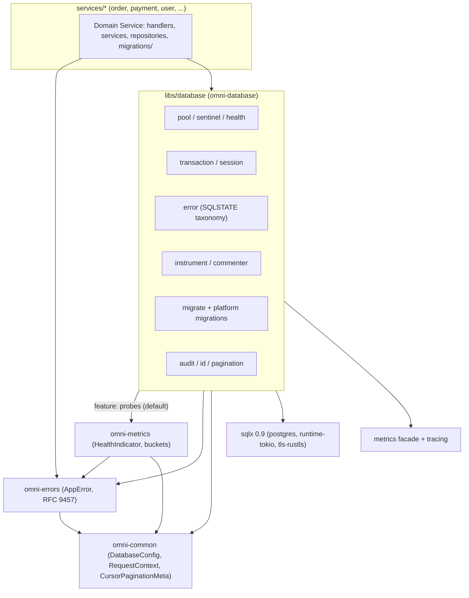
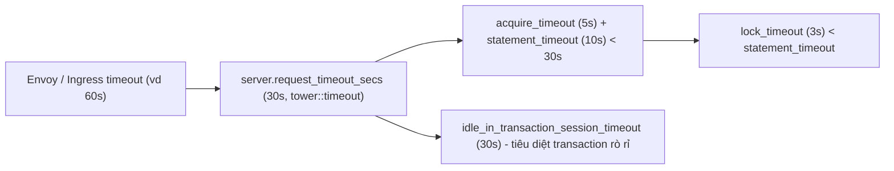
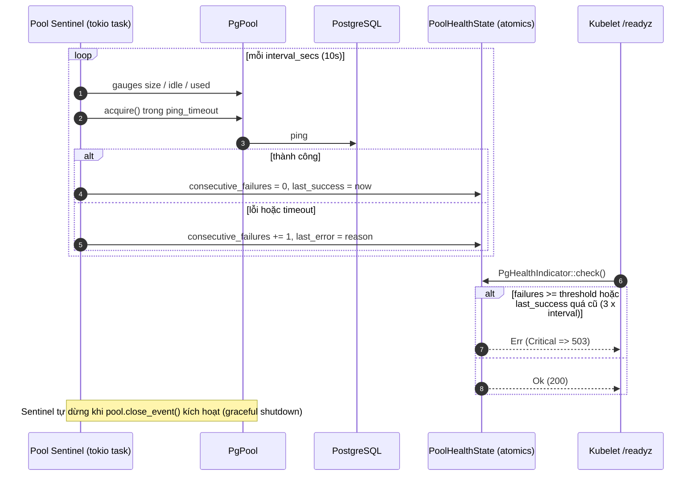
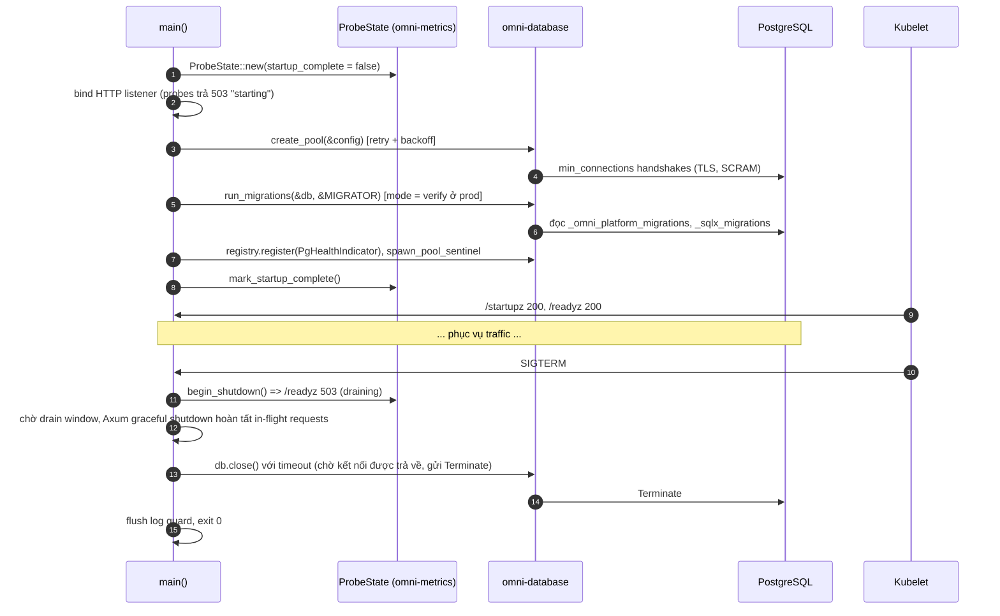
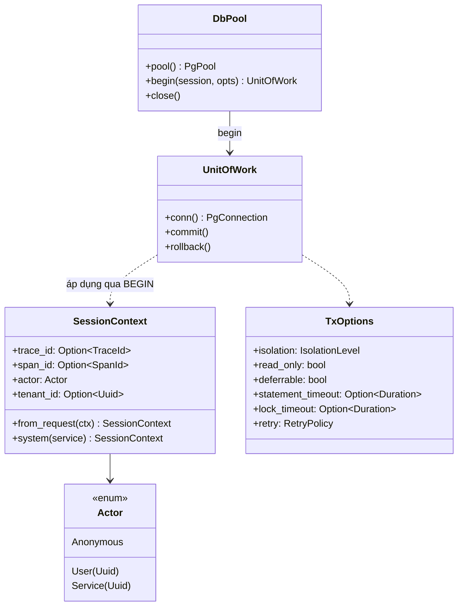

# OmniKubernetes Architecture Specification: Relational Persistence Foundation (`omni-database`)

- **Document Version:** `1.0.0`
- **Status:** Approved / Enterprise Architecture Standard
- **Author:** System Architecture Team
- **Roadmap Step:** Giai đoạn 2 — Bước 3: Relational Persistence Foundation ([`RoadMap.md`](../../RoadMap.md))
- **Target Platform:** Rust (2024 Edition, **Rust 1.94+** — xem §4.2), Tokio (1.43+), Axum (0.8+), **SQLx 0.9**, PostgreSQL 16+ (khuyến nghị 17/18), PgBouncer 1.21+ (tùy chọn), Kubernetes (Jobs, Helm Hooks / Argo CD PreSync, Prometheus Operator)

---

## 1. Executive Summary & Core Principles

Sau khi hoàn tất 4 mốc nền tảng (**Base Response & i18n**, **Structured Logging & Distributed Context**, **Type-Safe Configuration**, **Metrics & Kubernetes Probes**), hệ sinh thái OmniKubernetes bước sang lớp **trạng thái bền vững (Durable State)**. Đây là lớp có rủi ro vận hành cao nhất trong một hệ thống microservices: lỗi ở đây không chỉ gây ra `500`, mà còn gây **mất dữ liệu, dữ liệu sai lệch, cạn kết nối dây chuyền (connection storm)** và **downtime khi rollout**.

Crate `libs/database` (`omni-database`) cung cấp một lớp trừu tượng **mỏng, tường minh và có thể quan sát được** trên SQLx/PostgreSQL. Nó **không phải ORM**: SQL vẫn là ngôn ngữ hạng nhất, được kiểm tra lúc biên dịch qua `sqlx::query!`. Thứ crate cung cấp là **các rào chắn vận hành (operational guardrails)** mà mọi service phải có nhưng không được phép tự viết lại.

Tiêu chuẩn này xác lập **8 nguyên lý cốt lõi**:

1. **SQL-First, Compile-Time Verified, Injection-Proof by Type:**
   - Dùng `sqlx::query!` / `query_as!` cho truy vấn tĩnh (kiểm tra schema lúc build, chế độ offline `.sqlx/` cho CI/Docker).
   - Tận dụng tính năng mới của SQLx 0.9: `SqlSafeStr` chỉ chấp nhận `&'static str`. Mọi SQL động bắt buộc đi qua `AssertSqlSafe(..)` — **chỉ được phép bên trong `omni-database`** (với đầu vào kiểu tĩnh đã xác thực) hoặc qua `QueryBuilder::push_bind`. Mọi `AssertSqlSafe` trong `services/*` phải được review bảo mật.
2. **Bounded Everything (Mọi thứ đều có giới hạn):**
   - Không có thao tác nào được phép chờ vô hạn: `acquire_timeout` (client), `statement_timeout`, `lock_timeout`, `idle_in_transaction_session_timeout` (server), tuân thủ **Timeout Hierarchy** liên kết với `server.request_timeout_secs` (§5.3).
   - Timeout phía client **không hủy** câu lệnh đang chạy trên Postgres (SQLx không gửi `CancelRequest` khi future bị drop) — vì vậy timeout phía server là **bắt buộc**, không phải tùy chọn.
3. **Explicit Unit of Work & Zero-Round-Trip Session Context:**
   - Transaction là ranh giới tường minh (`UnitOfWork` / `with_transaction`). `COMMIT` khi `Ok`, `ROLLBACK` khi `Err`, drop, panic hoặc future bị hủy.
   - Ngữ cảnh phiên (isolation level, timeouts, `trace_id`, `actor_id`, `tenant_id`) được **ghép vào chính câu lệnh `BEGIN`** qua Simple Query Protocol — **chi phí round-trip tăng thêm bằng 0** (§7.2).
4. **Failure Taxonomy by SQLSTATE, Never Leak Internals:**
   - Mọi `sqlx::Error` được phân loại theo SQLSTATE thành `DbError` có ngữ nghĩa (unique violation, serialization failure, pool exhausted...), sau đó ánh xạ sang RFC 9457 `AppError` (`omni-errors`). Tên constraint, câu SQL, thông điệp Postgres **không bao giờ** xuất hiện trong response — chỉ ghi vào log nội bộ có `trace_id`.
5. **Observability by Default (OTel Semantic Conventions):**
   - Span `db.query` theo **OpenTelemetry Database Semantic Conventions (stable)**, bộ chỉ số pool/operation/transaction cho Prometheus, slow query log mức `WARN` mang `trace_id`, và liên kết ngược Postgres → Tempo qua `application_name` (§9).
6. **Kubernetes-Native Lifecycle:**
   - Kết nối có retry/backoff giới hạn khi khởi động, **Pool Sentinel** chạy nền làm keepalive + nguồn dữ liệu cho `/readyz` (không bắn `SELECT 1` vào DB mỗi lần Kubelet probe), đóng pool đúng thứ tự trong Graceful Shutdown.
   - Migration tách khỏi vòng đời Pod trong Production (Kubernetes Job / Helm hook), Pod chỉ **xác minh** (`verify`) schema — hỗ trợ rollback ứng dụng theo mô hình **Expand/Contract** (§10).
7. **Audit & Concurrency Correctness at the Database Layer:**
   - Cột audit chuẩn (`created_at/by`, `updated_at/by`, `deleted_at/by`, `version`) được **database trigger** đóng dấu từ biến phiên `omni.actor_id` — không phụ thuộc vào việc lập trình viên có nhớ gán hay không, đúng cả với `UPDATE` hàng loạt.
   - Optimistic locking bằng cột `version`, nối thẳng ra HTTP `ETag` / `If-Match`.
8. **Zero Hidden Global State & Testability:**
   - Không có pool toàn cục, không task-local ẩn. `DbPool` được truyền qua `AppState`; `SessionContext` được truyền tường minh. Toàn bộ logic thuần (ánh xạ lỗi, sinh câu `BEGIN`, ánh xạ cấu hình) kiểm thử được **không cần Postgres**, để `cargo test --all` luôn xanh trên máy không có DB.

---

## 2. Scope of Applicability & Workspace Dependency Architecture

### 2.1. Nằm trong phạm vi (In-Scope)

| #   | Năng lực                                                                           | Module                                |
| :-- | :--------------------------------------------------------------------------------- | :------------------------------------ |
| 1   | Enterprise PgPool Factory, connect retry, keepalive, Pool Sentinel, health         | `pool.rs`, `sentinel.rs`, `health.rs` |
| 2   | Cầu nối cấu hình `DatabaseConfig` → `PgConnectOptions` / `PgPoolOptions`           | `config.rs`                           |
| 3   | Unit of Work, `with_transaction`, retry cho serialization failure, session context | `transaction.rs`, `session.rs`        |
| 4   | Phân loại lỗi SQLSTATE → `DbError` → `AppError` (RFC 9457)                         | `error.rs`                            |
| 5   | Span OTel, metrics Prometheus, slow query log, trace correlation, sqlcommenter     | `instrument.rs`, `commenter.rs`       |
| 6   | Migration runner (apply / verify / disabled), platform migrations, báo cáo         | `migrate.rs`, `migrations/`           |
| 7   | Mô hình audit dùng chung, `Id<T>` UUIDv7 kiểu tĩnh, soft delete, optimistic lock   | `audit.rs`, `id.rs`                   |
| 8   | Cầu nối keyset pagination sang `CursorPaginationMeta` (`omni-common`)              | `pagination.rs`                       |

### 2.2. Ngoài phạm vi (Out-of-Scope)

- **ORM / Query DSL / Generic Repository\<T\>:** Không xây. Repository là các hàm SQL tường minh trong từng service.
- **Read/Write Splitting & Read Replicas:** Chỉ chừa điểm mở rộng (`pool_name` label, `DbCluster` ở v1.1).
- **Transactional Outbox & `outbox_events`:** Thuộc Bước 6 (`omni-messaging`), nhưng **được thiết kế để cắm vào `UnitOfWork`** của tiêu chuẩn này (cùng transaction).
- **Testcontainers harness:** Thuộc Bước 9. Bước 3 dùng cơ chế gating `OMNI_TEST_DATABASE_URL` (§17).
- **Multi-tenant Row-Level Security:** Chỉ chuẩn bị biến phiên `omni.tenant_id` (§7.2); chính sách RLS sẽ được đặc tả khi có yêu cầu nghiệp vụ.

### 2.3. Sơ đồ Phụ thuộc Kiến trúc (Acyclic Crate Dependency Graph)



> [!IMPORTANT]
> Chiều phụ thuộc bắt buộc: `omni-database → omni-metrics → omni-errors → omni-common`. Không crate nào ở tầng dưới được phép phụ thuộc ngược lên `omni-database`. Vì quy tắc orphan của Rust, `impl From<DbError> for AppError` **phải** nằm trong `omni-database`.

### 2.4. Các điểm điều chỉnh so với văn bản RoadMap (Roadmap Deviations)

Qua phân tích mã nguồn SQLx 0.9 và hiện trạng repo, một số mô tả trong RoadMap cần chuẩn hóa lại để triển khai đúng:

| RoadMap ghi                                                             | Thiết kế chuẩn hóa                                                                                                   | Lý do kỹ thuật                                                                                                                                                                                                                                                                                                                                     |
| :---------------------------------------------------------------------- | :------------------------------------------------------------------------------------------------------------------- | :------------------------------------------------------------------------------------------------------------------------------------------------------------------------------------------------------------------------------------------------------------------------------------------------------------------------------------------------- |
| `run_migrations(&PgPool)`                                               | `run_migrations(&DbPool, &Migrator)`                                                                                 | `sqlx::migrate!("./migrations")` phân giải đường dẫn theo `CARGO_MANIFEST_DIR` của **crate gọi macro**. Thư viện dùng chung không thể nhúng migrations của service; service phải tự khai báo `static MIGRATOR` và truyền vào.                                                                                                                      |
| `with_transaction(pool, \|tx\| async move { ... })`                     | `with_transaction(&db, &session, &opts, \|conn\| Box::pin(async move { ... }))`                                      | Closure trả về future **mượn** `&mut` connection cần HRTB `for<'c> FnOnce(&'c mut PgConnection) -> BoxFuture<'c, _>`. Async closure (`AsyncFnOnce`) chưa cho phép ràng buộc `Send` trên future trả về (Return Type Notation chưa ổn định) — Axum handler cần `Send`. Ngoài ra bổ sung `UnitOfWork` (guard) cho trường hợp không muốn dùng closure. |
| Comment SQL `/* trace_id=... */` cho mọi truy vấn                       | Tầng chính: `SET LOCAL application_name = '<svc>:<trace_id>'` ghép vào `BEGIN`. Sqlcommenter chỉ là chế độ tùy chọn. | SQLx cache prepared statement **theo chuỗi SQL**. Gắn `trace_id` khác nhau vào mỗi câu ⇒ mỗi truy vấn là một cache miss, sinh prepared statement mới trên server (thrash cache, tăng bộ nhớ backend), và không áp dụng được cho `query!` (SQL cố định lúc biên dịch). Chi tiết §9.4.                                                               |
| Span gắn `db.system`, `db.statement`                                    | `db.system.name`, `db.query.text`, `db.operation.name`, `db.collection.name`...                                      | Tuân thủ OpenTelemetry Database Semantic Conventions bản **stable**; tên cũ đã deprecated.                                                                                                                                                                                                                                                         |
| Audit: `id, created_at, updated_at, created_by, updated_by, deleted_at` | Bổ sung `deleted_by` và `version`                                                                                    | `deleted_by` để truy vết soft delete; `version` cho optimistic locking và HTTP `ETag`.                                                                                                                                                                                                                                                             |
| Ping kiểm tra kết nối nền (Keepalive)                                   | Pool Sentinel + `before_acquire` ping có điều kiện + `max_lifetime` có jitter                                        | SQLx 0.9 không cung cấp TCP keepalive phía client trên `PgConnectOptions`. Kết hợp 3 cơ chế để loại bỏ kết nối chết sau NAT/LB idle timeout và failover.                                                                                                                                                                                           |
| `create_pool(&config.database)`                                         | `create_pool(&config)` (nhận `AppConfig<C>`)                                                                         | Cần `service.name` để đặt `application_name` cho Postgres (truy vết trên `pg_stat_activity`), giống cách `MetricsConfig::from_app_config` đang làm.                                                                                                                                                                                                |

---

## 3. Standards & Compliance References

| Tiêu chuẩn                                                               | Tổ chức              | Áp dụng                                                                                                       |
| :----------------------------------------------------------------------- | :------------------- | :------------------------------------------------------------------------------------------------------------ |
| **PostgreSQL Error Codes (Appendix A, SQLSTATE)**                        | PostgreSQL GDG       | Nguồn duy nhất cho phân loại lỗi (§8).                                                                        |
| **PostgreSQL Frontend/Backend Protocol — Simple Query, multi-statement** | PostgreSQL GDG       | Cơ sở cho kỹ thuật ghép `BEGIN; SET LOCAL ...` trong 1 round-trip (§7.2).                                     |
| **OpenTelemetry Semantic Conventions — Database (stable)**               | CNCF / OpenTelemetry | Thuộc tính span & tên metric `db.client.*` (§9).                                                              |
| **W3C Trace Context**                                                    | W3C                  | Định dạng `trace_id` (32 hex) dùng trong `application_name` và sqlcommenter.                                  |
| **Google sqlcommenter specification**                                    | Google / OTel        | Định dạng comment `/*key='value'*/` cho chế độ statement correlation (§9.4).                                  |
| **RFC 9457 Problem Details**                                             | IETF                 | Hợp đồng lỗi trả về client qua `omni-errors`.                                                                 |
| **RFC 9562 (UUID v7)**                                                   | IETF                 | Khóa chính time-ordered, thân thiện B-Tree.                                                                   |
| **RFC 9110 §8.8.3 / §13.1.1 (ETag, If-Match)**                           | IETF                 | Optimistic concurrency end-to-end (§11.6).                                                                    |
| **Nghị định 13/2023/NĐ-CP & GDPR Art. 17**                               | VN Gov / EU          | Soft delete ≠ xóa dữ liệu; bắt buộc có đường anonymize/hard-delete (§11.7). Không ghi PII vào biến phiên/log. |
| **OWASP ASVS v5 — V5 (Injection), V8 (Data Protection)**                 | OWASP                | `SqlSafeStr`, least privilege roles, TLS `verify-full` (§13).                                                 |

---

## 4. Current State & Gap Analysis

### 4.1. Những gì đã có và được tái sử dụng

| Thành phần sẵn có                                                                    | Vị trí                                                      | Cách `omni-database` dùng                                                         |
| :----------------------------------------------------------------------------------- | :---------------------------------------------------------- | :-------------------------------------------------------------------------------- |
| `DatabaseConfig`, `DbSslMode`, `redacted_url()`                                      | [`database.rs`](../../libs/common/src/config/database.rs)   | Nguồn cấu hình duy nhất; mở rộng thêm trường (§5).                                |
| Guardrails `CFG_DB_POOL_BOUNDS`, `CFG_TIMEOUT_HIERARCHY`, `CFG_PROD_SECRET_REQUIRED` | [`config/mod.rs`](../../libs/common/src/config/mod.rs)      | Bổ sung guardrail mới (§5.2).                                                     |
| `RequestContext` (`trace_id`, `span_id`, `user_id`, `tenant_id`)                     | [`context.rs`](../../libs/common/src/middleware/context.rs) | Nguồn của `SessionContext` (§7.2).                                                |
| `CursorPaginationMeta`                                                               | [`response.rs`](../../libs/common/src/response.rs)          | Đích của keyset pagination (§12).                                                 |
| `AppError` / `ApiErrorResponse`                                                      | [`app_error.rs`](../../libs/errors/src/app_error.rs)        | Đích ánh xạ `DbError` (§8).                                                       |
| `HealthIndicator`, `HealthRegistry`, `ProbeState`                                    | [`probes.rs`](../../libs/metrics/src/probes.rs)             | `PgHealthIndicator` cắm vào `/readyz`; migration trước `mark_startup_complete()`. |
| `init_prometheus` + `set_buckets_for_metric`                                         | [`exporter.rs`](../../libs/metrics/src/exporter.rs)         | Đăng ký thêm `DB_DURATION_BUCKETS` (§9.2).                                        |

### 4.2. Các vấn đề phát hiện cần xử lý trước/trong khi triển khai

> [!WARNING]
> **MSRV xung đột:** `sqlx 0.9.0` khai báo `rust-version = "1.94.0"`, trong khi workspace khai báo `rust-version = "1.85"` (và `AGENTS.md`, `RoadMap.md` ghi "Rust 1.85+"). Workspace dùng `resolver = "2"` nên Cargo không tự hạ phiên bản theo MSRV — build bằng toolchain 1.85 sẽ thất bại. Toolchain local hiện là `1.99.1` nên không lộ lỗi. **Đề xuất:** nâng `workspace.package.rust-version = "1.94"` và cập nhật tài liệu tương ứng.

| #   | Vấn đề                                                                                                                                         | Mức độ     | Đề xuất                                                                                                                                                            |
| :-- | :--------------------------------------------------------------------------------------------------------------------------------------------- | :--------- | :----------------------------------------------------------------------------------------------------------------------------------------------------------------- |
| G1  | MSRV 1.85 < 1.94 của SQLx 0.9                                                                                                                  | Cao        | Nâng MSRV workspace lên 1.94.                                                                                                                                      |
| G2  | `DatabaseConfig::connection_url()` nối mật khẩu **không URL-encode** — mật khẩu chứa `@ : / ? #` sẽ làm hỏng URL                               | Cao        | Không dùng URL; dựng `PgConnectOptions` bằng builder (`.host().port().username().password()`). Đánh dấu `connection_url()` là `#[deprecated]` hoặc percent-encode. |
| G3  | Workspace `sqlx` thiếu feature `json`                                                                                                          | Trung bình | Thêm `json` (JSONB cho audit diff, outbox payload ở Bước 6).                                                                                                       |
| G4  | `metrics-exporter-prometheus` render histogram **không có bucket cấu hình thành summary** — không aggregate được qua nhiều Pod                 | Cao        | Thêm `DB_DURATION_BUCKETS` + `Matcher::Prefix("db_client_")` trong `omni-metrics::init_prometheus`.                                                                |
| G5  | `config/prod/default.yaml`: `max_connections: 50`. Với HPA tối đa 10 replica ⇒ 500 kết nối, vượt `max_connections` mặc định (100) của Postgres | Cao        | Áp dụng công thức sizing (§6.6), hạ mặc định prod hoặc bắt buộc PgBouncer.                                                                                         |
| G6  | `DatabaseConfig` thiếu `statement_timeout`, `lock_timeout`, `idle_in_transaction`, CA cert, cấu hình migration riêng                           | Cao        | Mở rộng cấu hình (§5.1).                                                                                                                                           |
| G7  | `uuid` workspace thiếu feature `v5`                                                                                                            | Thấp       | Thêm `v5` để sinh UUID tất định cho service actor (§11.3).                                                                                                         |
| G8  | `AppError::Conflict` không cho phép ghi đè `code` (luôn `ERR_CONFLICT`)                                                                        | Thấp       | Quyết định mở (§21, Q2).                                                                                                                                           |
| G9  | `log` crate chưa có trong workspace deps — SQLx 0.9 dùng `log::LevelFilter` cho `log_slow_statements`, `acquire_slow_level`                    | Thấp       | Thêm `log = "0.4"` (đã có sẵn trong cây phụ thuộc qua SQLx).                                                                                                       |

---

## 5. Configuration Model

### 5.1. `DatabaseConfig` mở rộng (tương thích ngược)

Mọi trường mới có giá trị mặc định an toàn trong `Default` impl, nên các file `config/*.yaml` hiện tại vẫn nạp được. Biến môi trường theo quy ước `OMNI__DATABASE__*`, lồng sâu dùng `__` (ví dụ `OMNI__DATABASE__MIGRATION__MODE`).

```yaml
# config/base.yaml — section database (đề xuất)
database:
  enabled: false
  host: "localhost"
  port: 5432
  username: "omni_user"
  password: "dev_only_password_change_me"
  database_name: "omni_db"
  ssl_mode: "prefer" # disable | prefer | require | verify-ca | verify-full
  ssl_root_cert_path: null # [MỚI] CA bundle cho verify-ca/verify-full (RDS, Cloud SQL, CNPG)
  application_name: null # [MỚI] mặc định = service.name (chuẩn hóa [a-z0-9-], tối đa 30 ký tự)

  # --- Pool ---
  max_connections: 20
  min_connections: 2
  acquire_timeout_secs: 5
  idle_timeout_secs: 300
  max_lifetime_secs: 1800
  max_lifetime_jitter_pct: 10 # [MỚI] rút ngắn ngẫu nhiên 0-10% để tránh reconnect storm đồng loạt
  ping_idle_threshold_secs: 30 # [MỚI] chỉ ping khi kết nối đã idle >= ngưỡng này
  slow_acquire_threshold_ms: 500 # [MỚI] WARN khi chờ mượn kết nối quá lâu
  statement_cache_capacity: 100 # [MỚI] LRU prepared statements / connection

  # --- Server-side timeouts (bắt buộc, xem 5.3) ---
  statement_timeout_ms: 10000 # [MỚI]
  lock_timeout_ms: 3000 # [MỚI]
  idle_in_transaction_timeout_ms: 30000 # [MỚI]

  # --- Observability ---
  slow_query_threshold_ms: 200
  trace_correlation: "transaction" # [MỚI] off | transaction | statement

  # --- Topology ---
  pgbouncer_mode: false # [MỚI] true => không gửi startup param `options` (xem 6.6)

  connect_retry: # [MỚI]
    max_attempts: 10
    initial_backoff_ms: 250
    max_backoff_ms: 5000

  sentinel: # [MỚI]
    interval_secs: 10
    ping_timeout_ms: 1000
    failure_threshold: 3

  auto_migrate: false # [DEPRECATED] alias: true => migration.mode = apply
  migration: # [MỚI]
    mode: "verify" # disabled | apply | verify
    host: null # kết nối trực tiếp Postgres, bỏ qua PgBouncer (advisory lock cần session)
    port: null
    username: null # role DDL riêng (owner schema); null => dùng username runtime
    password: null
    lock_timeout_ms: 5000
    statement_timeout_ms: 0 # 0 = không giới hạn (backfill dài); vẫn chịu activeDeadlineSeconds của Job
```

Khuyến nghị theo môi trường:

| Trường                 | `dev`       | `staging`             | `prod`                                                    |
| :--------------------- | :---------- | :-------------------- | :-------------------------------------------------------- |
| `ssl_mode`             | `prefer`    | `require`             | `verify-full` (+ `ssl_root_cert_path`)                    |
| `migration.mode`       | `apply`     | `apply` hoặc `verify` | `verify` (Job áp dụng migration, §10.4)                   |
| `max_connections`      | 10          | 15                    | Theo công thức §6.6 (thường 10–20 khi không có PgBouncer) |
| `trace_correlation`    | `statement` | `transaction`         | `transaction`                                             |
| `statement_timeout_ms` | 30000       | 10000                 | 5000–10000                                                |

### 5.2. Guardrails mới (Pha 2 — Cross-field & Production)

Bổ sung vào `AppConfig::validate_database_guardrails` (theo đúng cơ chế `ConfigValidationIssue` hiện có, chỉ kiểm tra khi `database.enabled = true`):

| Mã                                  | Điều kiện vi phạm                                                                                   | Môi trường        |
| :---------------------------------- | :-------------------------------------------------------------------------------------------------- | :---------------- |
| `CFG_DB_TIMEOUT_BUDGET`             | `acquire_timeout_secs*1000 + statement_timeout_ms >= server.request_timeout_secs*1000`              | Tất cả            |
| `CFG_DB_LIFETIME_ORDER`             | `idle_timeout_secs >= max_lifetime_secs`                                                            | Tất cả            |
| `CFG_DB_STATEMENT_TIMEOUT_REQUIRED` | `statement_timeout_ms == 0` hoặc `idle_in_transaction_timeout_ms == 0`                              | `staging`, `prod` |
| `CFG_PROD_DB_TLS_REQUIRED`          | `ssl_mode` ∉ {`require`, `verify-ca`, `verify-full`}                                                | `prod`            |
| `CFG_PROD_DB_TLS_CA`                | `ssl_mode` ∈ {`verify-ca`, `verify-full`} nhưng thiếu `ssl_root_cert_path` và CA không thuộc WebPKI | `prod` (cảnh báo) |
| `CFG_PROD_DB_MIGRATION_MODE`        | `migration.mode == apply` trong prod (khuyến nghị Job + `verify`)                                   | `prod`            |
| `CFG_DB_APPLICATION_NAME`           | `application_name` sau chuẩn hóa rỗng hoặc dài > 30                                                 | Tất cả            |

### 5.3. Timeout Hierarchy (Phân cấp thời gian chờ)



Quy tắc: **tầng trong luôn hết hạn trước tầng ngoài**. Nhờ đó khi một truy vấn chậm, client nhận `503` có ngữ nghĩa (`QueryCanceled`) từ chính service thay vì `504` mù từ gateway, và backend Postgres không tiếp tục đốt CPU cho một request đã bị bỏ.

---

## 6. Connection Pool Architecture

### 6.1. Dựng `PgConnectOptions` bằng builder (không qua URL)

```rust
// libs/database/src/config.rs (trích)
pub fn connect_options(&self) -> PgConnectOptions {
    let cfg = &self.raw;
    let mut opts = PgConnectOptions::new_without_pgpass()
        .host(&cfg.host)
        .port(cfg.port)
        .username(&cfg.username)
        .password(cfg.password.expose_secret()) // không bao giờ materialize URL chứa mật khẩu
        .database(&cfg.database_name)
        .ssl_mode(map_ssl_mode(cfg.ssl_mode))
        .application_name(self.application_name.as_str())
        .statement_cache_capacity(cfg.statement_cache_capacity)
        // SQLx phát event `sqlx::query` trong span hiện tại => JSON log tự mang trace_id.
        .log_statements(log::LevelFilter::Debug)
        .log_slow_statements(
            log::LevelFilter::Warn,
            Duration::from_millis(cfg.slow_query_threshold_ms),
        );

    if !cfg.pgbouncer_mode {
        // Startup parameter `options` (-c key=value). PgBouncer từ chối tham số này,
        // khi đó đặt bằng `ALTER ROLE ... SET` (xem 13.1).
        opts = opts.options([
            ("statement_timeout", cfg.statement_timeout_ms.to_string()),
            ("lock_timeout", cfg.lock_timeout_ms.to_string()),
            ("idle_in_transaction_session_timeout", cfg.idle_in_transaction_timeout_ms.to_string()),
            ("TimeZone", "UTC".to_string()),
        ]);
    }
    if let Some(ca) = &cfg.ssl_root_cert_path {
        opts = opts.ssl_root_cert(ca);
    }
    opts
}

const fn map_ssl_mode(mode: DbSslMode) -> PgSslMode {
    match mode {
        DbSslMode::Disable => PgSslMode::Disable,
        DbSslMode::Prefer => PgSslMode::Prefer,
        DbSslMode::Require => PgSslMode::Require,
        DbSslMode::VerifyCa => PgSslMode::VerifyCa,
        DbSslMode::VerifyFull => PgSslMode::VerifyFull,
    }
}
```

> [!NOTE]
> Feature `tls-rustls` của SQLx 0.9 tương đương `tls-rustls-ring-webpki` (bộ CA Mozilla nhúng sẵn). CA riêng (AWS RDS, Cloud SQL, CloudNativePG self-signed) bắt buộc cấu hình `ssl_root_cert_path`, hoặc đổi sang `tls-rustls-ring-native-roots` để dùng trust store của image.

### 6.2. Pool Options & chiến lược Keepalive 3 lớp

```rust
// libs/database/src/config.rs (trích)
pub fn pool_options(&self) -> PgPoolOptions {
    let cfg = &self.raw;
    let ping_after = Duration::from_secs(cfg.ping_idle_threshold_secs);

    PgPoolOptions::new()
        .max_connections(cfg.max_connections)
        .min_connections(cfg.min_connections)
        .acquire_timeout(Duration::from_secs(cfg.acquire_timeout_secs))
        .acquire_slow_threshold(Duration::from_millis(cfg.slow_acquire_threshold_ms))
        .acquire_slow_level(log::LevelFilter::Warn)
        .idle_timeout(Duration::from_secs(cfg.idle_timeout_secs))
        .max_lifetime(self.max_lifetime) // đã áp jitter
        // Lớp 2: tắt ping mặc định trên MỌI lần acquire (tốn 1 round-trip),
        // thay bằng ping có điều kiện chỉ khi kết nối đã nằm idle lâu.
        .test_before_acquire(false)
        .before_acquire(move |conn, meta| {
            Box::pin(async move {
                if meta.idle_for >= ping_after {
                    conn.ping().await?; // Err => SQLx đóng kết nối và lấy kết nối khác
                }
                Ok(true)
            })
        })
}
```

| Lớp | Cơ chế                                                                                                             | Chống lại                                                                                            |
| :-- | :----------------------------------------------------------------------------------------------------------------- | :--------------------------------------------------------------------------------------------------- |
| 1   | `max_lifetime` (có jitter) < idle timeout của NAT/LB (ví dụ AWS NLB 350s cho TCP idle — đặt `idle_timeout` < 350s) | Kết nối "nửa sống" bị middlebox cắt im lặng; rebalance sau failover; rò rỉ bộ nhớ backend lâu ngày.  |
| 2   | `before_acquire` ping khi `idle_for >= 30s`                                                                        | Kết nối chết được phát hiện **trước** khi giao cho request, chi phí chỉ phát sinh với kết nối nguội. |
| 3   | **Pool Sentinel** chạy nền mỗi `interval_secs` (§6.4)                                                              | Phát hiện mất kết nối ngay cả khi không có traffic; nuôi metrics và `/readyz`.                       |

Jitter không cần thêm crate `rand` — dùng `std::hash::RandomState` (khóa ngẫu nhiên theo tiến trình):

```rust
/// Hệ số ngẫu nhiên trong [1 - pct/100, 1.0]: chỉ rút ngắn, không bao giờ vượt cấu hình.
fn shrink_factor(pct: u8) -> f64 {
    use std::hash::{BuildHasher, RandomState};
    let r = RandomState::new().hash_one(std::process::id());
    let unit = f64::from(u32::try_from(r % 10_000).unwrap_or(0)) / 10_000.0;
    1.0 - (f64::from(pct.min(50)) / 100.0) * unit
}
```

### 6.3. Khởi tạo có Retry giới hạn (Bounded Exponential Backoff)

Trong Kubernetes, Postgres hoặc sidecar (Cloud SQL Auth Proxy, Istio) có thể sẵn sàng chậm hơn Pod vài giây. `create_pool` **kết nối eager** (để phát hiện sai cấu hình ngay) nhưng retry có giới hạn:

- Thử tối đa `connect_retry.max_attempts`, backoff `initial * 2^n` có jitter, trần `max_backoff_ms`.
- Mỗi lần thất bại log `WARN` với `db.url = redacted_url()` (không bao giờ có mật khẩu), `attempt`, `error.type`.
- **Không retry** các lỗi vĩnh viễn: `28P01 invalid_password`, `28000 invalid_authorization_specification`, `3D000 invalid_catalog_name` (DB không tồn tại), lỗi TLS chứng chỉ — fail-fast ngay để `CrashLoopBackOff` hiển thị nguyên nhân rõ ràng.
- Hết lượt ⇒ `DbError::Unavailable` ⇒ tiến trình thoát mã khác 0; `startupProbe` bảo vệ Pod khỏi `livenessProbe` trong suốt cửa sổ này.

### 6.4. Pool Sentinel & Readiness theo mô hình Cached Health

Kubelet probe `/readyz` mỗi 5–10s × N Pod. Nếu mỗi probe đều `SELECT 1` thì (a) tạo tải vô ích, (b) khi pool cạn, chính probe cũng phải xếp hàng chờ `acquire` ⇒ probe timeout ⇒ Pod bị rút khỏi EndpointSlice ⇒ traffic dồn sang Pod khác ⇒ **cascading failure**.

Thiết kế: một tác vụ nền duy nhất mỗi Pod thực hiện ping, ghi metrics và cập nhật trạng thái nguyên tử; `/readyz` chỉ **đọc** trạng thái đó.



```rust
// libs/database/src/sentinel.rs (trích)
pub fn spawn_pool_sentinel(db: DbPool) -> tokio::task::JoinHandle<()> {
    tokio::spawn(async move {
        let mut ticker = tokio::time::interval(db.settings().sentinel_interval());
        ticker.set_missed_tick_behavior(tokio::time::MissedTickBehavior::Delay);
        let close = db.pool().close_event();
        tokio::pin!(close);
        loop {
            tokio::select! {
                () = &mut close => break,
                _ = ticker.tick() => db.sentinel_tick().await,
            }
        }
        tracing::debug!(target: "omni_database::sentinel", "pool sentinel stopped");
    })
}
```

```rust
// libs/database/src/health.rs (feature "probes", mặc định bật)
#[derive(Debug, Clone)]
pub struct PgHealthIndicator {
    db: DbPool,
}

#[async_trait::async_trait]
impl omni_metrics::HealthIndicator for PgHealthIndicator {
    fn name(&self) -> &'static str {
        "postgres"
    }

    async fn check(&self) -> Result<(), String> {
        self.db.health().evaluate(self.db.pool().is_closed())
    }
}
```

Ngưỡng `failure_threshold = 3` (≈30s) tạo **hysteresis** chống flapping: một lần ping lỗi đơn lẻ (failover vài giây) không rút Pod khỏi traffic.

### 6.5. Vòng đời đầy đủ: Startup → Serving → Shutdown



> [!IMPORTANT]
> `db.close()` phải đứng **sau** khi HTTP server đã drain xong. Đóng pool sớm hơn khiến các request đang chạy nhận `PoolClosed` ⇒ `503` ngay trong cửa sổ grace period.

### 6.6. Pool Sizing & PgBouncer

Ràng buộc toàn cụm:

$$
\sum_{s \in services} \left( replicas^{max}_{s} \times max\_connections_{s} \right) + N_{jobs} + N_{admin} \le PG_{max\_connections} - superuser\_reserved\_connections
$$

Ví dụ với cấu hình prod hiện tại: HPA tối đa 10 replica × `max_connections: 50` = **500 kết nối cho một service**, trong khi Postgres mặc định `max_connections = 100`, và mỗi backend tiêu tốn ~5–10 MB RAM. Thông lượng thực tế của Postgres đạt đỉnh quanh `(số core × 2) + số đĩa hiệu dụng` kết nối **đang hoạt động** — thêm kết nối chỉ tăng tranh chấp lock và context switch.

| Kịch bản                         | Khuyến nghị                                                                                                    |
| :------------------------------- | :------------------------------------------------------------------------------------------------------------- |
| Ít service, replica ổn định      | Kết nối trực tiếp; `max_connections` per Pod = `floor(budget_service / replicas_max)`, thường 5–20.            |
| Nhiều service / HPA biên độ rộng | **PgBouncer `pool_mode = transaction`** (hoặc pooler tích hợp của CNPG/RDS Proxy). Bật `pgbouncer_mode: true`. |

Tương thích PgBouncer transaction mode của thiết kế này:

| Tính năng                                        | Tương thích | Ghi chú                                                                                            |
| :----------------------------------------------- | :---------: | :------------------------------------------------------------------------------------------------- |
| Prepared statements của SQLx (`sqlx_s_N`)        |     Có      | Cần PgBouncer ≥ 1.21 với `max_prepared_statements > 0`. Nếu cũ hơn: `statement_cache_capacity: 0`. |
| `SET LOCAL ...` ghép trong `BEGIN` (§7.2)        |     Có      | `SET LOCAL` chỉ sống trong transaction — đúng mô hình transaction pooling.                         |
| Startup param `options` (`-c statement_timeout`) |    Không    | `pgbouncer_mode` bỏ qua; đặt qua `ALTER ROLE ... SET` (§13.1).                                     |
| Advisory lock session-level của Migrator         |    Không    | Migration luôn dùng `migration.host` kết nối thẳng Postgres (§10.3).                               |
| `LISTEN/NOTIFY`, `SET` (không `LOCAL`)           |    Không    | Cấm trong code service khi chạy sau PgBouncer.                                                     |

---

## 7. Transaction Management (Unit of Work)

### 7.1. Mô hình khái niệm



### 7.2. Zero-Round-Trip Session Context: ghép vào câu lệnh `BEGIN`

`Pool::begin_with(statement)` của SQLx 0.9 gửi câu lệnh `BEGIN` tùy biến qua **Simple Query Protocol** (`queue_simple_query`), sau đó kiểm tra trạng thái `ReadyForQuery = 'T'` (đang trong transaction). Simple Query cho phép **nhiều câu lệnh trong một message**; khi chuỗi chứa `BEGIN` tường minh, transaction block tiếp tục tồn tại sau message đó. Do đó toàn bộ ngữ cảnh phiên được thiết lập trong **đúng 1 round-trip — bằng chi phí của một `BEGIN` thông thường**:

```sql
BEGIN ISOLATION LEVEL READ COMMITTED;
SET LOCAL statement_timeout = 5000;
SET LOCAL application_name = 'order-service:4bf92f3577b34da6a3ce929d0e0e4736';
SET LOCAL omni.trace_id = '4bf92f3577b34da6a3ce929d0e0e4736';
SET LOCAL omni.actor_id = '0192d4b8-f2e1-7e83-a4c3-b8162e24cf81';
```

| Biến phiên                          | Mục đích                                                                                                                                                                                                                                                                                                              |
| :---------------------------------- | :-------------------------------------------------------------------------------------------------------------------------------------------------------------------------------------------------------------------------------------------------------------------------------------------------------------------- |
| `application_name`                  | Hiện trên `pg_stat_activity`, trong log Postgres (`log_line_prefix = '%m [%p] %a '`), `auto_explain`, `log_lock_waits` ⇒ DBA copy `trace_id` sang Grafana Tempo. `SET LOCAL` tự hoàn nguyên khi `COMMIT/ROLLBACK`, kết nối trở về tên gốc. Giới hạn 63 byte (NAMEDATALEN − 1): `svc` ≤ 30 + `:` + 32 hex = tối đa 63. |
| `omni.trace_id`                     | Cho trigger/audit log đọc lại (`current_setting('omni.trace_id', true)`).                                                                                                                                                                                                                                             |
| `omni.actor_id`                     | Nguồn cho trigger đóng dấu `created_by/updated_by/deleted_by` (§11.2).                                                                                                                                                                                                                                                |
| `omni.tenant_id`                    | Chuẩn bị cho Row-Level Security đa tenant (ngoài phạm vi v1).                                                                                                                                                                                                                                                         |
| `statement_timeout`, `lock_timeout` | Ghi đè theo từng transaction (ví dụ báo cáo nặng `READ ONLY` được phép 30s).                                                                                                                                                                                                                                          |

**An toàn chống injection:** chuỗi `BEGIN` được dựng **chỉ từ giá trị kiểu tĩnh đã xác thực**, không bao giờ nhận `&str` tự do:

- `IsolationLevel` là enum ⇒ ánh xạ sang hằng chuỗi.
- Timeout là `Duration` ⇒ in số nguyên mili-giây.
- `TraceId` chỉ tạo được qua `TraceId::parse` (đúng 32 ký tự `[0-9a-f]`, không phải toàn số 0).
- `actor_id`, `tenant_id` là `Uuid` ⇒ format chuẩn hyphenated.
- `ApplicationName` được chuẩn hóa lúc nạp cấu hình về `[a-z0-9-]{1,30}`.

Vì vậy `AssertSqlSafe` trong `session.rs` là hợp lệ và là **chỗ duy nhất** được phép trong crate (ngoài `commenter.rs`).

```rust
// libs/database/src/session.rs (trích)
pub(crate) fn build_begin_statement(
    opts: &TxOptions,
    session: &SessionContext,
    settings: &DatabaseSettings,
) -> String {
    use std::fmt::Write as _;
    let mut sql = String::with_capacity(256);
    sql.push_str("BEGIN ISOLATION LEVEL ");
    sql.push_str(opts.isolation.as_sql());
    if opts.read_only {
        sql.push_str(" READ ONLY");
        if opts.deferrable && opts.isolation == IsolationLevel::Serializable {
            sql.push_str(" DEFERRABLE");
        }
    }
    sql.push(';');
    if let Some(t) = opts.statement_timeout {
        let _ = write!(sql, " SET LOCAL statement_timeout = {};", t.as_millis());
    }
    if let Some(t) = opts.lock_timeout {
        let _ = write!(sql, " SET LOCAL lock_timeout = {};", t.as_millis());
    }
    if settings.trace_correlation() != TraceCorrelation::Off {
        if let Some(trace) = &session.trace_id {
            let app = settings.application_name().as_str();
            let _ = write!(sql, " SET LOCAL application_name = '{app}:{trace}';");
            let _ = write!(sql, " SET LOCAL omni.trace_id = '{trace}';");
        }
    }
    if let Some(actor) = session.actor.id() {
        let _ = write!(sql, " SET LOCAL omni.actor_id = '{actor}';");
    }
    if let Some(tenant) = session.tenant_id {
        let _ = write!(sql, " SET LOCAL omni.tenant_id = '{tenant}';");
    }
    sql
}
```

`SessionContext` được dựng tường minh từ `RequestContext` của `omni-common`:

```rust
impl SessionContext {
    /// Dựng ngữ cảnh phiên từ request HTTP. Giá trị không hợp lệ bị bỏ qua (không bao giờ panic).
    pub fn from_request(ctx: &omni_common::middleware::RequestContext) -> Self {
        Self {
            trace_id: TraceId::parse(&ctx.trace_id),
            span_id: SpanId::parse(&ctx.span_id),
            actor: ctx
                .user_id
                .as_deref()
                .and_then(|s| uuid::Uuid::parse_str(s).ok())
                .map_or(Actor::Anonymous, Actor::User),
            tenant_id: ctx.tenant_id.as_deref().and_then(|s| uuid::Uuid::parse_str(s).ok()),
        }
    }

    /// Ngữ cảnh cho background job / consumer: actor là service account tất định (UUIDv5).
    pub fn system(service_name: &str) -> Self {
        Self { trace_id: None, span_id: None, actor: Actor::service(service_name), tenant_id: None }
    }
}
```

> [!NOTE]
> **Vì sao không dùng `tokio::task_local!` để tự động lấy ngữ cảnh?** Task-local bị mất khi `tokio::spawn`, khó kiểm thử, và tạo "phép màu" ẩn trái nguyên lý 8. Truyền `&SessionContext` tường minh chỉ tốn một tham số nhưng luôn đúng.

### 7.3. `TxOptions` và các preset

```rust
#[derive(Debug, Clone, Copy, PartialEq, Eq, Default)]
pub enum IsolationLevel {
    #[default]
    ReadCommitted,
    RepeatableRead,
    Serializable,
}

#[derive(Debug, Clone, Default)]
pub struct TxOptions {
    pub isolation: IsolationLevel,
    pub read_only: bool,
    pub deferrable: bool,
    pub statement_timeout: Option<Duration>,
    pub lock_timeout: Option<Duration>,
    pub retry: RetryPolicy, // chỉ dùng bởi with_retryable_transaction
}

impl TxOptions {
    /// Mặc định cho lệnh ghi thông thường.
    pub fn read_write() -> Self { Self::default() }
    /// Đọc nhất quán nhiều câu (báo cáo, export) — không chặn writer.
    pub fn read_only_snapshot() -> Self {
        Self { isolation: IsolationLevel::RepeatableRead, read_only: true, ..Self::default() }
    }
    /// Bất biến nghiệp vụ phức tạp (số dư, tồn kho) — bắt buộc đi kèm retry.
    pub fn serializable() -> Self {
        Self { isolation: IsolationLevel::Serializable, retry: RetryPolicy::standard(), ..Self::default() }
    }
}
```

### 7.4. Hai API: Guard `UnitOfWork` và Closure `with_transaction`

**(a) Guard — linh hoạt nhất, hợp với luồng có nhánh rẽ phức tạp:**

```rust
let mut uow = state.db.begin(&session, &TxOptions::read_write()).await?;
let order = order_repo::insert(uow.conn(), &new_order).await?;   // DbError -> AppError qua `?`
inventory_repo::reserve(uow.conn(), order.id, &items).await?;
uow.commit().await?;                                               // quên commit => drop => ROLLBACK
```

```rust
// libs/database/src/transaction.rs (trích)
pub struct UnitOfWork {
    tx: sqlx::Transaction<'static, sqlx::Postgres>,
    guard: TxMetricsGuard, // Drop ghi metrics với outcome mặc định "aborted"
}

impl UnitOfWork {
    pub fn conn(&mut self) -> &mut sqlx::PgConnection {
        &mut self.tx
    }

    pub async fn commit(self) -> Result<(), DbError> {
        let Self { tx, mut guard } = self; // UnitOfWork không impl Drop => được phép destructure
        match tx.commit().await {
            Ok(()) => { guard.set_outcome(TxOutcome::Committed); Ok(()) }
            Err(e) => { guard.set_outcome(TxOutcome::CommitFailed); Err(DbError::from(e)) }
        }
    }

    pub async fn rollback(self) -> Result<(), DbError> {
        let Self { tx, mut guard } = self;
        guard.set_outcome(TxOutcome::RolledBack);
        tx.rollback().await.map_err(DbError::from)
    }
}
```

**(b) Closure — đảm bảo commit/rollback không thể quên:**

```rust
pub async fn with_transaction<T, E, F>(
    db: &DbPool,
    session: &SessionContext,
    opts: &TxOptions,
    f: F,
) -> Result<T, E>
where
    F: for<'c> FnOnce(&'c mut sqlx::PgConnection) -> BoxFuture<'c, Result<T, E>> + Send,
    E: From<DbError> + Send,
    T: Send,
{
    let mut uow = db.begin(session, opts).await?;
    match f(uow.conn()).await {
        Ok(value) => {
            uow.commit().await?;
            Ok(value)
        }
        Err(err) => {
            if let Err(rb) = uow.rollback().await {
                tracing::warn!(error.type = rb.kind_str(), "rollback failed after business error");
            }
            Err(err)
        }
    }
}
```

Sử dụng trong handler:

```rust
let session = SessionContext::from_request(&ctx);
let order = with_transaction(&state.db, &session, &TxOptions::read_write(), |conn| {
    Box::pin(async move {
        let order = order_repo::insert(conn, &body).await?;
        order_repo::insert_lines(conn, order.id, &body.lines).await?;
        Ok::<_, AppError>(order)
    })
})
.await?;
```

### 7.5. Retry cho Serialization Failure & Deadlock

Ở mức `SERIALIZABLE` (và đôi khi `REPEATABLE READ`), Postgres **chủ động hủy** transaction với `40001 serialization_failure` hoặc `40P01 deadlock_detected`; tài liệu Postgres yêu cầu ứng dụng **chạy lại toàn bộ transaction**. Lưu ý quan trọng: `COMMIT` cũng có thể trả `40001` ⇒ vòng retry phải bao trùm cả commit.

```rust
pub async fn with_retryable_transaction<T, E, F>(
    db: &DbPool,
    session: &SessionContext,
    opts: &TxOptions,
    mut f: F,
) -> Result<T, E>
where
    F: for<'c> FnMut(&'c mut sqlx::PgConnection) -> BoxFuture<'c, Result<T, E>> + Send,
    E: From<DbError> + Retryable + Send,
    T: Send,
{
    let mut attempt: u32 = 1;
    loop {
        let mut uow = db.begin(session, opts).await?;
        let err = match f(uow.conn()).await {
            Ok(value) => match uow.commit().await {
                Ok(()) => return Ok(value),
                Err(commit_err) => E::from(commit_err),
            },
            Err(e) => {
                let _ = uow.rollback().await;
                e
            }
        };
        if attempt >= opts.retry.max_attempts || !err.is_transient() {
            return Err(err);
        }
        metrics::counter!(METRIC_DB_CLIENT_TRANSACTION_RETRIES_TOTAL, "reason" => err.retry_reason())
            .increment(1);
        tokio::time::sleep(opts.retry.backoff(attempt)).await; // exponential + jitter
        attempt += 1;
    }
}
```

Quy tắc retry:

| Lỗi                                               |                 Retry tự động?                  | Lý do                                                                                                    |
| :------------------------------------------------ | :---------------------------------------------: | :------------------------------------------------------------------------------------------------------- |
| `40001` serialization_failure                     |                       Có                        | Postgres đảm bảo transaction đã bị hủy hoàn toàn.                                                        |
| `40P01` deadlock_detected                         |                       Có                        | Như trên.                                                                                                |
| `55P03` lock_not_available (`lock_timeout`)       | Tùy chọn (`RetryPolicy::retry_on_lock_timeout`) | Có thể làm tăng tranh chấp; mặc định tắt.                                                                |
| `PoolTimedOut`                                    |                    **Không**                    | Retry khi pool cạn chỉ khuếch đại quá tải. Trả `503` ngay.                                               |
| Lỗi kết nối (`08xxx`, I/O) **trong khi `COMMIT`** |                **Không bao giờ**                | Không biết commit đã thành công hay chưa ⇒ retry có thể ghi trùng. Cần idempotency key ở tầng nghiệp vụ. |

Trait `Retryable` được impl sẵn cho `DbError`. Với `AppError` (đã mất thông tin SQLSTATE sau chuyển đổi), service dùng enum lỗi riêng bọc `DbError` khi cần retry:

```rust
#[derive(Debug, thiserror::Error)]
pub enum LedgerError {
    #[error(transparent)]
    Db(#[from] DbError),
    #[error("insufficient balance")]
    InsufficientBalance,
}

impl Retryable for LedgerError {
    fn is_transient(&self) -> bool {
        matches!(self, Self::Db(e) if e.is_transient())
    }
}
```

> [!CAUTION]
> Closure truyền vào `with_retryable_transaction` có thể chạy **nhiều lần**. Tuyệt đối không gọi HTTP sang service khác, gửi email, publish message bên trong. Hiệu ứng phụ bên ngoài phải đi qua **Transactional Outbox** (Bước 6), vốn ghi cùng transaction và chỉ phát khi `COMMIT` thành công.

### 7.6. Cancellation Safety & Panic

| Tình huống                                                   | Hành vi                                                                                                                                                           |
| :----------------------------------------------------------- | :---------------------------------------------------------------------------------------------------------------------------------------------------------------- |
| Handler trả `Err` qua `?` giữa chừng                         | `UnitOfWork` bị drop ⇒ `sqlx::Transaction::drop` xếp hàng `ROLLBACK` (`start_rollback`), thực thi trước lần dùng kế tiếp của kết nối. Metric `outcome="aborted"`. |
| Client ngắt kết nối / `tower::timeout` drop future           | Như trên. **Câu lệnh đang chạy vẫn tiếp tục trên server** đến khi xong hoặc chạm `statement_timeout` — đây là lý do timeout server-side là bắt buộc.              |
| Panic trong closure (profile `dev`/`test`, unwind)           | Unwind drop transaction ⇒ ROLLBACK.                                                                                                                               |
| Panic ở profile `release` (`panic = "abort"`)                | Tiến trình chết ⇒ TCP đóng ⇒ Postgres tự rollback mọi transaction mở. Không mất tính nhất quán.                                                                   |
| Transaction bị "treo" do bug (quên await, giữ guard quá lâu) | `idle_in_transaction_session_timeout` tiêu diệt phiên; metric `db_client_transaction_duration_seconds` + alert phát hiện.                                         |

### 7.7. Quy ước Repository (Executor Conventions)

```rust
// services/order/src/repository/order_repo.rs
use omni_database::{DbError, DbFutureExt, DbOperation, Id};

/// Hàm nhiều câu lệnh hoặc cần chạy trong transaction: nhận `&mut PgConnection`.
/// Gọi được với `uow.conn()`, `&mut *pool_conn`, hoặc trong closure `with_transaction`.
pub async fn insert(conn: &mut sqlx::PgConnection, new: &NewOrder) -> Result<Order, DbError> {
    sqlx::query_as!(
        Order,
        r#"INSERT INTO orders (id, customer_id, total_minor, currency)
           VALUES ($1, $2, $3, $4)
           RETURNING id AS "id: Id<Order>", customer_id, total_minor, currency,
                     created_at, created_by, updated_at, updated_by,
                     deleted_at, deleted_by, version"#,
        Id::<Order>::new() as Id<Order>,
        new.customer_id,
        new.total_minor,
        new.currency,
    )
    .fetch_one(&mut *conn)
    .instrument_db(DbOperation::insert("orders"))
    .await
}

/// Truy vấn đọc đơn lẻ, không cần transaction: nhận executor tổng quát.
pub async fn find_by_id<'e, E>(exec: E, id: Id<Order>) -> Result<Option<Order>, DbError>
where
    E: sqlx::PgExecutor<'e>,
{
    sqlx::query_as!(
        Order,
        r#"SELECT id AS "id: Id<Order>", customer_id, total_minor, currency,
                  created_at, created_by, updated_at, updated_by,
                  deleted_at, deleted_by, version
           FROM orders WHERE id = $1 AND deleted_at IS NULL"#,
        id as Id<Order>,
    )
    .fetch_optional(exec)
    .instrument_db(DbOperation::select("orders"))
    .await
}
```

Quy tắc bắt buộc:

1. Repository trả `Result<_, DbError>` — **không** trả `AppError` (repository không biết HTTP).
2. Mọi truy vấn kết thúc bằng `.instrument_db(DbOperation::...)`. Ngoài span/metrics, đây là bước chuyển `sqlx::Error → DbError`, nhờ đó `?` hoạt động xuyên suốt đến `AppError` (Rust chỉ áp dụng **một** `From` cho mỗi `?`, và không thể `impl From<sqlx::Error> for AppError` do quy tắc orphan).
3. Savepoint (transaction lồng): dùng `sqlx::Connection::begin(conn)` trên `&mut PgConnection` đang ở trong transaction — SQLx tự sinh `SAVEPOINT`. Không được dùng `begin_with` khi đã ở trong transaction (SQLx trả `InvalidSavePointStatement`).
4. `query_as!` **không hỗ trợ** `#[sqlx(flatten)]`; với struct có `AuditColumns` lồng (§11.4), dùng `query_as::<_, T>()` runtime (`FromRow` derive hỗ trợ `flatten`) hoặc struct phẳng.

---

## 8. Error Taxonomy: SQLSTATE → `DbError` → `AppError`

### 8.1. Bảng ánh xạ chuẩn

| Nguồn (`sqlx::Error` / SQLSTATE)                                                                                                                                                                 | `DbError`                                     | `is_transient` | `AppError` (HTTP)                  | Log                                      |
| :----------------------------------------------------------------------------------------------------------------------------------------------------------------------------------------------- | :-------------------------------------------- | :------------: | :--------------------------------- | :--------------------------------------- |
| `RowNotFound`                                                                                                                                                                                    | `NotFound`                                    |       —        | `NotFound` (404)                   | `DEBUG`                                  |
| `23505` unique_violation                                                                                                                                                                         | `UniqueViolation { constraint }`              |       —        | `Conflict` (409)                   | `INFO`                                   |
| `23503` foreign_key_violation                                                                                                                                                                    | `ForeignKeyViolation { constraint }`          |       —        | `Conflict` (409)                   | `INFO`                                   |
| `23502` not_null, `23514` check, `23P01` exclusion, lớp `22` data_exception                                                                                                                      | `IntegrityViolation { constraint, sqlstate }` |       —        | `BadRequest` (400)                 | `WARN` (lỗ hổng validate tầng ứng dụng)  |
| Optimistic lock: `UPDATE ... WHERE version = $n` ảnh hưởng 0 dòng                                                                                                                                | `ConcurrentModification { entity }`           |       —        | `Conflict` (409)                   | `INFO`                                   |
| `40001` serialization_failure, `40P01` deadlock_detected                                                                                                                                         | `SerializationFailure(sqlstate)`              |     **Có**     | `Conflict` (409) sau khi hết retry | `WARN`                                   |
| `55P03` lock_not_available                                                                                                                                                                       | `LockNotAvailable`                            |    Tùy chọn    | `ServiceUnavailable` (503)         | `WARN`                                   |
| `57014` query_canceled (`statement_timeout`)                                                                                                                                                     | `QueryCanceled`                               |       —        | `ServiceUnavailable` (503)         | `WARN`                                   |
| `PoolTimedOut`                                                                                                                                                                                   | `PoolExhausted`                               |       —        | `ServiceUnavailable` (503)         | `WARN`                                   |
| `PoolClosed`, `Io`, `Tls`, `WorkerCrashed`, lớp `08`, `53xxx` (vd `53300` too_many_connections), `57P01`/`57P02`/`57P03`, `25006` read_only_sql_transaction (primary vừa bị hạ cấp khi failover) | `Unavailable(source)`                         |       —        | `ServiceUnavailable` (503)         | `ERROR`                                  |
| `42501` insufficient_privilege                                                                                                                                                                   | `Internal(source)`                            |       —        | `Internal` (500)                   | `ERROR` (sai cấu hình GRANT — cần alert) |
| `MigrateError`                                                                                                                                                                                   | `Migration(source)`                           |       —        | `Internal` (500)                   | `ERROR`                                  |
| Còn lại (`42xxx` syntax, `ColumnDecode`, `Protocol`...)                                                                                                                                          | `Internal(source)`                            |       —        | `Internal` (500)                   | `ERROR`                                  |

### 8.2. Thiết kế mã nguồn

```rust
// libs/database/src/error.rs (trích)
#[derive(Debug, thiserror::Error)]
pub enum DbError {
    #[error("record not found")]
    NotFound,
    #[error("unique constraint violated ({constraint:?})")]
    UniqueViolation { constraint: Option<String> },
    #[error("foreign key constraint violated ({constraint:?})")]
    ForeignKeyViolation { constraint: Option<String> },
    #[error("integrity constraint violated ({sqlstate}, {constraint:?})")]
    IntegrityViolation { constraint: Option<String>, sqlstate: SqlState },
    #[error("concurrent modification detected on `{entity}`")]
    ConcurrentModification { entity: &'static str },
    #[error("transaction aborted by server ({0})")]
    SerializationFailure(SqlState),
    #[error("lock not available within lock_timeout")]
    LockNotAvailable,
    #[error("statement canceled (statement_timeout or cancel request)")]
    QueryCanceled,
    #[error("connection pool exhausted (acquire_timeout elapsed)")]
    PoolExhausted,
    #[error("database unavailable")]
    Unavailable(#[source] sqlx::Error),
    #[error("migration failed")]
    Migration(#[from] sqlx::migrate::MigrateError),
    #[error("invalid database configuration: {0}")]
    Configuration(String),
    #[error("unexpected database error")]
    Internal(#[source] sqlx::Error),
}

impl From<sqlx::Error> for DbError {
    fn from(err: sqlx::Error) -> Self {
        let mapped = if let sqlx::Error::Database(db_err) = &err {
            let sqlstate = db_err.code().and_then(|c| SqlState::parse(&c));
            let constraint = db_err.constraint().map(ToOwned::to_owned);
            Self::from_sqlstate(sqlstate, constraint, err)
        } else {
            match err {
                sqlx::Error::RowNotFound => Self::NotFound,
                sqlx::Error::PoolTimedOut => Self::PoolExhausted,
                e @ (sqlx::Error::PoolClosed
                | sqlx::Error::Io(_)
                | sqlx::Error::Tls(_)
                | sqlx::Error::WorkerCrashed) => Self::Unavailable(e),
                other => Self::Internal(other), // sqlx::Error là #[non_exhaustive]
            }
        };
        metrics::counter!(METRIC_DB_CLIENT_ERRORS_TOTAL, "error_type" => mapped.kind_str()).increment(1);
        mapped
    }
}
```

`SqlState` là newtype `[u8; 5]` với các hằng (`SqlState::UNIQUE_VIOLATION = SqlState(*b"23505")`...) và `class() -> [u8; 2]` để phân loại theo lớp. `kind_str()` trả về `&'static str` ổn định, ít chiều (`"unique_violation"`, `"pool_exhausted"`...) — dùng cho nhãn metric và `error.type` của span.

### 8.3. Chuyển sang `AppError` — không rò rỉ nội bộ

```rust
impl From<DbError> for omni_errors::AppError {
    fn from(err: DbError) -> Self {
        err.log(); // log có cấu trúc: error.type, db.response.status_code (SQLSTATE), db.constraint — trong span request => có trace_id
        match err {
            DbError::NotFound => Self::NotFound,
            DbError::UniqueViolation { .. }
            | DbError::ForeignKeyViolation { .. }
            | DbError::ConcurrentModification { .. }
            | DbError::SerializationFailure(_) => Self::Conflict { detail: None },
            DbError::IntegrityViolation { .. } => Self::BadRequest { detail: None },
            DbError::LockNotAvailable
            | DbError::QueryCanceled
            | DbError::PoolExhausted
            | DbError::Unavailable(_) => Self::ServiceUnavailable,
            other => Self::Internal(other.to_string()), // AppError::Internal chỉ log, không lộ ra client
        }
    }
}
```

> [!TIP]
> Khi service cần thông điệp nghiệp vụ cụ thể (ví dụ "Email đã được đăng ký"), hãy bắt `DbError::UniqueViolation { constraint: Some(c) } if c == "users_email_live_uq"` **trong tầng service** và trả `AppError::Conflict { detail: Some(...) }` (hoặc `ValidationFailed` với `InvalidParamError` trỏ JSON Pointer `/email`). Không bao giờ chuyển tiếp tên constraint thô ra client.

---

## 9. Database Observability & OpenTelemetry Semantic Conventions

### 9.1. OpenTelemetry Database Semantic Conventions (Stable)

Mọi truy vấn thực thi qua `omni-database` được gắn span `db.query` tuân thủ nghiêm ngặt quy ước đặt tên ổn định (Stable) của OpenTelemetry:

| Thuộc tính span      | Giá trị mẫu            | Mô tả                                                              |
| :------------------- | :--------------------- | :----------------------------------------------------------------- |
| `db.system.name`     | `"postgresql"`         | Chuẩn hóa định danh hệ quản trị CSDL theo chuẩn OTel.              |
| `db.operation.name`  | `"SELECT"`, `"INSERT"` | Thao tác dữ liệu cấp cao (`select`, `insert`, `update`, `delete`). |
| `db.collection.name` | `"orders"`, `"users"`  | Tên bảng dữ liệu mục tiêu.                                         |
| `otel.kind`          | `"client"`             | Client span đại diện cho lời gọi ra downstream database.           |
| `error.type`         | `"unique_violation"`   | Nhãn lỗi chuẩn hóa trích xuất từ `DbError::kind_str()`.            |

### 9.2. Prometheus Database Metrics

Bộ chỉ số Prometheus `db_client_*` được đăng ký và xuất bản tự động:

- **Histogram `db_client_operation_duration_seconds`:** Đo lường thời gian thực thi từng câu lệnh SQL, phân nhóm theo `db_system`, `db_operation`, `db_collection` với dải bucket `DB_DURATION_BUCKETS` (1ms đến 5s).
- **Histogram `db_client_transaction_duration_seconds`:** Đo lường toàn bộ vòng đời của một Unit of Work giao dịch theo kết quả `outcome` (`committed`, `rolled_back`, `commit_failed`, `aborted`).
- **Counter `db_client_errors_total`:** Đếm số lỗi phát sinh phân loại theo `error_type`.
- **Counter `db_client_transaction_retries_total`:** Đếm số lần giao dịch được tự động thử lại theo `reason`.
- **Gauges `db_client_connections_usage`:** Chỉ số kết nối `state="idle"` và `state="used"`.
- **Gauges `db_client_connections_max` / `min`:** Giới hạn kết nối pool.

### 9.3. Cảnh báo Truy vấn Chậm (Slow Query Warning)

Tự động ghi log cảnh báo mức `WARN` (target: `omni_database::slow_query`) khi thời gian thực thi truy vấn vượt ngưỡng cấu hình `slow_query_threshold_ms` (mặc định 200ms), kèm nhãn thao tác, bảng và thời lượng mili-giây.

### 9.4. Sqlcommenter Context Correlation

Hỗ trợ gắn chú thích W3C Trace Context và tên service (`/*application='...',traceparent='...'*/`) vào câu truy vấn thông qua module `commenter.rs`, cho phép DBA liên kết trực tiếp log trên PostgreSQL với Trace trên Grafana Tempo.

---

## 10. Kubernetes-Native Migrations (Apply, Verify, Disabled)

Nhằm đảm bảo quy trình rollout an toàn và không gây downtime (Zero-Downtime Deployments), `omni-database` hỗ trợ 3 chế độ migration qua `MigrationMode`:

1. **`Disabled`:** Bỏ qua hoàn toàn việc chạy hoặc xác minh migrations (dành cho replica chỉ đọc hoặc môi trường kiểm thử cô lập).
2. **`Apply`:** Tự động áp dụng platform schema setup (`_omni_platform_migrations`, trigger `omni_set_audit_timestamps`) và thực thi toàn bộ migrations chưa chạy của microservice thông qua `sqlx::migrate::Migrator`. Khuyến nghị dùng trong môi trường `dev`/`staging` hoặc chạy riêng trong Kubernetes Job / Argo CD PreSync Hook.
3. **`Verify`:** Pod chỉ kiểm tra bảng `_sqlx_migrations` để đối chiếu với mã nguồn. Nếu phát hiện migration chưa được áp dụng, Pod lập tức từ chối khởi động (Fail-Fast) với thông báo lỗi chi tiết, ngăn ngừa sự cố Pod phục vụ traffic khi schema chưa tương thích. Đây là chuẩn bắt buộc cho môi trường **Production**.

---

## 11. Entity Auditing, Strongly-Typed `Id<T>`, & Optimistic Concurrency

### 11.1. Khóa chính định danh kiểu tĩnh `Id<T>`

Sử dụng kiểu generic `Id<T>` bọc UUIDv7 (RFC 9562):

- **Type-Safety:** Ngăn chặn tuyệt đối việc gán nhầm ID khác thực thể (ví dụ truyền nhầm `CustomerId` vào tham số `OrderId`) ngay lúc biên dịch.
- **Index Locality:** UUIDv7 có tiền tố thời gian (Unix Epoch Milliseconds) giúp chỉ mục B-Tree trên PostgreSQL không bị phân mảnh như UUIDv4 ngẫu nhiên.
- **Native SQLx Integration:** Tự động implement `Type<Postgres>`, `Encode` và `Decode` trực tiếp từ PostgreSQL `UUID`.

### 11.2. Bộ cột kiểm toán `AuditColumns`

Mọi thực thể bền vững đều chuẩn hóa các cột:

- `created_at`, `created_by`: Thời điểm và người tạo bản ghi.
- `updated_at`, `updated_by`: Thời điểm và người sửa đổi gần nhất.
- `deleted_at`, `deleted_by`: Dấu hiệu xóa mềm (Soft Delete).
- `version`: Số phiên bản tự tăng phục vụ khóa lạc quan (Optimistic Locking).

Trigger CSDL `omni_set_audit_timestamps()` tự động gán và cập nhật các trường này từ biến phiên `omni.actor_id`.

### 11.3. Khóa lạc quan (Optimistic Concurrency Control)

Hàm `check_optimistic_lock(rows_affected, entity)` kiểm tra số dòng bị ảnh hưởng bởi câu lệnh `UPDATE ... WHERE version = $old_version`. Nếu `rows_affected == 0`, hàm trả về `DbError::ConcurrentModification { entity }` (ánh xạ sang HTTP `409 Conflict`), ngăn chặn hiện tượng ghi đè dữ liệu (Lost Update) khi nhiều client cùng thao tác.

---

## 12. Keyset (Cursor-Based) Pagination Bridge

Cung cấp `KeysetCursor` và hàm tiện ích `paginate_keyset`:

- Mã hóa cặp `(timestamp_millis, id)` thành chuỗi Base64 URL-safe không padding.
- Ghép nối trực tiếp sang cấu trúc hợp đồng `CursorPaginationMeta` của `omni-common`.
- Đảm bảo hiệu năng truy vấn $O(1)$ ngay cả với bảng hàng triệu bản ghi, loại bỏ điểm nghẽn hiệu năng của `OFFSET`.

---

## 13. Verification & Testing Strategy

Tuân thủ nguyên lý số 8 (**Zero Hidden Global State & Testability**):

- Toàn bộ logic nghiệp vụ thuần (phân loại lỗi SQLSTATE, dựng câu lệnh `BEGIN`, kiểm tra cấu hình, `Id<T>`, `AuditColumns`, `KeysetCursor`, `PoolHealthState`) được kiểm thử 100% trong bộ nhớ, **hoàn toàn không phụ thuộc vào tiến trình PostgreSQL đang chạy**.
- Kiểm thử tích hợp trực tiếp với cơ sở dữ liệu thật được cô lập qua biến môi trường `OMNI_TEST_DATABASE_URL` (`live_postgres_tests.rs`). Nếu không có biến môi trường, test tự động bỏ qua an toàn để bảo đảm lệnh `cargo test --all` luôn thành công trên mọi môi trường build và CI.
