# OmniKubernetes Architecture Specification: Resilience & Traffic Control Standard (`omni-common` Resilience)

- **Document Version:** `1.0.0`
- **Status:** Approved / Enterprise Architecture Standard
- **Author:** System Architecture Team
- **Roadmap Step:** Giai đoạn 4 — Bước 7: Khả năng Phục hồi mạng & Kiểm soát luồng ([`RoadMap.md`](../../RoadMap.md))
- **Target Platform:** Rust (2024 Edition, **Rust 1.94+**), Tokio Runtime (1.43+), Axum Framework (0.8+), Tower (0.5+), Tower HTTP (0.7+), Redis OSS 7.2+ / Valkey 8+ (`omni-cache`), Prometheus Telemetry (`omni-metrics`), RFC 9457 Problem Details (`omni-errors`), Structured Logging & Distributed Tracing (`omni-logging`), Kubernetes 1.30+ (Kubelet Probes, EndpointSlice, Ingress/Gateway API, Termination Lifecycle).

---

## 1. Executive Summary & Core Principles

Sau khi hoàn tất trọn vẹn **Giai đoạn 3: Bảo mật & Truyền thông Bất đồng bộ** với hai trụ cột cốt lõi là `omni-auth` (JWT Engine, RBAC, Claims, Argon2id) và `omni-messaging` (CloudEvents, Transactional Outbox, Idempotent Inbox, Resilient Consumer Pipeline), hệ sinh thái **OmniKubernetes** chính thức bước sang **Giai đoạn 4: Khả năng Phục hồi & Khung mẫu Service**.

Trọng tâm khởi đầu của Giai đoạn 4 là **Bước 7: Khả năng Phục hồi mạng & Kiểm soát luồng (Resilience & Traffic Control)**.

Trong kiến trúc Enterprise Microservices vận hành trên Kubernetes, hệ thống phải đối mặt với **8 nghịch lý kinh điển của tính toán phân tán (Fallacies of Distributed Computing)**:

1. Mạng internet không bao giờ đáng tin cậy tuyệt đối.
2. Độ trễ mạng không bao giờ bằng 0.
3. Băng thông không bao giờ là vô hạn.
4. Tô-pô mạng luôn luôn biến đổi khi Pod scale-up/scale-down hoặc rolling update.
5. Vận tốc xử lý của các downstream dependency (PostgreSQL, Redis, Payment Partner) không đồng nhất.

Nếu thiếu một tầng kiểm soát lưu lượng và phục hồi mạng chuẩn mực, hệ thống sẽ nhanh chóng rơi vào các thảm k họa nghiêm trọng:

- **Hiện tượng sụp đổ dây chuyền (Cascading Failure):** Một dịch vụ hạ tầng phản hồi chậm khiến các dịch vụ thượng nguồn bị dồn ứ kết nối, cạn kiệt luồng (thread starvation) và sập hàng loạt.
- **Bão thử lại (Retry Storms):** Hàng nghìn client đồng thời gửi lại các request lỗi mà không có jitter, biến một sự cố chập chờn tạm thời thành thảm họa sập toàn diện.
- **Hiện tượng nổ hàng đợi vô hạn (Unbounded Queueing & OOMKilled):** Bộ nhớ RAM bị bão hòa do hàng đợi request tăng không phanh, dẫn tới việc Linux OOM Killer tiêu diệt Pod (Exit Code 137).
- **Rơi rụng kết nối khi cập nhật (Zero-Downtime Breach):** Khi Kubernetes rolling update, Pod bị tiêu diệt bằng `SIGTERM` trong khi Ingress Controller chưa kịp rút IP khỏi EndpointSlice, làm hàng loạt người dùng nhận mã lỗi `502 Bad Gateway` hoặc `Connection Refused`.

Tiêu chuẩn kiến trúc này xác lập **10 nguyên lý cốt lõi (Core Architectural Tenets)** cho module `resilience` thuộc crate `libs/common` (`omni-common`):

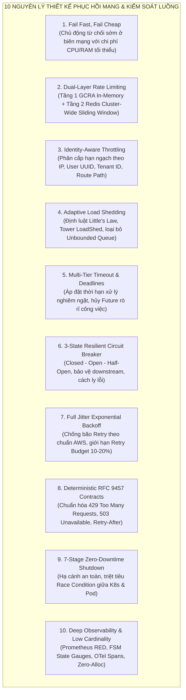

### 10 Nguyên lý Kiến trúc Cốt lõi:

1. **Fail Fast, Fail Cheap (Chủ động từ chối sớm, chi phí tối thiểu):**
   - Khi hệ thống chạm ngưỡng quá tải, việc từ chối một request ngay tại tầng Middleware đầu vào bằng mã lỗi `503 Service Unavailable` hoặc `429 Too Many Requests` chỉ tiêu tốn dưới 50 micro-giây CPU và 0 byte heap allocation.
   - Tránh để request đi sâu vào tầng nghiệp vụ rồi mới thất bại hoặc làm nghẽn kết nối database pool.
2. **Dual-Layer Rate Limiting (Kiểm soát tần suất 2 tầng):**
   - **Tầng 1 (In-Memory Local Fast-Path):** Sử dụng thuật toán GCRA (Generic Cell Rate Algorithm) lock-free trên từng Pod instance để chặn đứng các đợt tấn công bộc phát (burst/spike) với độ trễ nanosecond.
   - **Tầng 2 (Distributed Redis Cluster-Wide):** Tái sử dụng `omni-cache` và Redis Lua script trượt thời gian (Sliding Window Counter) để bảo đảm tổng hạn ngạch trên toàn cụm Pod replica không bị vi phạm.
3. **Identity-Aware Multi-Dimensional Throttling (Phân cấp hạn ngạch đa chiều):**
   - Hệ thống không giới hạn lưu lượng theo một biến duy nhất.
   - Hạn ngạch được phân tầng rõ rệt: IP ẩn danh (Sanitized Client IP qua trusted proxy), Người dùng đã xác thực (`user_id` từ `omni-auth`), Khách hàng doanh nghiệp (`tenant_id`), và Phân loại theo độ nhạy cảm của Route (ví dụ: route đăng nhập `/auth/login` có quota nghiêm ngặt hơn route đọc `/products`).
4. **Adaptive Load Shedding & Little's Law (Chống bão hòa tải theo định luật Little):**
   - Áp dụng định luật Little $L = \lambda \cdot W$. Khi thời gian xử lý $W$ của downstream tăng vọt, số lượng request tồn đọng $L$ sẽ bùng nổ nếu không có giới hạn đồng thời.
   - Thay vì cho phép hàng đợi vô hạn (Unbounded Queueing), hệ thống tích hợp `tower::load_shed` và Semaphore giới hạn trần: từ chối ngay lập tức các request đến sau khi hàng đợi chạm ngưỡng an toàn, ngăn chặn Pod bị Linux OOMKilled.
5. **Multi-Tier Request Timeout & Cancellation Propagation (Thời hạn xử lý đa tầng):**
   - Áp đặt thời hạn xử lý nghiêm ngặt qua `tower::timeout::Timeout`.
   - Kết hợp chặt chẽ với cơ chế Future Cancellation của Tokio: khi Client ngắt kết nối (hoặc request bị timeout), toàn bộ các tác vụ con (SQL query, HTTP call) lập tức bị hủy bỏ thông qua `tokio_util::sync::CancellationToken`, chấm dứt tình trạng lãng phí tài nguyên CPU/DB cho những request đã bị bỏ rơi.
6. **3-State Resilient Circuit Breaker (Bộ ngắt mạch 3 trạng thái):**
   - Áp dụng mô hình máy trạng thái hữu hạn (FSM): `CLOSED` $\leftrightarrow$ `OPEN` $\leftrightarrow$ `HALF_OPEN`.
   - Khi tỷ lệ lỗi hoặc tỷ lệ cuộc gọi chậm (Slow Calls) vượt ngưỡng định trước, mạch lập tức chuyển sang `OPEN`, chặn đứng toàn bộ các cuộc gọi tới downstream gặp sự cố và trả về `503 Service Unavailable` tức thì.
   - Cung cấp cơ chế tự phục hồi thăm dò (Half-Open probing) trước khi mở lại lưu lượng hoàn toàn.
7. **Exponential Backoff with Full Jitter & Retry Budget (Chống bão thử lại):**
   - Mọi cơ chế thử lại (Client call, Outbox relay, Consumer) bắt buộc áp dụng công thức Full Jitter theo nghiên cứu của AWS Architecture Lab để phân rã đỉnh xung đột lưu lượng.
   - Chỉ cho phép thử lại các request thỏa mãn tính lũy thừa (**Idempotent HTTP Methods: GET, PUT, DELETE, HEAD** hoặc có header `Idempotency-Key`).
   - Giới hạn **Retry Budget** nghiêm ngặt (tối đa 10% - 20% tổng lưu lượng), nếu vượt trần thì cấm hoàn toàn hành vi thử lại.
8. **Deterministic RFC 9457 Error Contract (Chuẩn hóa lỗi RFC 9457):**
   - Mọi quyết định điều phối lưu lượng (bị chặn do rate limit, bị từ chối do load shedding, hoặc bị ngắt do circuit breaker) đều trả về định dạng chuẩn **RFC 9457 Problem Details** (`application/problem+json`).
   - Cung cấp đầy đủ các header tiêu chuẩn quốc tế: `Retry-After`, `RateLimit-Limit`, `RateLimit-Remaining`, `RateLimit-Reset`.
9. **7-Stage Zero-Downtime Kubernetes Graceful Shutdown (Hạ cánh an toàn 7 giai đoạn):**
   - Hóa giải triệt để bài toán bất đồng bộ giữa tín hiệu `SIGTERM` của Kubelet và việc cập nhật bảng định tuyến mạng của Ingress/EndpointSlice Controller.
   - Phối hợp nhịp nhàng giữa: Đánh dấu Drain Gate `/readyz` $\rightarrow$ Ngủ chờ Ingress đồng bộ $\rightarrow$ Xử lý dứt điểm In-flight HTTP requests $\rightarrow$ Dừng Worker Outbox/Inbox $\rightarrow$ Đóng kết nối Database/Redis $\rightarrow$ Xả bộ đệm Log sang Loki/Tempo $\rightarrow$ Thoát an toàn mã 0.
10. **Deep Observability & Low-Cardinality Telemetry (Giám sát chuyên sâu):**
    - Mọi biến động trạng thái (chuyển trạng thái Circuit Breaker, số request bị rate limit, số request bị load shed, thời gian thực thi từng giai đoạn shutdown) đều xuất bản ra Prometheus metrics với nhãn đã chuẩn hóa (Low Cardinality) và liên kết chặt chẽ với W3C `traceparent` qua OpenTelemetry Spans.

---

## 2. Scope of Applicability & Workspace Dependency Architecture

### 2.1. Nằm trong phạm vi (In-Scope)

| #   | Năng lực / Module                                      | Module kỹ thuật                       | Mô tả chức năng chi tiết                                                                                                                                                                            |
| :-- | :----------------------------------------------------- | :------------------------------------ | :-------------------------------------------------------------------------------------------------------------------------------------------------------------------------------------------------- |
| 1   | **Adaptive Rate Limiting (`rate_limit`)**              | `omni_common::resilience::rate_limit` | Triển khai thuật toán GCRA in-memory (`governor`) và thuật toán Distributed Sliding Window Counter trên Redis (`omni-cache` Lua scripts). Hỗ trợ trích xuất khóa linh hoạt (IP, User, Tenant, Key). |
| 2   | **Concurrency Limiting & Load Shedding (`load_shed`)** | `omni_common::resilience::load_shed`  | Giới hạn số lượng request đồng thời bằng Semaphore. Tự động từ chối request bằng HTTP 503 khi hệ thống bão hòa để bảo vệ Tokio Worker Threads và ngăn ngừa lỗi Linux OOMKilled.                     |
| 3   | **Request Timeout & Cancellation (`timeout`)**         | `omni_common::resilience::timeout`    | Áp đặt thời hạn xử lý tối đa cho HTTP request. Tích hợp `CancellationToken` để dừng tính toán khi kết nối Client bị đóng hoặc timeout. Truyền header hạn ngạch deadline xuống downstream.           |
| 4   | **Enterprise Circuit Breaker (`circuit_breaker`)**     | `omni_common::resilience::circuit`    | Máy trạng thái 3 pha (`Closed`, `Open`, `HalfOpen`) với cửa sổ trượt (Count-based & Time-based). Theo dõi tỷ lệ lỗi hạ tầng (5xx, Timeout, Connect Error) và tự ngắt kết nối bảo vệ downstream.     |
| 5   | **Resilient Retry & Full Jitter (`retry`)**            | `omni_common::resilience::retry`      | Bộ tính toán thời gian chờ lũy tiến kèm Full Jitter ngẫu nhiên. Phân định rạch ròi Transient Error vs Terminal Error. Cơ chế kiểm soát hạn ngạch thử lại (Retry Budget) chống bão Retry Storms.     |
| 6   | **Kubernetes Graceful Shutdown (`shutdown`)**          | `omni_common::resilience::shutdown`   | Bộ điều phối quy trình hạ cánh an toàn 7 giai đoạn: Đón bắt `SIGTERM`/`SIGINT`, phối hợp với `omni-metrics` Drain Gate, cửa sổ chờ Ingress, drain HTTP requests, dừng workers, xả flush bộ nhớ đệm. |
| 7   | **Axum & Tower Layer Integration (`middleware`)**      | `omni_common::resilience::layer`      | Đóng gói các năng lực trên thành các Tower Layers / Axum Middlewares chuẩn, sẵn sàng tích hợp dạng cắm-rút (Plug-and-Play) vào `AppBuilder`.                                                        |
| 8   | **RFC 9457 Error Adapters (`error`)**                  | `omni_common::resilience::error`      | Ánh xạ tự động các lỗi `RateLimited`, `LoadShed`, `CircuitOpen`, `RequestTimeout` sang `omni_errors::AppError` và `ApiErrorResponse` chuẩn quốc tế.                                                 |
| 9   | **Resilience Telemetry & Metrics (`metrics`)**         | `omni_common::resilience::metrics`    | Cung cấp bộ chỉ số Prometheus: `http_requests_rate_limited_total`, `resilience_circuit_breaker_state`, `resilience_load_shed_rejected_total`, `resilience_shutdown_stage_duration_seconds`.         |

### 2.2. Ngoài phạm vi (Out-of-Scope)

- **L7 API Gateway Global Rate Limiting:** Các chính sách rate limit phân tán cấp độ toàn cầu ở tầng Edge (như Cloudflare WAF, Envoy Global Rate Limit Service - RLS gRPC) được cấu hình tại cụm Ingress Gateway bên ngoài. Crate `omni-common` tập trung vào việc tự vệ nội tại (**Defense-in-Depth**) của từng Microservice.
- **Service Mesh Traffic Routing:** Việc chia tách luồng Canary/Blue-Green hoặc mTLS traffic encryption được đảm nhiệm bởi Istio/Linkerd, không nằm trong trách nhiệm code Rust của thư viện common.
- **Connection-Level Pool Resilience:** Cơ chế quản lý kết nối cơ sở dữ liệu (Health ping, acquire timeout, idle timeout) đã được đóng gói chuyên biệt trong `omni-database` (`PgPoolFactory`). Module này phối hợp thông qua việc kích hoạt graceful drain của pool khi shutdown.

### 2.3. Sơ đồ Phụ thuộc Kiến trúc (Acyclic Dependency Graph)

Cấu trúc phân lớp tuân thủ nghiêm ngặt nguyên tắc Directed Acyclic Graph (DAG), không gây phụ thuộc vòng giữa các crate:

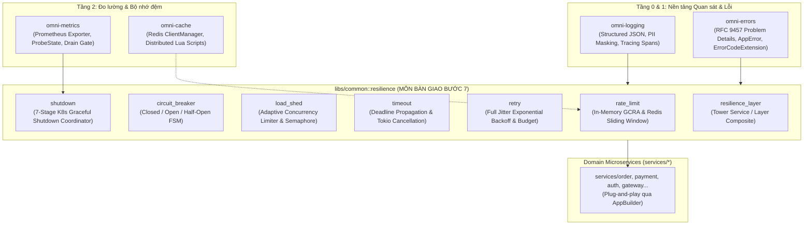

---

## 3. Standards & Compliance References

| Tiêu chuẩn / Đặc tả kỹ thuật                            | Cơ quan / Nghiên cứu  | Ứng dụng cụ thể trong hệ sinh thái OmniKubernetes                                                                               |
| :------------------------------------------------------ | :-------------------- | :------------------------------------------------------------------------------------------------------------------------------ |
| **RFC 6585 (Additional HTTP Status Codes)**             | IETF                  | Chuẩn hóa mã phản hồi HTTP `429 Too Many Requests` khi vượt hạn ngạch lưu lượng.                                                |
| **RFC 7231 (HTTP/1.1 Semantics & Content, Sec. 7.1.3)** | IETF                  | Chuẩn hóa header `Retry-After: <delta-seconds>` cho cả hai tình huống Rate Limiting (429) và Quá tải dịch vụ (503).             |
| **IETF RateLimit Header Fields for HTTP (Draft)**       | IETF HTTPAPI WG       | Các header phản hồi chuẩn: `RateLimit-Limit`, `RateLimit-Remaining`, `RateLimit-Reset`.                                         |
| **RFC 9457 (Problem Details for HTTP APIs)**            | IETF                  | Định dạng JSON lỗi đồng nhất: `type`, `title`, `status`, `detail`, `instance`, `code`, `meta`.                                  |
| **Kubernetes Container Lifecycle Hooks (v1.30+)**       | CNCF / Kubernetes     | Chuẩn hóa phối hợp vòng đời Pod: `SIGTERM`, `preStop` exec hook, `terminationGracePeriodSeconds`, EndpointSlice propagation.    |
| **Exponential Backoff And Jitter (AWS Architecture)**   | Marc Brooker, AWS Lab | Thuật toán Full Jitter: $T_{\text{sleep}} = \text{random}(0, \min(T_{\text{max}}, T_{\text{base}} \times 2^{\text{attempt}}))$. |
| **Little's Law for Queuing Systems**                    | John Little (MIT)     | Cân bằng số lượng request trong hệ thống: $L = \lambda \cdot W$. Căn cứ để áp đặt trần Concurrency Limiting.                    |
| **Circuit Breaker Pattern**                             | Martin Fowler / SRE   | Máy trạng thái hữu hạn bảo vệ hệ thống khỏi lỗi dây chuyền và phục hồi tự động khi downstream ổn định trở lại.                  |

---

## 4. Adaptive Rate Limiting Architecture (Tầng Kiểm soát Tần suất Truy cập)

### 4.1. So sánh 5 Thuật toán Giới hạn Tần suất

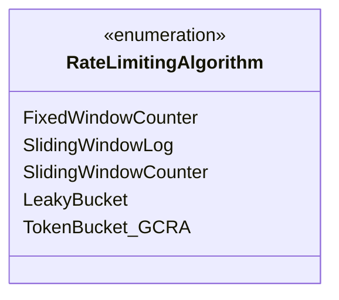

| Thuật toán                                       | Độ phức tạp Bộ nhớ | Chi phí CPU | Xử lý Spike ở Biên Cửa Sổ             | Phù hợp cho OmniKubernetes                         |
| :----------------------------------------------- | :----------------: | :---------: | :------------------------------------ | :------------------------------------------------- |
| **Fixed Window Counter**                         |       $O(1)$       |  Thấp nhất  | Rất kém (Cho phép tải gấp $2\times$)  | Không dùng (Gây sập hệ thống tại biên giây).       |
| **Sliding Window Log**                           |       $O(N)$       |   Rất cao   | Hoàn hảo                              | Không dùng (Tốn bộ nhớ RAM lớn khi traffic cao).   |
| **Sliding Window Counter**                       |       $O(1)$       |    Thấp     | Rất tốt (Xấp xỉ trọng số thời gian)   | **Dùng cho Distributed Rate Limiting trên Redis**. |
| **Leaky Bucket**                                 |       $O(1)$       |    Thấp     | San phẳng lưu lượng, triệt tiêu burst | Dùng cho hàng đợi tác vụ nền (Queue Workers).      |
| **Token Bucket / GCRA (Generic Cell Rate Algo)** |       $O(1)$       |  Cực thấp   | Cho phép burst có kiểm soát           | **Dùng cho In-Memory Fast-Path trên từng Pod**.    |

### 4.2. Chiến lược 2 Tầng (Dual-Layer Rate Limiting Topology)

Để vừa bảo đảm độ trễ cực thấp (Sub-microsecond latency), vừa đảm bảo tính toàn vẹn của hạn ngạch toàn hệ thống (Cluster-wide Quota), OmniKubernetes triển khai mô hình **Phòng thủ 2 lớp (Defense-in-Depth)**:

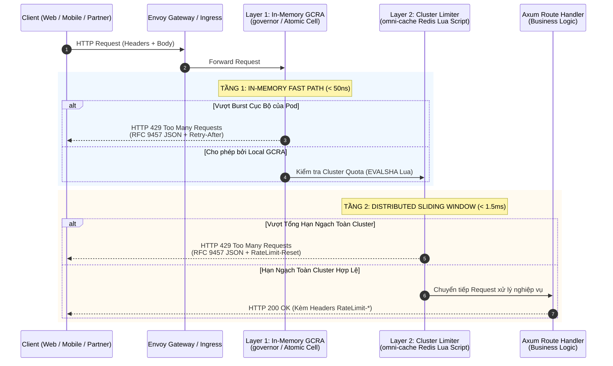

#### Tầng 1: In-Memory GCRA Limiter (Local Pod Fast-Path)

- Sử dụng thuật toán **GCRA (Generic Cell Rate Algorithm)** được chuẩn hóa trong ATM networks và hiện thực hóa bằng crate `governor` tối ưu lock-free.
- Quản lý thời điểm phát hành tế bào kế tiếp (Theoretical Arrival Time - TAT).
- Đạt hiệu năng cực hạn: Kiểm tra trạng thái bằng Atomic integers trên bộ nhớ RAM nội bộ của tiến trình, **chi phí trễ dưới 50 nanosecond**, không phát sinh network call.
- Bảo vệ từng container Pod đơn lẻ không bị tê liệt bởi các đợt bắn phá traffic đột biến (Micro-bursts).

#### Tầng 2: Distributed Sliding Window Counter (Cluster-Wide Quota)

- Tích hợp trực tiếp với `omni-cache` qua Redis/Valkey.
- Khắc phục nhược điểm của môi trường Autoscaling: khi Pod scale từ 2 lên 20 replicas, nếu chỉ dùng local limiter thì tổng lưu lượng vào hệ thống sẽ tăng gấp 10 lần.
- Thực thi thông qua một **Redis Lua Script nguyên tử**, kết hợp giữa cửa sổ hiện tại và cửa sổ trước đó để tính toán số lượng request ước lượng theo thời gian thực:
  $$\text{Count} = \text{Count}_{\text{current}} + \text{Count}_{\text{previous}} \times \left(1 - \frac{t - t_{\text{start}}}{\text{WindowSize}}\right)$$
- Mọi thao tác đều thực hiện trong 1 Round-Trip duy nhất (`EVALSHA`), bảo đảm tính toàn vẹn ngay cả khi có hàng trăm Pod cùng kiểm tra đồng thời.

### 4.3. Đa chiều Trích xuất Khóa Định danh (Multi-Dimensional Key Extraction)

Khóa định danh tần suất (`RateLimitKey`) được trích xuất linh hoạt theo thứ tự ưu tiên:

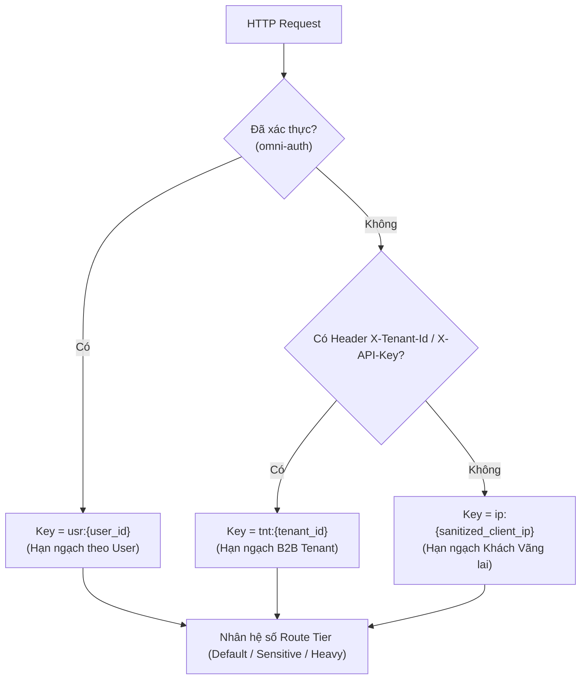

1. **Khách hàng đã đăng nhập (Authenticated User):**
   - Khóa: `rl:usr:{user_id}`.
   - Trích xuất từ `AuthUserClaims` do `omni-auth` giải mã từ JWT token.
   - Được cấp hạn ngạch cao nhất (ví dụ: 100 RPS, burst 200).
2. **Khách hàng doanh nghiệp / Đối tác B2B (Tenant / API Key):**
   - Khóa: `rl:tnt:{tenant_id}` hoặc `rl:key:{api_key_hash}`.
   - Hạn ngạch tùy biến theo gói dịch vụ hợp đồng (SLA Tier: Basic, Pro, Enterprise).
3. **Khách vãng lai / Ẩn danh (Sanitized Client IP):**
   - Khóa: `rl:ip:{sanitized_ip}`.
   - Trích xuất từ header `X-Forwarded-For` hoặc địa chỉ socket kết nối.
   - **Bảo mật tuyệt đối chống giả mạo IP (IP Spoofing Protection):** Chỉ tin cậy giá trị `X-Forwarded-For` từ các Proxy / Ingress nằm trong danh sách `trusted_proxies` đã cấu hình trong `HttpServerConfig`.
4. **Phân cấp theo độ nhạy cảm của Endpoint (Route Tiering):**
   - **Sensitive Endpoints (`/api/v1/auth/login`, `/api/v1/auth/register`):** Giới hạn khắt khe (ví dụ: 5 RPS / IP) để ngăn chặn tấn công Bruteforce và Credential Stuffing.
   - **Heavy Mutating Endpoints (`/api/v1/orders/checkout`, `/api/v1/reports/generate`):** Giới hạn vừa phải (ví dụ: 20 RPS).
   - **Read-Only Endpoints (`/api/v1/products`):** Giới hạn phóng khoáng (ví dụ: 200 RPS).

### 4.4. Chuẩn hóa Headers & Hợp đồng Lỗi RFC 9457

Khi request được chấp thuận hoặc bị từ chối, middleware tự động đính kèm các header chuẩn IETF:

- `RateLimit-Limit`: Tổng số request tối đa được phép trong cửa sổ thời gian.
- `RateLimit-Remaining`: Số lượng request còn lại có thể gửi trước khi bị chặn.
- `RateLimit-Reset`: Số giây còn lại cho đến khi hạn ngạch được làm mới hoàn toàn.
- `Retry-After`: Số giây client bắt buộc phải chờ trước khi được phép thử lại (khi bị HTTP 429).

Phản hồi lỗi tuân thủ nghiêm ngặt định dạng RFC 9457:

```http
HTTP/1.1 429 Too Many Requests
Content-Type: application/problem+json; charset=utf-8
Retry-After: 12
RateLimit-Limit: 100
RateLimit-Remaining: 0
RateLimit-Reset: 12
X-Request-Id: 018f4a2b-8a5e-7a1b-9c3d-4e5f6a7b8c9d

{
  "type": "https://errors.omnikubernetes.com/rate-limited",
  "title": "Too Many Requests",
  "status": 429,
  "detail": "Rate limit exceeded. Quota resets in 12 seconds.",
  "instance": "/api/v1/orders",
  "code": "ERR_RATE_LIMITED",
  "meta": {
    "request_id": "018f4a2b-8a5e-7a1b-9c3d-4e5f6a7b8c9d",
    "timestamp": "2026-11-02T16:30:00Z"
  }
}
```

---

## 5. Concurrency Limiting & Adaptive Load Shedding (Tầng Chống Bão hòa Tải)

### 5.1. Định luật Little & Cạm bẫy của Hàng đợi Vô hạn (Unbounded Queueing)

Một trong những sai lầm kinh điển nhất trong kỹ thuật phần mềm phân tán là việc cho phép hàng đợi HTTP request mở rộng không giới hạn:

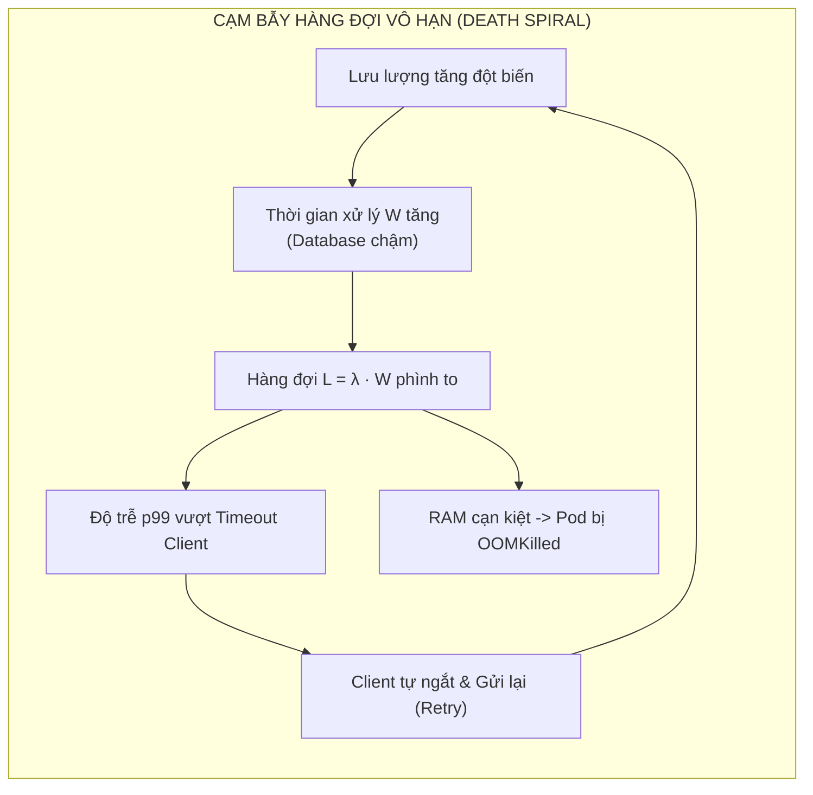

Theo **Định luật Little (Little's Law)**:
$$L = \lambda \cdot W$$
Trong đó:

- $L$: Số lượng request đang nằm trong hệ thống (đang xử lý hoặc chờ trong hàng đợi).
- $\lambda$: Tần suất request gửi tới (Arrival Rate).
- $W$: Thời gian trung bình để xử lý xong một request (Wait Time / Duration).

Khi PostgreSQL hoặc downstream service bị nghẽn, thời gian xử lý $W$ tăng từ $10\text{ms}$ lên $1000\text{ms}$ (tăng 100 lần). Nếu hệ thống vẫn cố chấp nhận request mới với tốc độ $\lambda$ không đổi, số lượng request tồn đọng $L$ sẽ tăng vọt gấp 100 lần.  
Hậu quả tất yếu:

1. Bộ nhớ RAM bị chiếm dụng toàn bộ bởi các request bodies và stack frames chưa hoàn tất, dẫn tới việc Kubernetes Kubelet bắn tín hiệu tiêu diệt Pod bằng `OOMKilled` (Exit Code 137).
2. Các request nằm ở cuối hàng đợi phải chờ quá lâu, Client phía trước đã hết hạn timeout và đóng kết nối từ lâu. Server vẫn tiếp tục tiêu tốn CPU/DB để xử lý một kết quả mà không ai còn đón nhận (**Wasted Work**).

### 5.2. Nguyên lý Hoạt động của `Adaptive LoadShed`

Hệ thống triển khai cơ chế **Chủ động Trút tải (Load Shedding)** dựa trên `tower::load_shed` và Semaphore đồng bộ của Tokio:

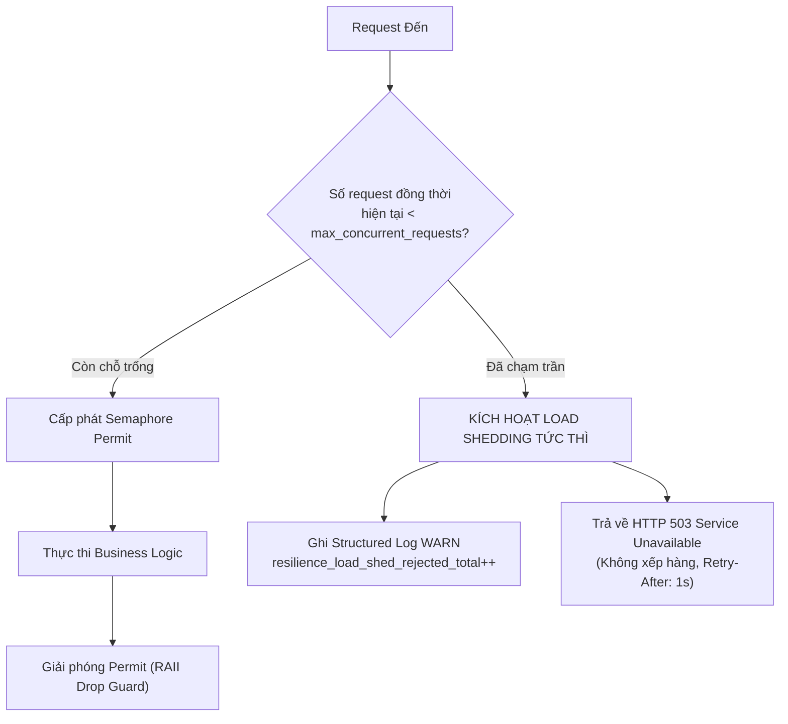

- Khi tổng số request đang được xử lý đồng thời đạt ngưỡng cấu hình `max_concurrent_requests` (ví dụ: 1024 requests):
  - Thay vì cho phép các request kế tiếp xếp vào hàng đợi vô hạn, middleware `LoadShedLayer` **lập tức từ chối thẳng thừng** request mới với mã lỗi `503 Service Unavailable`.
  - Phản hồi được trả về trong thời gian dưới **10 micro-giây**, tiêu tốn tài nguyên gần như bằng 0.
  - Đính kèm header `Retry-After: 1` để báo hiệu cho Client hoặc Ingress tạm hoãn trong 1 giây trước khi thử gửi lại.
- **Bảo vệ toàn diện Tokio Runtime:** Luôn luôn duy trì khả năng lập lịch mượt mà cho Tokio Reactor Thread Pool, đảm bảo các endpoint quan trọng sống còn như Kubernetes Health Probes (`/livez`, `/readyz`) không bao giờ bị nghẽn luồng.

---

## 6. Multi-Tier Request Timeout & Deadline Propagation (Tầng Quản lý Thời hạn)

### 6.1. Kiến trúc Timeout 3 Tầng

Hệ thống thiết lập hàng rào kiểm soát thời hạn (Deadlines) trên 3 cấp độ:

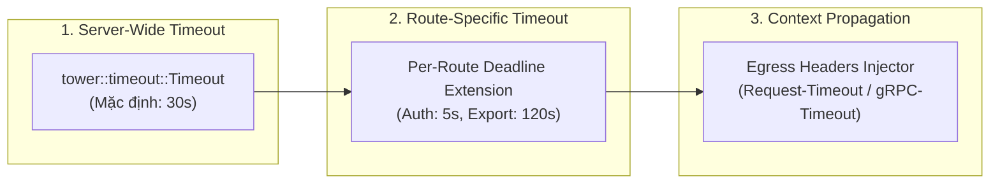

1. **Server-Wide Global Timeout:**  
   Bọc toàn bộ Axum Router bằng `tower::timeout::TimeoutLayer` với tham số `request_timeout_secs` từ `HttpServerConfig`. Đảm bảo không có bất kỳ kết nối socket nào có thể treo vĩnh viễn trong hệ thống.
2. **Route-Specific Override:**  
   Cho phép từng endpoint khai báo thời hạn tùy biến:
   - Các tác vụ nhanh (`/api/v1/auth/login`, `/healthz`): Timeout nghiêm ngặt từ 1s đến 5s.
   - Các tác vụ xuất báo cáo, tải file (`/api/v1/reports/export`): Timeout nới rộng tới 120s.
3. **Egress Context Deadline Propagation:**  
   Khi service A thực hiện cuộc gọi HTTP downstream sang service B thông qua `reqwest` hoặc `tonic` gRPC:
   - Tự động tính toán thời gian khả dụng còn lại của request gốc:
     $$\text{RemainingDeadline} = \text{TotalTimeout} - \text{ElapsedDuration}$$
   - Tiêm giá trị này vào header HTTP chuẩn `Request-Timeout: <seconds>` hoặc gRPC metadata `grpc-timeout`.
   - Dịch vụ downstream đọc header này và thiết lập timeout con tương ứng, ngăn chặn việc downstream tiếp tục chạy một tác vụ mà upstream đã bỏ cuộc từ lâu.

### 6.2. Tích hợp `CancellationToken` & Ngăn ngừa Lãng phí Tài nguyên

Trong Rust Tokio, khi một Future bị `timeout` hoặc Client ngắt kết nối (TCP FIN/RST), Future đó sẽ bị **Drop**.  
Tuy nhiên, nếu một tác vụ đang chạy câu lệnh SQL trên PostgreSQL hoặc đang đợi khóa phân tán trên Redis, việc Future bị Drop ở tầng Web Server chưa chắc đã giải phóng tài nguyên ở tầng Database:

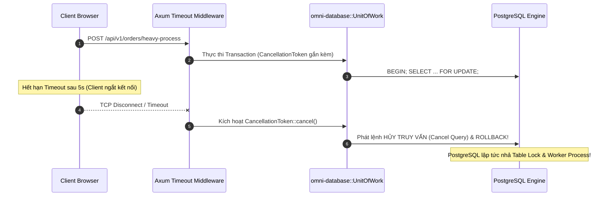

- Module resilience cung cấp helper `with_cancellation_token(ctx, async move { ... })`.
- Khi Web Future bị drop, token lập tức phát tín hiệu hủy. `UnitOfWork` bắt tín hiệu này và chủ động gửi lệnh ngắt truy vấn tới PostgreSQL, giải phóng các khóa bản ghi (`Row-Level Locks`) và hoàn trả connection về Pool ngay tức thì.

---

## 7. Enterprise Circuit Breaker Architecture (Tầng Ngắt Mạch Tự Động)

### 7.1. Máy Trạng thái Hữu hạn (Finite State Machine - FSM)

Bộ ngắt mạch (Circuit Breaker) hoạt động như một công tắc an toàn tự động, ngăn ngừa hiện tượng quá tải dây chuyền khi các dịch vụ phụ thuộc bên ngoài bị suy thoái:

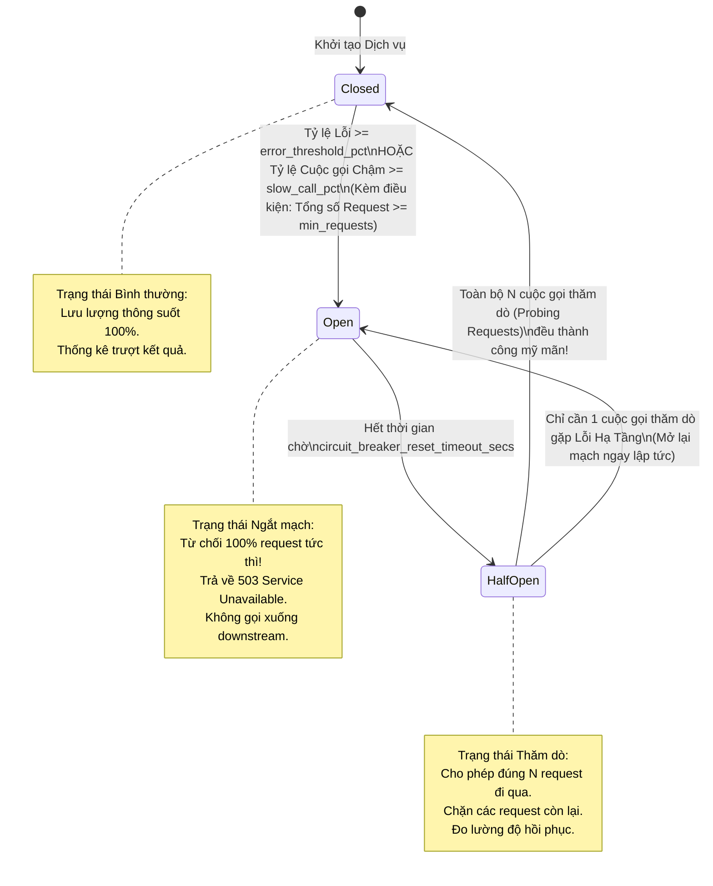

### 7.2. Ba Trạng thái Hoạt động Chi tiết

1. **`CLOSED` (Mạch đóng - Vận hành Bình thường):**
   - Toàn bộ các cuộc gọi tới downstream được thông qua tự do.
   - Bộ ghi nhận trượt (Sliding Window) thống kê kết quả của từng cuộc gọi: `Success`, `Failure`, hoặc `Slow`.
   - Điều kiện ngắt mạch sang `OPEN`:
     - Cửa sổ đã thu thập tối thiểu `circuit_breaker_min_requests` (ví dụ: 20 requests) để tránh việc mở mạch oan do một vài lỗi ngẫu nhiên ban đầu.
     - Tỷ lệ lỗi hạ tầng vượt quá `circuit_breaker_error_threshold_pct` (ví dụ: $\ge 50\%$).
     - Hoặc tỷ lệ cuộc gọi bị chậm (Latency > ngưỡng cho phép) vượt quá `circuit_breaker_slow_call_pct` (ví dụ: $\ge 60\%$).
2. **`OPEN` (Mạch ngắt - Cách ly Tuyệt đối):**
   - Mạch bị ngắt hoàn toàn nhằm bảo vệ downstream đang hấp hối không phải nhận thêm tải.
   - Toàn bộ các request mới gọi tới downstream này bị **từ chối ngay tức thì** với mã lỗi `503 Service Unavailable` và mã lỗi nghiệp vụ `ERR_SERVICE_UNAVAILABLE`.
   - Thời gian tồn tại ở trạng thái `OPEN` được kiểm soát bởi đồng hồ đếm ngược `circuit_breaker_reset_timeout_secs` (ví dụ: 30 giây).
3. **`HALF_OPEN` (Mạch bán mở - Thăm dò Thận trọng):**
   - Khi thời gian đếm ngược kết thúc, Circuit Breaker chuyển sang trạng thái `HALF_OPEN`.
   - Cung cấp một hạn ngạch thử nghiệm giới hạn (Trial Quota, ví dụ: 5 requests thăm dò). Các request vượt ngoài hạn ngạch này trong lúc đang thăm dò vẫn tiếp tục nhận lỗi 503.
   - Nếu **100% các request thăm dò đều thành công**: Hệ thống xác nhận downstream đã phục hồi hoàn toàn $\rightarrow$ Chuyển trạng thái về `CLOSED`, reset bộ đếm cửa sổ trượt.
   - Nếu **bất kỳ một request thăm dò nào gặp lỗi**: Xác nhận downstream vẫn chưa sẵn sàng $\rightarrow$ Mạch lập tức quay ngược về `OPEN` và kích hoạt lại cửa sổ chờ.

### 7.3. Phân định Lỗi Hạ tầng vs Lỗi Nghiệp vụ (Failure Qualification Matrix)

Một bộ Circuit Breaker được thiết kế tồi sẽ mở mạch nhầm khi người dùng nhập sai mật khẩu hàng loạt (401) hoặc gửi thiếu trường dữ liệu (422).  
OmniKubernetes thiết lập ma trận phân định lỗi nghiêm ngặt:

| Loại Lỗi Phát Sinh                           | HTTP Status Code | Tính vào Circuit Breaker Failure? | Lý do Kỹ thuật                                                             |
| :------------------------------------------- | :--------------: | :-------------------------------: | :------------------------------------------------------------------------- |
| **Connection Refused / Network Unreachable** |       N/A        |              **CÓ**               | Lỗi hạ tầng mạng, downstream đã sập tiến trình.                            |
| **Connect Timeout / Read Timeout**           |    504 / N/A     |              **CÓ**               | Downstream bị bão hòa, không kịp phản hồi.                                 |
| **Internal Server Error**                    |       500        |              **CÓ**               | Downstream gặp sự cố logic nội bộ nghiêm trọng hoặc crash.                 |
| **Service Unavailable / Bad Gateway**        |    502 / 503     |              **CÓ**               | Downstream hoặc Gateway bị quá tải.                                        |
| **Bad Request / Input Validation Failed**    |    400 / 422     |             **KHÔNG**             | Lỗi do Client gửi sai dữ liệu, downstream vẫn hoàn toàn khỏe mạnh.         |
| **Unauthorized / Forbidden**                 |    401 / 403     |             **KHÔNG**             | Lỗi phân quyền truy cập nghiệp vụ thông thường.                            |
| **Resource Not Found**                       |       404        |             **KHÔNG**             | Dữ liệu không tồn tại, downstream phản hồi hoàn toàn chính xác.            |
| **Conflict / Optimistic Lock Error**         |       409        |             **KHÔNG**             | Tranh chấp nghiệp vụ thông thường, không liên quan tới độ tin cậy hạ tầng. |

---

## 8. Retry Storm Prevention & Exponential Backoff with Jitter

### 8.1. Hiểm họa của Bão Thử Lại (The Retry Storm Catastrophe)

Khi một dịch vụ downstream tạm thời bị chậm hoặc ngắt kết nối trong 5 giây:

- Nếu $1,000$ client gửi request và gặp lỗi, sau đó tất cả đồng loạt thử lại (Fixed Retry Interval, ví dụ sau đúng 1 giây).
- Đúng 1 giây sau, toàn bộ $1,000$ request đồng loạt dội vào downstream cùng một thời điểm (**Thundering Herd / Resonance Effect**).
- Downstream đang trong quá trình hồi phục lập tức bị đợt sóng xung kích này đánh sập trở lại. Chu kỳ này lặp đi lặp lại vô tận, biến một sự cố nhỏ thành một đợt mất điện toàn hệ thống (**Outage Loop**).

### 8.2. Thuật toán AWS Full Jitter

Để triệt tiêu hiện tượng cộng hưởng pha (Phase Alignment) của các request thử lại, OmniKubernetes áp dụng thuật toán **Exponential Backoff with Full Jitter** theo công bố nghiên cứu của Marc Brooker (AWS Architecture Lab):

$$T_{\text{sleep}} = \text{random}\left(0, \min\left(T_{\text{max}}, T_{\text{base}} \times 2^{\text{attempt}}\right)\right)$$

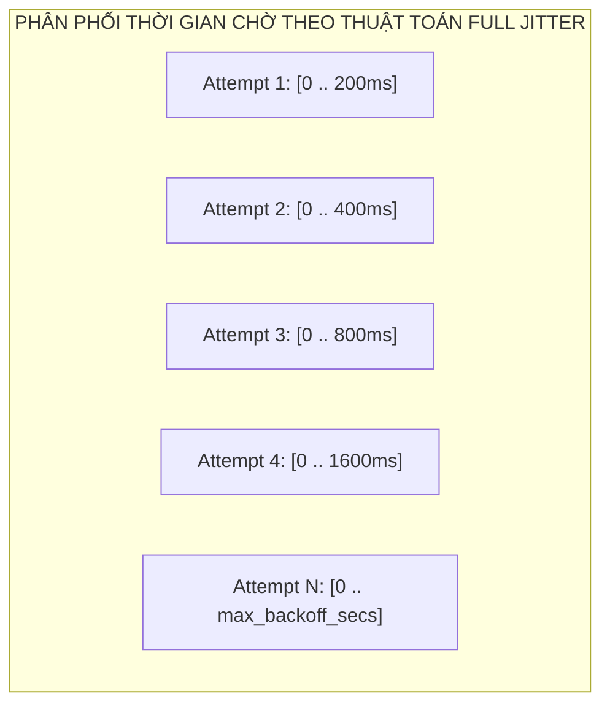

- Bằng cách lấy mẫu ngẫu nhiên từ $0$ đến giá trị trần hàm mũ $\min(T_{\text{max}}, T_{\text{base}} \times 2^{\text{attempt}})$, lưu lượng các request thử lại được **rải đều hoàn hảo trên trục thời gian**.
- Đỉnh xung đột lưu lượng được triệt tiêu hoàn toàn, tạo khoảng không an toàn cho downstream tái khởi động bộ nhớ đệm và kết nối pool.

### 8.3. Hàng Rào An toàn Lũy Thừa & Hạn ngạch Thử lại (Retry Budget)

1. **Idempotency Gating (Chặn đứng Thử lại Không An toàn):**
   - **Tuyệt đối CẤM tự động thử lại** đối với các HTTP request mang phương thức không an toàn (`POST`, `PATCH`) trừ khi request đó có mang theo header **`Idempotency-Key`** hợp lệ.
   - Tự động thử lại một request `POST /payments` khi bị timeout mạng là nguyên nhân hàng đầu dẫn tới lỗi trừ tiền hai lần (Double Charge).
   - Chỉ các phương thức an toàn và lũy thừa theo RFC 9110 (`GET`, `HEAD`, `PUT`, `DELETE`, `OPTIONS`) mới được phép thử lại tự động.
2. **Retry Budget Token Bucket (Hạn ngạch Thử lại Tối đa):**
   - Cung cấp cơ chế Token Bucket dành riêng cho việc thử lại:
     - Mỗi khi một request bình thường thành công, hệ thống nạp thêm $0.2$ token vào Retry Budget.
     - Mỗi khi một lượt retry được thực thi, hệ thống tiêu tốn $1.0$ token.
   - Cơ chế này bảo đảm **tổng số request thử lại không bao giờ vượt quá 20% tổng lưu lượng** của service. Khi ngân sách cạn kiệt, middleware lập tức đình chỉ toàn bộ hành vi retry và trả lỗi về client, bảo vệ hệ thống khỏi bão retry.

---

## 9. The 7-Stage Zero-Downtime Kubernetes Graceful Shutdown Protocol

### 9.1. Bản chất Race Condition khi Tắt Pod trên Kubernetes

Trong môi trường Kubernetes, việc khởi động lại Pod (khi Rolling Update một Deployment) thường xuyên làm phát sinh các lỗi `502 Bad Gateway` hoặc rớt kết nối socket nếu tiến trình ứng dụng xử lý `SIGTERM` một cách ngây thơ.  
Nguyên nhân gốc rễ là **sự bất đồng bộ trong hai luồng xử lý độc lập của Kubernetes Control Plane**:

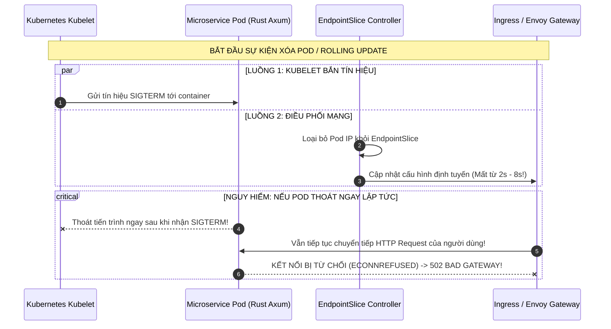

Nếu Pod thoát ngay khi nhận `SIGTERM`, trong khoảng thời gian từ $2$ đến $8$ giây tiếp theo, Ingress Controller và `kube-proxy` vẫn chưa hoàn tất việc đồng bộ iptables/ipvs và Envoy routes. Do đó, các request mới từ người dùng vẫn bị đẩy vào IP của Pod đã chết, gây ra lỗi gián đoạn dịch vụ.

### 9.2. Sơ đồ Trình tự Hạ cánh An toàn 7 Giai đoạn (The 7-Stage Protocol)

Để bảo đảm **Zero-Downtime hoàn hảo (0% 502/503 errors)**, module `shutdown` phối hợp một quy trình 7 giai đoạn được điều phối tuần tự:

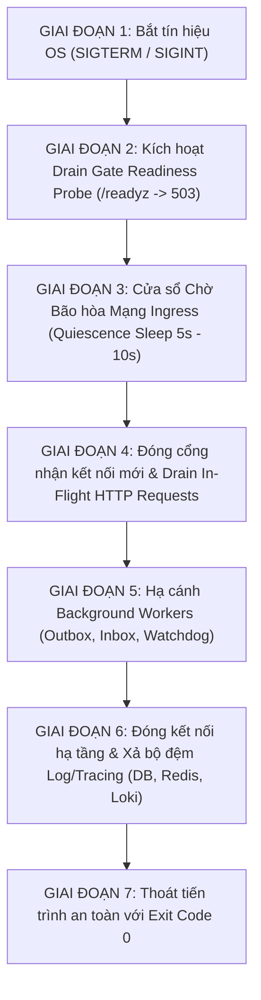

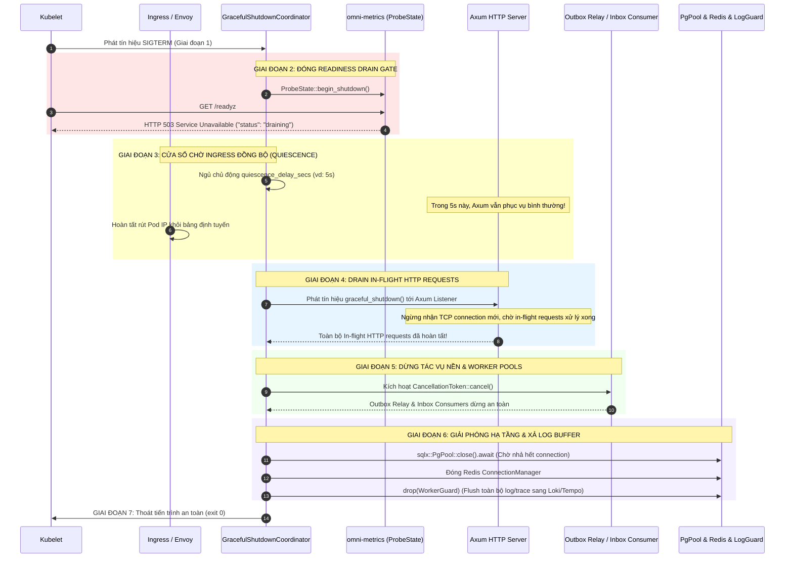

### 9.3. Đặc tả 7 Giai đoạn Chi tiết

1. **Giai đoạn 1: Đón bắt Tín hiệu Hệ điều hành (Signal Interception):**
   - Đăng ký lắng nghe hai tín hiệu POSIX chuẩn: `SIGTERM` (do Kubelet gửi khi scale-down hoặc rolling update) và `SIGINT` (Ctrl+C trong môi trường Local Dev).
   - Sử dụng `tokio::signal::unix::signal(SignalKind::terminate())`.
2. **Giai đoạn 2: Kích hoạt Drain Gate Readiness Probe (`/readyz` $\rightarrow$ 503):**
   - Bộ điều phối gọi ngay lập tức `probe_state.begin_shutdown()` thuộc `omni-metrics`.
   - Ngay từ thời điểm này, endpoint `/readyz` lập tức phản hồi `HTTP 503 Service Unavailable` với payload JSON:
     `{"status": "draining", "service": "order-service", ...}`.
   - Kubelet phát hiện Pod không còn `Ready`, lập tức gửi thông điệp yêu cầu EndpointSlice Controller loại bỏ Pod ra khỏi danh sách phục vụ.
   - **Lưu ý sống còn:** Endpoint `/livez` **vẫn tiếp tục trả về `200 OK`** để báo hiệu tiến trình vẫn sống và đang hạ cánh, ngăn chặn Kubelet gửi tín hiệu `SIGKILL` cưỡng chế sớm.
3. **Giai đoạn 3: Cửa sổ Chờ Bão hòa Mạng Ingress (Quiescence Wait Window):**
   - Tiến trình cố tình ngủ (sleep) trong một khoảng thời gian cấu hình `shutdown_quiescence_delay_secs` (mặc định $5$ đến $10$ giây).
   - **Tại sao cần ngủ?** Để tạo cửa sổ đệm an toàn cho Envoy Gateway, Ingress NGINX và CoreDNS hoàn tất việc cập nhật bộ nhớ định tuyến nội bộ.
   - Trong khoảng thời gian này, **Axum HTTP Server vẫn mở cổng và phục vụ bình thường** các request cuối cùng đang được Gateway chuyển tiếp tới.
4. **Giai đoạn 4: Đóng Cổng Tiếp nhận & Drain In-Flight HTTP Requests:**
   - Axum Server đóng socket lắng nghe TCP (`TcpListener`), từ chối mọi kết nối mới.
   - Cung cấp một cửa sổ timeout `shutdown_timeout_secs` (mặc định $15$ đến $30$ giây) để toàn bộ các HTTP request đang xử lý dở dang (In-Flight Requests) được hoàn tất trọn vẹn và trả kết quả về cho Client.
5. **Giai đoạn 5: Hạ cánh Tác vụ Nền & Worker Pools (Background Worker Teardown):**
   - Phát tín hiệu hủy thông qua `tokio_util::sync::CancellationToken` tới:
     - Worker `HybridOutboxRelay` của `omni-messaging` (chờ hoàn tất mẻ bản tin đang gửi).
     - Worker `ResilientConsumer` của `omni-messaging` (chờ hoàn tất việc Ack/Nack bản tin hiện tại).
     - Worker `OutboxRetentionWorker` (dọn dẹp dữ liệu cũ).
     - Bộ thu thập chỉ số định kỳ `spawn_system_metrics_collector` của `omni-metrics`.
6. **Giai đoạn 6: Đóng Kết nối Hạ tầng & Xả Bộ đệm Log/Tracing (Resource Drain):**
   - Gọi `sqlx::PgPool::close().await`: Ngăn chặn việc cấp phát connection mới, chờ các transaction đang chạy commit/rollback xong, đóng toàn bộ TCP connection tới PostgreSQL an toàn.
   - Ngắt kết nối `omni-cache` Redis connection manager.
   - Xả toàn bộ bộ đệm log phi đồng bộ: Giải phóng `WorkerGuard` của `tracing-appender`, đảm bảo các dòng log audit và tracing spans cuối cùng được gửi toàn vẹn sang Grafana Loki và Tempo qua gRPC OTLP.
7. **Giai đoạn 7: Thoát Tiến trình An toàn (Clean Exit):**
   - Ghi một bản ghi structured log duy nhất ở mức `INFO`:  
     `"Service shutdown sequence completed successfully. Clean exit code 0."`
   - Thoát tiến trình với `std::process::exit(0)`.

### 9.4. Mẫu Cấu hình Kubernetes Pod Spec Chuẩn hóa

Để quy trình 7 giai đoạn phát huy hiệu quả tối đa, Kubernetes Manifest bắt buộc phải cấu hình thời gian chờ tổng thể `terminationGracePeriodSeconds` lớn hơn tổng thời gian của các giai đoạn cộng lại:

$$\text{terminationGracePeriodSeconds} > \text{quiescence\_delay} + \text{shutdown\_timeout} + \text{infra\_drain} \approx 10\text{s} + 20\text{s} + 5\text{s} = 35\text{s}$$

```yaml
apiVersion: apps/v1
kind: Deployment
metadata:
  name: order-service
  namespace: omni-enterprise
spec:
  replicas: 3
  template:
    spec:
      # Cửa sổ thời gian tối đa K8s chờ trước khi gửi SIGKILL cưỡng chế (Mặc định 30s là quá ngắn)
      terminationGracePeriodSeconds: 45
      containers:
        - name: order-service
          image: omni/order-service:1.0.0
          lifecycle:
            # preStop hook tùy chọn: hỗ trợ thêm 3 giây ngủ ở mức container runtime
            preStop:
              exec:
                command: ["/bin/sleep", "3"]
          ports:
            - containerPort: 8080
              name: http
          livenessProbe:
            httpGet:
              path: /livez
              port: http
            initialDelaySeconds: 5
            periodSeconds: 10
            timeoutSeconds: 2
            failureThreshold: 3
          readinessProbe:
            httpGet:
              path: /readyz
              port: http
            initialDelaySeconds: 5
            periodSeconds: 5
            timeoutSeconds: 2
            failureThreshold: 2
```

---

## 10. Configuration Specification (`ResilienceConfig`)

Cấu hình khả năng phục hồi mạng và kiểm soát luồng được tích hợp hoàn chỉnh vào hệ thống nạp cấu hình phân cấp 5 tầng của `omni-common::config`:

### 10.1. Rust Struct Đặc tả (`libs/common/src/config/resilience.rs`)

```rust
//! Fault tolerance, rate limiting and circuit breaking configuration.

use serde::{Deserialize, Serialize};
use validator::Validate;

/// Cấu hình khả năng phục hồi mạng và điều phối lưu lượng.
#[derive(Debug, Clone, Serialize, Deserialize, Validate)]
#[serde(default)]
pub struct ResilienceConfig {
    // ==========================================
    // 1. RATE LIMITING CONFIGURATION
    // ==========================================
    /// Kích hoạt bộ giới hạn tần suất request (Rate Limiting).
    pub rate_limit_enabled: bool,

    /// Số request tối đa mỗi giây cho mỗi client IP (Requests Per Second).
    #[validate(range(min = 1, max = 100_000))]
    pub rate_limit_rps: u32,

    /// Dung lượng burst cho phép vượt đỉnh tức thời.
    #[validate(range(min = 1, max = 100_000))]
    pub rate_limit_burst: u32,

    /// Kích hoạt giới hạn tần suất phân tán qua Redis cluster-wide.
    pub distributed_rate_limit_enabled: bool,

    // ==========================================
    // 2. LOAD SHEDDING & CONCURRENCY
    // ==========================================
    /// Kích hoạt cơ chế chủ động trút tải khi bão hòa (Load Shedding).
    pub load_shed_enabled: bool,

    /// Số lượng request đồng thời tối đa toàn hệ thống xử lý trước khi kích hoạt 503 Load Shed.
    #[validate(range(min = 1, max = 65_536))]
    pub max_concurrent_requests: usize,

    // ==========================================
    // 3. CIRCUIT BREAKER CONFIGURATION
    // ==========================================
    /// Kích hoạt bộ ngắt mạch bảo vệ downstream (Circuit Breaker).
    pub circuit_breaker_enabled: bool,

    /// Tỷ lệ lỗi kích hoạt Circuit Breaker mở mạch (%).
    #[validate(range(min = 1, max = 100))]
    pub circuit_breaker_error_threshold_pct: u8,

    /// Số lượng request tối thiểu trong cửa sổ trượt trước khi cho phép ngắt mạch.
    #[validate(range(min = 5, max = 10_000))]
    pub circuit_breaker_min_requests: u32,

    /// Thời gian chờ ở trạng thái OPEN trước khi chuyển sang HALF_OPEN để thử thăm dò (giây).
    #[validate(range(min = 1, max = 600))]
    pub circuit_breaker_reset_timeout_secs: u64,

    /// Số lượng request thăm dò trong trạng thái HALF_OPEN.
    #[validate(range(min = 1, max = 100))]
    pub circuit_breaker_half_open_probes: u32,

    // ==========================================
    // 4. RETRY & JITTER CONFIGURATION
    // ==========================================
    /// Số lần thử lại tối đa cho các request hợp lệ (Idempotent only).
    #[validate(range(min = 0, max = 10))]
    pub max_retry_attempts: u32,

    /// Thời gian chờ khởi điểm cho thuật toán Exponential Backoff (mili-giây).
    #[validate(range(min = 10, max = 10_000))]
    pub retry_base_delay_ms: u64,

    /// Thời gian chờ tối đa cho thuật toán Exponential Backoff (mili-giây).
    #[validate(range(min = 100, max = 60_000))]
    pub retry_max_delay_ms: u64,

    // ==========================================
    // 5. KUBERNETES GRACEFUL SHUTDOWN
    // ==========================================
    /// Cửa sổ thời gian ngủ chờ Ingress/EndpointSlice đồng bộ sau khi nhận SIGTERM (giây).
    #[validate(range(min = 0, max = 30))]
    pub shutdown_quiescence_delay_secs: u64,

    /// Thời gian tối đa chờ xử lý dứt điểm các HTTP In-Flight requests đang chạy (giây).
    #[validate(range(min = 1, max = 120))]
    pub shutdown_grace_period_secs: u64,
}

impl Default for ResilienceConfig {
    fn default() -> Self {
        Self {
            rate_limit_enabled: true,
            rate_limit_rps: 100,
            rate_limit_burst: 200,
            distributed_rate_limit_enabled: false,

            load_shed_enabled: true,
            max_concurrent_requests: 1024,

            circuit_breaker_enabled: true,
            circuit_breaker_error_threshold_pct: 50,
            circuit_breaker_min_requests: 20,
            circuit_breaker_reset_timeout_secs: 30,
            circuit_breaker_half_open_probes: 5,

            max_retry_attempts: 3,
            retry_base_delay_ms: 100,
            retry_max_delay_ms: 5000,

            shutdown_quiescence_delay_secs: 5,
            shutdown_grace_period_secs: 15,
        }
    }
}
```

### 10.2. Mẫu Cấu hình YAML Chuẩn (`config/base.yaml`)

```yaml
# ==============================================================================
# OMNIKUBERNETES RESILIENCE & TRAFFIC CONTROL STANDARD CONFIGURATION
# ==============================================================================
resilience:
  # 1. Rate Limiting
  rate_limit_enabled: true
  rate_limit_rps: 100
  rate_limit_burst: 200
  distributed_rate_limit_enabled: false # Bật true khi triển khai multi-pod production kèm Redis

  # 2. Concurrency & Load Shedding
  load_shed_enabled: true
  max_concurrent_requests: 1024

  # 3. Circuit Breaker
  circuit_breaker_enabled: true
  circuit_breaker_error_threshold_pct: 50
  circuit_breaker_min_requests: 20
  circuit_breaker_reset_timeout_secs: 30
  circuit_breaker_half_open_probes: 5

  # 4. Retry & Jitter
  max_retry_attempts: 3
  retry_base_delay_ms: 100
  retry_max_delay_ms: 5000

  # 5. Kubernetes Graceful Shutdown
  shutdown_quiescence_delay_secs: 5
  shutdown_grace_period_secs: 15
```

---

## 11. Deep Observability, Metrics & RFC 9457 Error Contract

### 11.1. Danh mục Bộ Chỉ số Prometheus (Prometheus Telemetry Catalog)

Toàn bộ các chỉ số được đăng ký thông qua facade chuẩn của `metrics` crate và xuất bản qua endpoint `/metrics` của `omni-metrics`:

| Metric Name                                    | Loại      | Nhãn (Low Cardinality)         | Mô tả Kỹ thuật                                                               |
| :--------------------------------------------- | :-------- | :----------------------------- | :--------------------------------------------------------------------------- |
| `http_requests_rate_limited_total`             | Counter   | `route`, `key_type`            | Tổng số lượng HTTP request bị từ chối do vượt hạn ngạch Rate Limit (429).    |
| `resilience_circuit_breaker_state`             | Gauge     | `target_service`               | Trạng thái hiện tại của Circuit Breaker (`0`=Closed, `1`=HalfOpen, `2`=Open) |
| `resilience_circuit_breaker_transitions_total` | Counter   | `target_service`, `from`, `to` | Số lần chuyển dịch trạng thái FSM của Circuit Breaker.                       |
| `resilience_circuit_breaker_rejected_total`    | Counter   | `target_service`               | Số request bị ngắt mạch từ chối tức thì (Fast Fail 503).                     |
| `resilience_load_shed_rejected_total`          | Counter   | `reason`                       | Số request bị từ chối do kích hoạt Load Shedding khi bão hòa tải.            |
| `resilience_concurrency_in_flight`             | Gauge     | `service`                      | Số lượng request đang được xử lý đồng thời trong Semaphore.                  |
| `resilience_retry_attempts_total`              | Counter   | `target_service`, `attempt`    | Số lượt thử lại request theo thuật toán Full Jitter.                         |
| `resilience_retry_exhausted_total`             | Counter   | `target_service`               | Số lần thử lại thất bại hoàn toàn sau khi đã tiêu tốn hết hạn ngạch.         |
| `resilience_shutdown_stage_duration_seconds`   | Histogram | `stage`                        | Thời lượng thực thi của từng giai đoạn trong 7 bước Graceful Shutdown.       |

### 11.2. Ánh xạ Mã lỗi RFC 9457 & Header Chuẩn

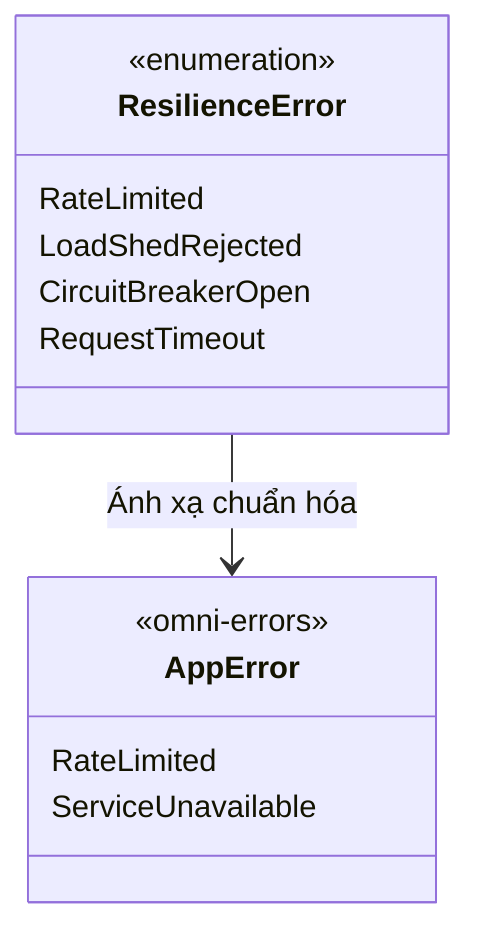

1. **Khi vượt hạn ngạch Rate Limiting:**
   - HTTP Status: `429 Too Many Requests`.
   - Headers: `Retry-After: <secs>`, `RateLimit-Limit`, `RateLimit-Remaining`, `RateLimit-Reset`.
   - Error Code: `ERR_RATE_LIMITED`.
   - Problem Type URI: `https://errors.omnikubernetes.com/rate-limited`.
2. **Khi kích hoạt Load Shedding hoặc Circuit Breaker Open:**
   - HTTP Status: `503 Service Unavailable`.
   - Headers: `Retry-After: 1` (Load shed) hoặc `Retry-After: <reset_timeout>` (Circuit breaker).
   - Error Code: `ERR_SERVICE_UNAVAILABLE`.
   - Problem Type URI: `https://errors.omnikubernetes.com/service-unavailable`.
3. **Khi vượt quá Request Timeout:**
   - HTTP Status: `504 Gateway Timeout` (hoặc `408 Request Timeout`).
   - Error Code: `ERR_TIMEOUT`.
   - Problem Type URI: `https://errors.omnikubernetes.com/gateway-timeout`.

---

## 12. Implementation Blueprint & Code Contract

### 12.1. Thiết kế Module `libs/common/src/resilience/`

Cấu trúc cây thư mục mô-đun được bố trí khoa học bên trong `libs/common`:

```structure
libs/common/src/
├── config/
│   └── resilience.rs            <-- ResilienceConfig đặc tả cấu hình
├── resilience/
│   ├── mod.rs                   <-- Re-exports & ResilienceLayer builder
│   ├── rate_limit.rs            <-- In-memory GCRA + Redis sliding window
│   ├── circuit_breaker.rs       <-- 3-state FSM Circuit Breaker
│   ├── load_shed.rs             <-- Semaphore adaptive load shedding
│   ├── timeout.rs               <-- Deadline propagation & cancellation token
│   ├── retry.rs                 <-- Full Jitter calculator & retry budget
│   ├── shutdown.rs              <-- 7-Stage Kubernetes Graceful Shutdown Coordinator
│   └── error.rs                 <-- ResilienceError -> AppError RFC 9457
```

### 12.2. Trích xuất Code Contract: `GracefulShutdownCoordinator`

```rust
//! Kubernetes 7-Stage Zero-Downtime Graceful Shutdown Coordinator.

use std::{sync::Arc, time::Duration};
use tokio::sync::watch;
use tokio_util::sync::CancellationToken;
use tracing::{error, info, warn};

use omni_metrics::probes::ProbeState;
use crate::config::ResilienceConfig;

/// Bộ điều phối quy trình hạ cánh an toàn chuẩn Kubernetes.
#[derive(Debug, Clone)]
pub struct GracefulShutdownCoordinator {
    config: ResilienceConfig,
    probe_state: Arc<ProbeState>,
    cancellation_token: CancellationToken,
}

impl GracefulShutdownCoordinator {
    /// Khởi tạo coordinator mới gắn liền với ProbeState của omni-metrics.
    #[must_use]
    pub fn new(config: ResilienceConfig, probe_state: Arc<ProbeState>) -> Self {
        Self {
            config,
            probe_state,
            cancellation_token: CancellationToken::new(),
        }
    }

    /// Trả về CancellationToken dùng chung cho các background workers.
    #[must_use]
    pub fn cancellation_token(&self) -> CancellationToken {
        self.cancellation_token.clone()
    }

    /// Lắng nghe tín hiệu hệ điều hành và thực thi tuần tự 7 giai đoạn hạ cánh.
    pub async fn wait_for_signal_and_shutdown<F, Fut>(self, drain_infra_fn: F)
    where
        F: FnOnce() -> Fut,
        Fut: std::future::Future<Output = ()>,
    {
        // Giai đoạn 1: Đón bắt tín hiệu SIGTERM hoặc SIGINT
        Self::wait_for_os_signal().await;
        let shutdown_start = std::time::Instant::now();
        info!("Kubernetes SIGTERM/SIGINT received. Initiating 7-stage graceful shutdown protocol...");

        // Giai đoạn 2: Kích hoạt Drain Gate Readiness Probe (/readyz -> 503 Draining)
        info!("Stage 2/7: Triggering Kubernetes readiness drain gate (/readyz -> 503 Draining)...");
        self.probe_state.begin_shutdown();

        // Giai đoạn 3: Cửa sổ Chờ Bão hòa Mạng Ingress (Quiescence Wait Window)
        let quiescence = Duration::from_secs(self.config.shutdown_quiescence_delay_secs);
        info!(
            quiescence_secs = quiescence.as_secs(),
            "Stage 3/7: Sleeping for Ingress/EndpointSlice route convergence..."
        );
        tokio::time::sleep(quiescence).await;

        // Giai đoạn 4 & 5: Dừng tiếp nhận request mới và phát tín hiệu dừng Workers
        info!("Stage 4 & 5/7: Cancelling background workers & draining in-flight requests...");
        self.cancellation_token.cancel();

        // Giai đoạn 6: Giải phóng kết nối hạ tầng (Postgres, Redis, WorkerGuard Log Flush)
        info!("Stage 6/7: Draining infrastructure connections (PgPool, Redis, Tracing Flushes)...");
        tokio::time::timeout(
            Duration::from_secs(self.config.shutdown_grace_period_secs),
            drain_infra_fn(),
        )
        .await
        .unwrap_or_else(|_| {
            warn!("Stage 6 timed out waiting for infrastructure pool drain. Forcing closure.");
        });

        // Giai đoạn 7: Thoát tiến trình an toàn mã 0
        let total_duration = shutdown_start.elapsed();
        info!(
            total_duration_ms = total_duration.as_millis(),
            "Stage 7/7: Service shutdown sequence completed successfully. Clean exit."
        );
    }

    /// Lắng nghe đa kênh SIGTERM và SIGINT.
    async fn wait_for_os_signal() {
        let ctrl_c = async {
            tokio::signal::ctrl_c()
                .await
                .expect("Failed to install Ctrl+C signal handler");
        };

        #[cfg(unix)]
        let terminate = async {
            tokio::signal::unix::signal(tokio::signal::unix::SignalKind::terminate())
                .expect("Failed to install SIGTERM signal handler")
                .recv()
                .await;
        };

        #[cfg(not(unix))]
        let terminate = std::future::pending::<()>();

        tokio::select! {
            _ = ctrl_c => {
                info!("Captured SIGINT (Ctrl+C) signal.");
            },
            _ = terminate => {
                info!("Captured SIGTERM (Kubernetes termination) signal.");
            },
        }
    }
}
```

### 12.3. Mẫu Khởi tạo Service Chuẩn (The Golden Path Integration)

Khi Bước 7 hoàn tất, việc lắp ghép toàn bộ các năng lực phục hồi mạng vào một Microservice thông qua `AppBuilder` trở nên trong suốt và tối giản:

```rust
// services/order/src/main.rs
use std::sync::Arc;
use omni_common::config::AppConfig;
use omni_common::resilience::GracefulShutdownCoordinator;

#[tokio::main]
async fn main() -> Result<(), Box<dyn std::error::Error>> {
    // 1. Nạp cấu hình & Khởi tạo Logging non-blocking
    let config = AppConfig::load("order-service")?;
    let _log_guard = omni_logging::init(&config.logging)?;

    // 2. Khởi tạo Database Pool, Redis Manager & Metrics Probes
    let db_pool = omni_database::create_pool(&config.database).await?;
    let probe_state = Arc::new(omni_metrics::probes::ProbeState::new(true, std::time::Duration::from_secs(15)));

    // 3. Khởi tạo bộ điều phối Graceful Shutdown
    let shutdown_coord = GracefulShutdownCoordinator::new(
        config.resilience.clone(),
        probe_state.clone(),
    );

    // 4. Lắp ráp Axum Router với Resilience Middleware Stack chuẩn
    let app = axum::Router::new()
        .merge(routes::order_router())
        // Thứ tự xếp lớp Middleware phòng thủ từ ngoài vào trong:
        .layer(omni_common::resilience::timeout_layer(&config.server))
        .layer(omni_common::resilience::load_shed_layer(&config.resilience))
        .layer(omni_common::resilience::rate_limit_layer(&config.resilience))
        .layer(omni_common::middleware::observability_middleware(&config.service));

    // 5. Khởi động Web Server và hạ cánh an toàn 7 giai đoạn
    let listener = tokio::net::TcpListener::bind(config.server.http_socket_addr()).await?;

    axum::serve(listener, app)
        .with_graceful_shutdown(shutdown_coord.wait_for_signal_and_shutdown(|| async move {
            db_pool.close().await;
        }))
        .await?;

    Ok(())
}
```

---

## 13. Comprehensive Testing Strategy & Quality Gate

Để đáp ứng tiêu chuẩn nghiệm thu khắt khe theo [`AGENTS.md`](../../AGENTS.md) và [`.agents/rules/quality-gate.md`](../../.agents/rules/quality-gate.md), việc kiểm thử khả năng phục hồi mạng được thực thi qua 4 tầng:

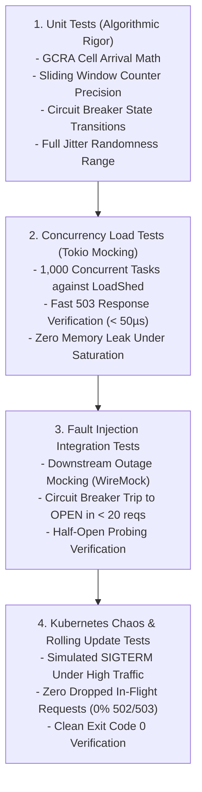

1. **Unit Tests (Kiểm thử Thuật toán Thuần túy):**
   - Xác thực tính chính xác của thuật toán GCRA và phân bố ngẫu nhiên của Full Jitter không dùng mã `unsafe`.
   - Kiểm tra FSM của Circuit Breaker: Chuyển dịch chính xác `Closed` $\rightarrow$ `Open` $\rightarrow$ `HalfOpen` $\rightarrow$ `Closed`.
2. **Concurrency Load Tests (Kiểm thử Bão hòa Đồng thời với Tokio):**
   - Kích hoạt $1,000$ task đồng thời bắn phá một endpoint giả lập.
   - Kiểm chứng `LoadShedLayer` chặn đúng số lượng request vượt quá `max_concurrent_requests` và lập tức trả về `503 Service Unavailable` mà không gây bùng nổ RAM.
3. **Fault Injection Integration Tests (Kiểm thử Tiêm Lỗi Hạ tầng):**
   - Giả lập downstream service bị trả về mã lỗi 500 hoặc timeout mạng liên tục.
   - Kiểm chứng Circuit Breaker mở mạch sau đủ số lượng request tối thiểu, cô lập downstream và tự động thăm dò phục hồi sau khi hết thời gian chờ.
4. **Kubernetes Rolling Update Chaos Verification:**
   - Sử dụng công cụ test tải k6 / Apache Bench bắn liên tục $500$ RPS vào Pod trong khi gửi lệnh `SIGTERM`.
   - Xác nhận $100\%$ các in-flight request được xử lý trọn vẹn, không có bất kỳ request nào bị đứt gãy kết nối giữa chừng (`0% connection dropped`, exit code 0).

---

## 14. Tổng kết & Kế hoạch Thực thi Tiếp theo

Tài liệu kiến trúc này hoàn thiện khung thiết kế lý thuyết và tiêu chuẩn kỹ thuật chi tiết cho **Bước 7: Khả năng Phục hồi mạng & Kiểm soát luồng (`omni-common` Resilience)**.

Ngay sau khi tài liệu kiến trúc này được phê duyệt, đội ngũ kỹ thuật sẽ tiến hành triển khai mã nguồn vào `libs/common/src/resilience/*`, đồng bộ workspace dependencies qua `cargo hakari`, và thực thi kiểm thử toàn diện qua lệnh:

```bash
cargo fmt --all
cargo hakari generate
cargo clippy --all-targets --all-features -- -D warnings
cargo test --all
```
